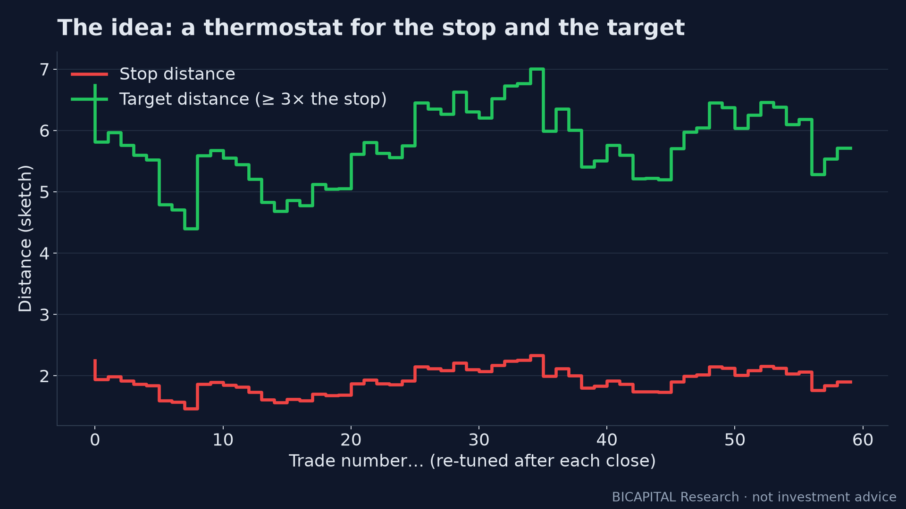
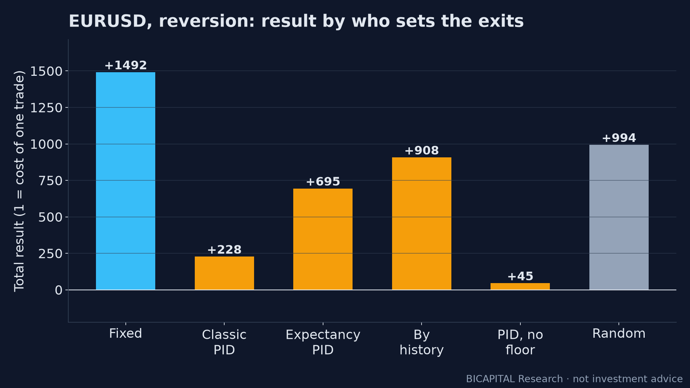
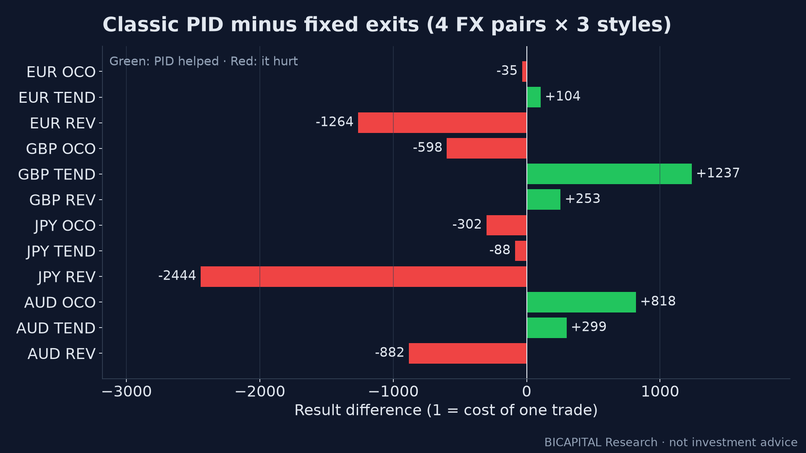
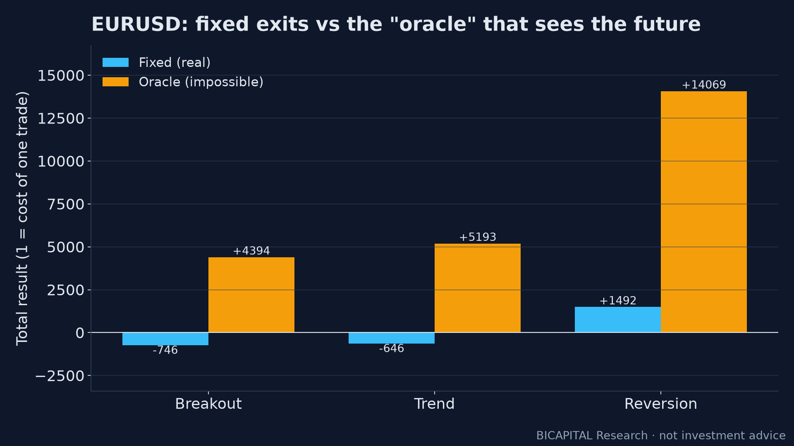
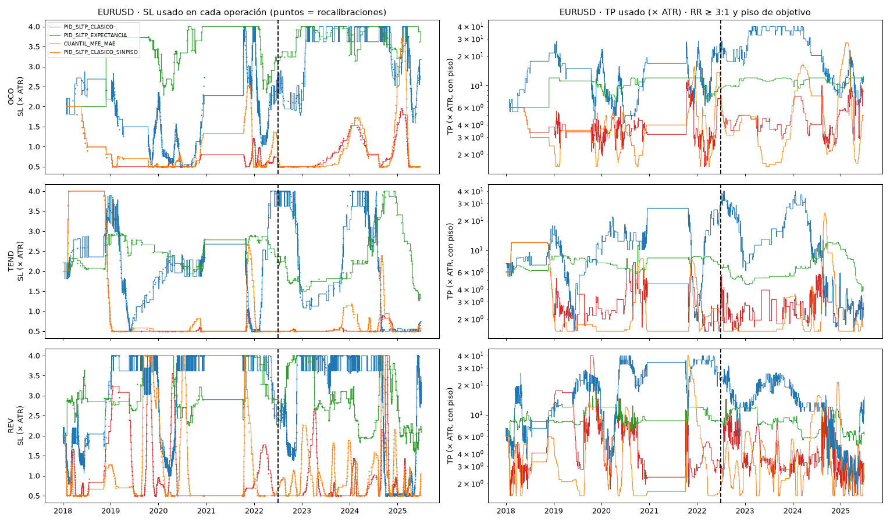

# An autopilot for the stop and the target: does it beat leaving them fixed?

*We continue the self-tuning system that works like a thermostat. This time we gave it control of the exits. Across 8 assets and 192 tests, it did not beat a fixed stop and a fixed target.*

A few weeks ago we published a system that tuned itself, like the thermostat at home. If it's cold, it turns the heating up; if it's hot, it turns it down. That system used a controller called a **PID** to re-tune the entry rules after each trade. It did not manage to win reliably.

One question was left open. What if the thermostat does not decide *when to enter*, but *when to exit*? Many traders say the key is management: where to put the stop and where to take profits. We tested it.

## Two words before we start

- **Stop:** the point where you close a trade that is going badly. It is the handbrake: it limits the loss.
- **Target:** the point where you close a trade that is going well and collect. It is the bus stop where you get off.

If the stop is too close, any stumble in price knocks you out, even if the trade would have worked later. If it is too far, you lose too much when you are wrong. The target works the same way: too close and you make little; too far and you almost never get there.

## What a PID is, with a household example

A PID is a formula that corrects an error by looking at three things:

1. **P (present):** how wrong you are right now. It's 3 degrees colder than you want: turn it up a lot.
2. **I (past):** whether you have been wrong in the same direction for a long time. It's been cold for an hour: turn it up a bit more.
3. **D (trend):** whether the error is growing or shrinking. It's already warming up fast: ease off.

Here the "error" was, for example, how often the stop was hit and then price reached the target anyway. That signals a stop that is too tight. After each closed trade, the PID widened or narrowed the stop and the target. The target was always at least 3 times the stop.

**How to read the chart:** this is a drawing, not real data. The red line is the stop distance; the green line, the target distance. Each step is a re-tune after a trade. The target always sits at least three times as far as the stop.

## What we compared

The entries were exactly those of the earlier system. Only who decided the exits changed:

- **Fixed:** stop and target always the same.
- **Classic PID** and **PID with no floor** (no minimum target).
- **Expectancy PID:** directly searches for the combination that would earn the most.
- **By history:** sets stop and target based on how the last 50 trades moved.
- **Random:** stop and target drawn by lot.
- **The oracle:** picks the best exit by looking at the future. Impossible in real life; it only shows the ceiling.

We measured results in "costs". +1 means earning what one round-trip trade costs. We tested 8 assets (four currency pairs, gold and three indices) and three entry styles: breakout, trend and reversion (betting that price comes back).

## How we built "chance"

We created made-up price worlds that resemble the real ones: same moves, but shuffled in blocks to break any exploitable pattern. For EURUSD, 100 worlds; for the other assets, 50. In each world we repeated the whole process, entry and exit. If the real result does not stand out from those worlds, it may be luck.

## What came out

Of 192 tests, **0** reliably beat the fixed exits. And **0** made money on their own.

**How to read the chart:** this is the best case from the earlier system, EURUSD in reversion. Each bar is the total result. Fixed exits (blue) made +1,491.8. Every adaptive method (orange) came in lower: classic PID +227.9; PID with no floor +45.4. Even the random draw (grey) did better than the PIDs: +993.8.

**How to read the chart:** each bar is a currency pair and a style (breakout, trend or reversion). Green means the PID beat the fixed exits; red, that it did worse. The PID won in 5 of 12 cases and lost in 7. The biggest losses, such as −2,444 in USDJPY reversion, outweigh the gains.

## The ceiling: what an oracle would do

**How to read the chart:** blue is the real fixed exits; orange is the oracle, which for each trade picks the best exit knowing what will happen. In EURUSD reversion, the oracle would reach +14,068.9. That is huge compared with +1,491.8.

This chart explains why the idea is so tempting. With the same entries, perfect exits would change everything. But the oracle needs the future. No method that only looks at the past came close.

## How much the thermostat moved

**How to read the chart:** this is the lab's original chart (technical labels, partly in Spanish). On the left, the stop distance; on the right, the target distance, for every trade from 2018 to 2025. Each row is an entry style and each colour a method. The dashed line marks where the test data begins. The key point: the lines go up and down constantly. The thermostat moved a lot, but moving is not the same as being right.

## Why it did not work

The main reason is simple. **A good exit does not fix a bad entry.** The earlier system's entries had no edge on most assets. Adjusting the brake does not make the car go to the right place.

There was also a minimum target and a mandatory daily close. Many targets were not reached within the day. The PID moved the numbers, but those limits had the final say.

## What I take away

- Adjusting the stop and target automatically did not beat leaving them fixed: 0 of 192 tests.
- What an oracle could do is huge, but out of reach. Comparing against it helps you avoid wishful thinking.
- If the entry has no edge, exit management will not create one.
- A system that moves a lot is not a system that learns. Sometimes it is just chasing noise.

*Educational content. Not investment advice.*
