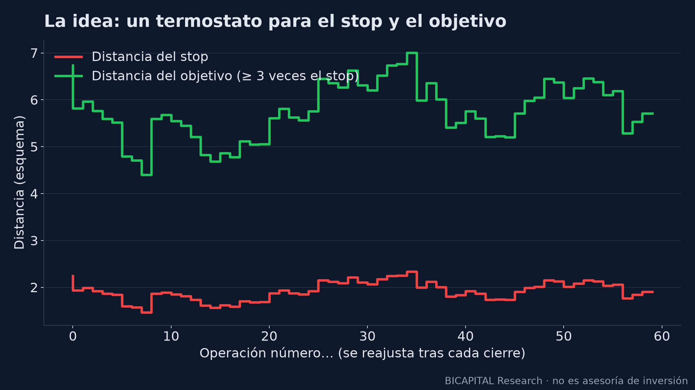
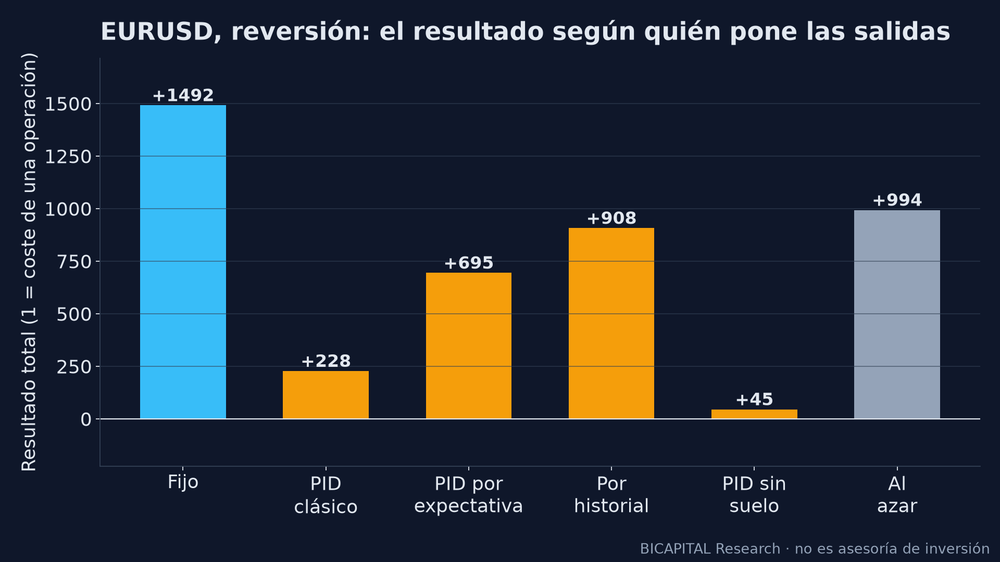
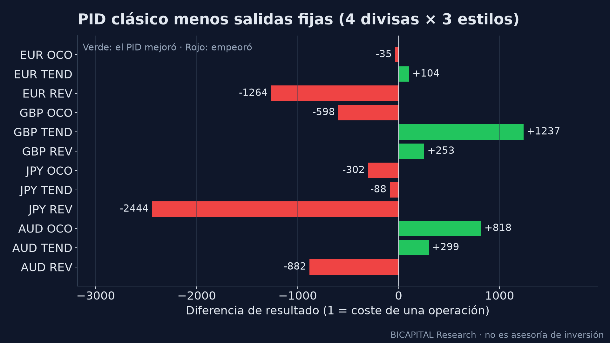
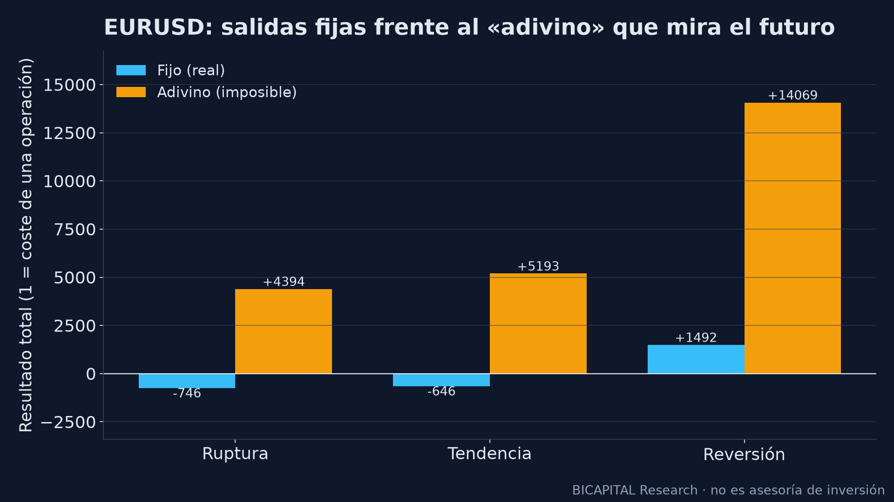
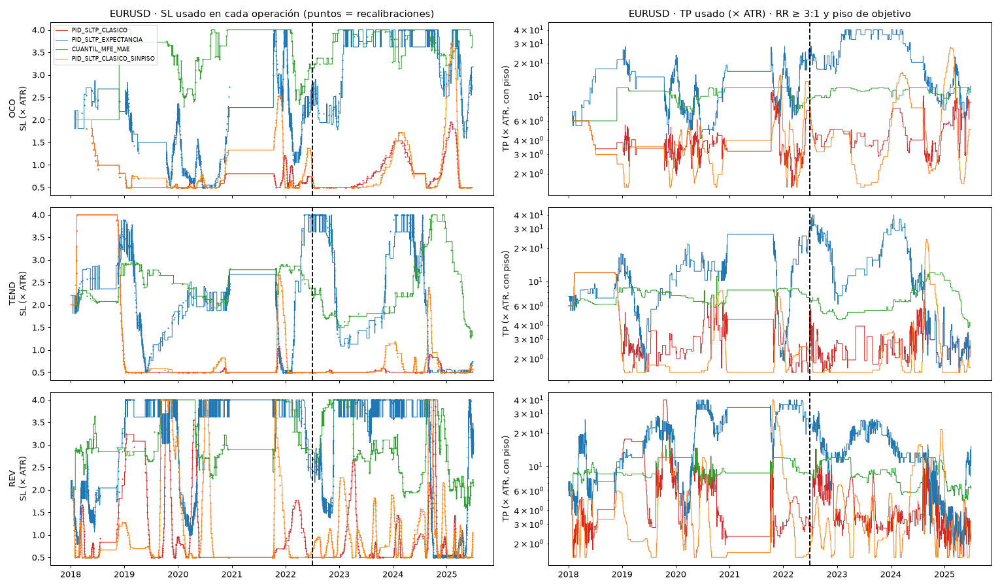

# Un piloto automático para el stop y el objetivo: ¿mejora a dejarlos fijos?

*Continuamos el sistema que se recalibra solo, como un termostato. Esta vez le dimos el control de las salidas. En 8 activos y 192 pruebas, no mejoró a un stop y un objetivo fijos.*

Hace unas semanas publicamos un sistema que se ajustaba solo, como el termostato de casa. Si hace frío, sube la calefacción; si hace calor, la baja. Aquel sistema usaba un controlador llamado **PID** para recalibrar las reglas de entrada después de cada operación. No consiguió ganar de forma fiable.

Quedaba una pregunta abierta. ¿Y si el termostato no decide *cuándo* entrar, sino *cuándo salir*? Muchos traders dicen que la clave está en la gestión: dónde poner el stop y dónde recoger beneficios. Lo probamos.

## Dos palabras antes de empezar

- **Stop:** el punto donde cierras una operación que va mal. Es el freno de mano: limita la pérdida.
- **Objetivo:** el punto donde cierras una operación que va bien y cobras. Es la parada del autobús donde te bajas.

Si el stop está muy cerca, cualquier tropiezo del precio te saca, aunque luego habría ido bien. Si está muy lejos, pierdes demasiado cuando te equivocas. Con el objetivo pasa lo mismo: muy cerca, ganas poco; muy lejos, casi nunca llegas.

## Qué es un PID, con un ejemplo de casa

Un PID es una fórmula que corrige un error mirando tres cosas:

1. **P (presente):** cuánto te equivocas ahora. Hace 3 grados menos de lo que quieres: sube fuerte.
2. **I (pasado):** si llevas mucho rato equivocándote en la misma dirección. Lleva una hora con frío: sube un poco más.
3. **D (tendencia):** si el error está creciendo o bajando. Ya se está calentando rápido: frena.

Aquí el «error» era, por ejemplo, cuántas veces el stop saltaba y luego el precio llegaba al objetivo de todos modos. Eso indica un stop demasiado ceñido. Tras cada operación cerrada, el PID ensanchaba o estrechaba el stop y el objetivo. El objetivo siempre era al menos 3 veces el stop.

**Cómo leer el gráfico:** es un dibujo, no datos reales. La línea roja es la distancia del stop; la verde, la del objetivo. Cada escalón es un reajuste después de una operación. El objetivo siempre va al menos a tres veces la distancia del stop.

## Qué comparamos

Las entradas eran exactamente las del sistema anterior. Solo cambiaba quién decidía las salidas:

- **Fijo:** stop y objetivo siempre iguales.
- **PID clásico** y **PID sin suelo** (sin un objetivo mínimo).
- **PID por expectativa:** busca directamente la combinación que más ganaría.
- **Por historial:** pone el stop y el objetivo según cómo se movieron las últimas 50 operaciones.
- **Al azar:** stop y objetivo sorteados.
- **El adivino:** elige la mejor salida mirando el futuro. Es imposible en la vida real; solo sirve para ver el techo.

Medimos el resultado en «costes». +1 significa ganar lo que cuesta una operación de ida y vuelta. Probamos 8 activos (cuatro divisas, oro y tres índices) y tres estilos de entrada: ruptura, tendencia y reversión (apostar a que el precio vuelve atrás).

## Cómo construimos el azar

Creamos mundos de precios inventados que se parecen a los reales: mismos movimientos, pero barajados por bloques para romper cualquier patrón aprovechable. En EURUSD, 100 mundos; en los demás activos, 50. En cada mundo repetimos todo el proceso, entrada y salida. Si el resultado real no destaca sobre esos mundos, puede ser suerte.

## Lo que salió

De 192 pruebas, **0** mejoraron a las salidas fijas de forma fiable. Y **0** ganaron por sí solas.

**Cómo leer el gráfico:** es el mejor caso del sistema anterior, EURUSD en reversión. Cada barra es el resultado total. Las salidas fijas (azul) dieron +1.491,8. Todos los métodos que se ajustan (naranja) quedaron por debajo: el PID clásico, +227,9; el PID sin suelo, +45,4. Incluso el sorteo al azar (gris) dio más que los PID: +993,8.

**Cómo leer el gráfico:** cada barra es una divisa y un estilo (ruptura, tendencia o reversión). Verde significa que el PID mejoró a las salidas fijas; rojo, que empeoró. El PID ganó en 5 de 12 casos y perdió en 7. Las pérdidas más grandes, como −2.444 en USDJPY reversión, pesan más que las mejoras.

## El techo: lo que haría un adivino

**Cómo leer el gráfico:** azul son las salidas fijas reales; naranja, el adivino, que para cada operación elige la mejor salida sabiendo lo que pasará. En EURUSD reversión, el adivino llegaría a +14.068,9. Es enorme comparado con +1.491,8.

Este gráfico explica por qué la idea es tan tentadora. Con las mismas entradas, unas salidas perfectas lo cambiarían todo. Pero el adivino necesita el futuro. Ningún método que solo mira el pasado se acercó.

## Cuánto se movía el termostato

**Cómo leer el gráfico:** es el gráfico original del laboratorio (rótulos técnicos). A la izquierda, la distancia del stop; a la derecha, la del objetivo, en cada operación de 2018 a 2025. Cada fila es un estilo de entrada y cada color un método. La línea discontinua marca dónde empiezan los datos de prueba. Lo importante: las líneas suben y bajan sin parar. El termostato se movía mucho, pero moverse no es acertar.

## Por qué no funcionó

La razón principal es sencilla. **Una buena salida no arregla una mala entrada.** Las entradas del sistema anterior no tenían ventaja en la mayoría de activos. Ajustar el freno no hace que el coche vaya al sitio correcto.

Además, había un objetivo mínimo y un cierre diario obligatorio. Muchos objetivos no se alcanzaban dentro del día. El PID movía los números, pero esos límites mandaban.

## Qué me llevo

- Ajustar el stop y el objetivo de forma automática no mejoró a dejarlos fijos: 0 de 192 pruebas.
- Lo que haría un adivino es enorme, pero no es alcanzable. Compararse con él ayuda a no ilusionarse.
- Si la entrada no tiene ventaja, la gestión de salidas no la crea.
- Un sistema que se mueve mucho no es un sistema que aprende. A veces solo persigue el ruido.

*Contenido educativo. No es asesoría de inversión.*
