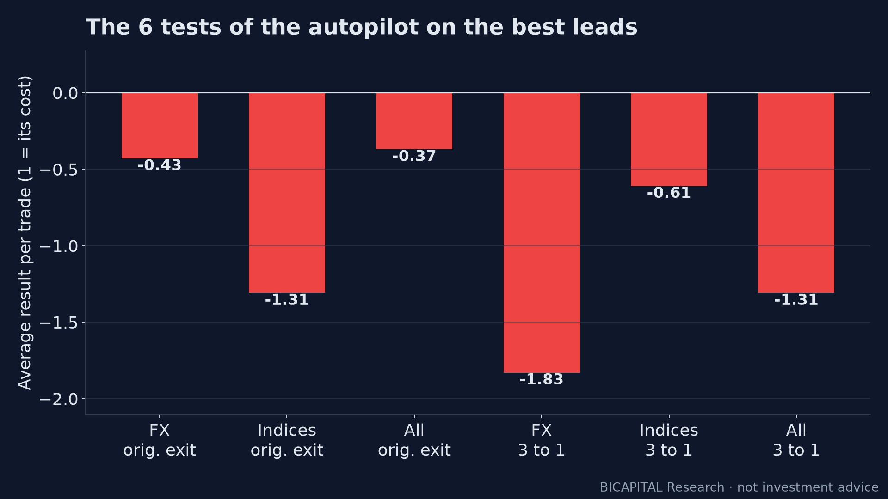
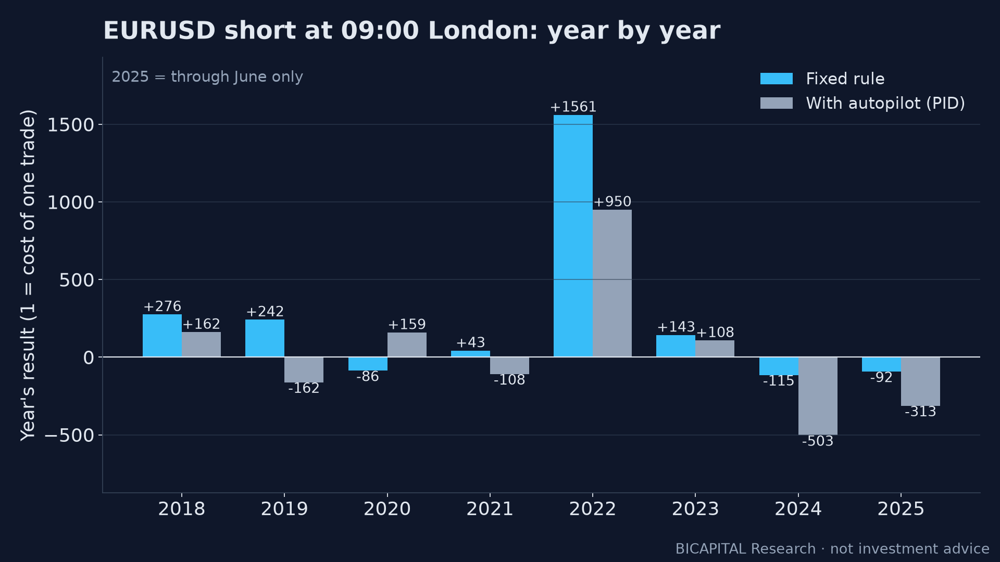
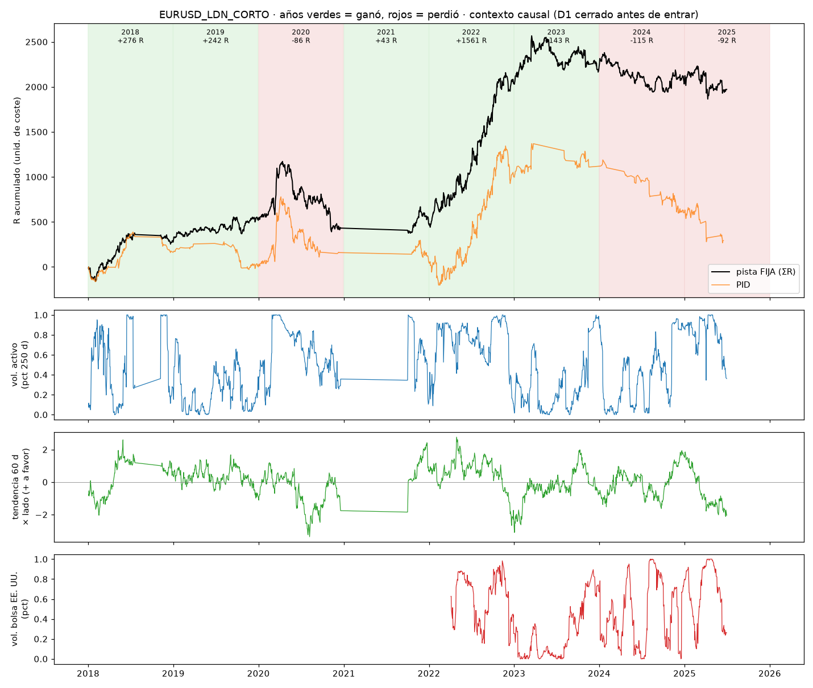
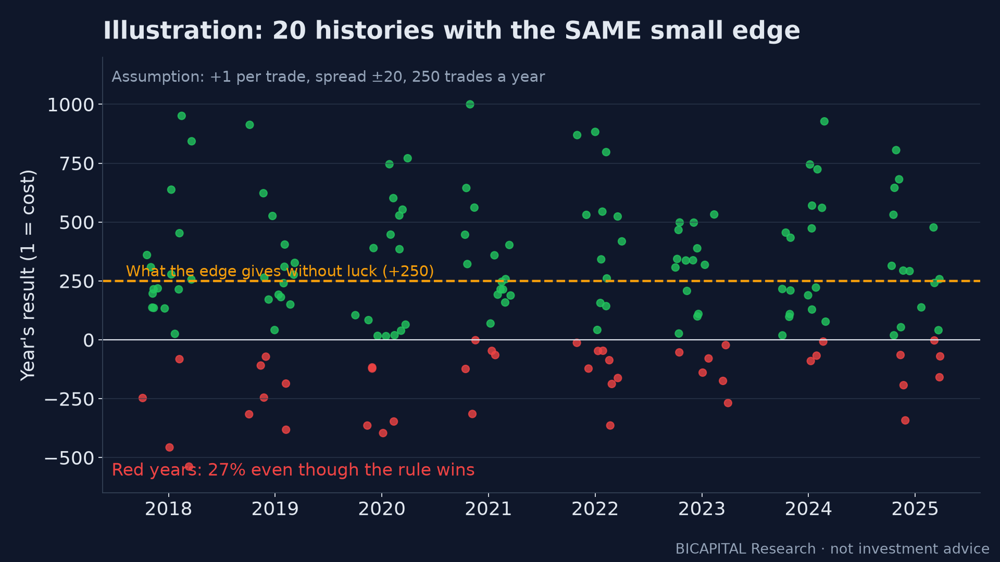
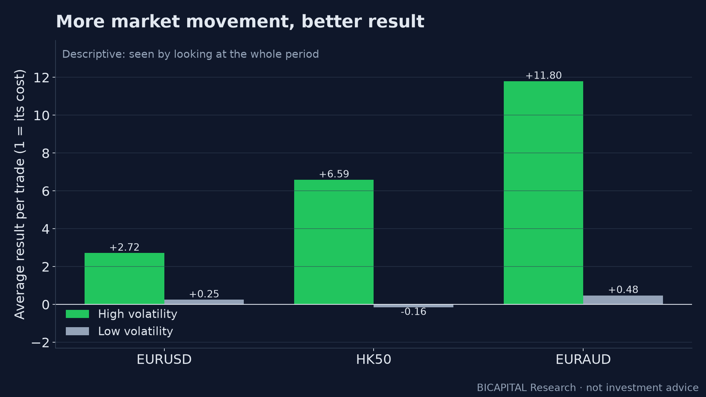

# Why some years win and others lose with the same rule

*We applied the autopilot to our best direction leads: 0 of 6 tests passed. Looking year by year, we found something useful: with a small edge, bad years are normal.*

Imagine a simple rule: sell euros against dollars every day at 9 a.m. London time and close 4 hours later. One year it makes a lot. The next, it loses. Three years later it wins again. Has it stopped working? Is it back? Should you change it?

This article brings two studies together. The first closes our series on the self-tuning "thermostat". The second answers a question we all ask: why does the same rule have such different years?

## Reminder: the autopilot

In earlier articles we tested a controller called a **PID**. It works like the thermostat at home: if the temperature drifts from the one you want, it corrects. Here, if the rule starts losing, the PID changes its settings: entry time, holding period, threshold.

We had tested it on rules with no edge and it did not work. The question now was: what if we apply it to the **best leads** we found in earlier labs? If there is anything to improve, it should show there.

## How we measured it

We took 15 leads on 13 assets: currencies, indices, and gold against other currencies. Each lead is a specific rule, such as "short EURUSD at 09:00 London".

We measured in "costs": +1 means earning what one round-trip trade costs. We ran 6 tests: currencies, indices and everything together, with two exit types (the lead's original exit, and one with a target 3 times the stop).

**How we built "chance":** we repeated everything in 100 made-up price worlds. They resemble the real ones (same moves) but are shuffled in blocks to break any pattern. If the real result does not stand out from those worlds, it may be luck.

## Result of the autopilot

**How to read the chart:** each bar is one of the 6 tests. They are all red: the autopilot lost on average in every one. The best, everything together with the original exit, lost 0.37 costs per trade over 6,466 trades. The worst, currencies with the 3-to-1 exit, lost 1.83.

None of the 6 passed. And in most cases the PID did worse than leaving the lead fixed and untouched.

## The fixed rule, year by year

So we looked closely at the 5 fixed leads with the most trades. The clearest is EURUSD short at 09:00 London.

**How to read the chart:** blue is the fixed rule; grey, the same rule with the autopilot. Each pair of bars is a year. The fixed rule won in 2018, 2019, 2021, 2022 and 2023, and lost in 2020, 2024 and the first half of 2025. In 2022 it made +1,560.7: 79% of everything it earned in eight years.

Two lessons come out of this. First: the autopilot, which was supposed to adapt, did worse than the fixed rule in 4 of the 5 leads. Second: without 2022, the lead makes +0.30 per trade instead of +1.19. Since its best moment, in March 2023, it has gone 580 trades without getting back to that peak.

**How to read the chart:** this is the analysis's original chart (labels in Spanish). At the top, the cumulative gain: black is the fixed rule and orange the PID; green backgrounds are winning years and red, losing years. Below are three panels: how much the euro was moving, whether its 60-day trend favoured selling, and how much the US stock market was moving. Look at 2022: the euro was falling hard and the curve shoots up like a rocket.

## Are bad years just bad luck?

Here is the most useful part. We ran a simple test: shuffle the years of the trades, like mixing a deck of cards. If the real years differ more than the shuffled ones, something special is going on. **In none of the 5 leads** did the years differ more than chance would produce.

EURUSD had 3 losing years. With the same edge, chance alone gave about 2.1 on average.

**How to read the chart:** this is our own illustration, not real data. Each dot is one year of a made-up history. They all have the same edge: +1 per trade, with a spread of about ±20 per trade and 250 trades a year, as in the study. The orange line is what the edge would give without luck. Even so, in this illustration more than one year in four comes out red.

Think of a good basketball player who makes 55% of their shots. In a bad game they may make 45%. They have not forgotten how to play. It is just that few shots leave plenty of room for luck. In fact, what changed between good and bad years was the hit rate (between 49% and 57%), not the size of the wins.

## What goes along with good years

**How to read the chart:** green is the average result per trade when the market was moving a lot (high volatility); grey, when it was moving little. In EURUSD, +2.72 vs +0.25. In HK50, +6.59 vs −0.16. In EURAUD, +11.8 vs +0.48. When there is movement, the movement pays for the cost.

Another pattern: selling EURUSD made much more when the euro had already been falling over the last 60 days: +1.94 vs +0.30. In gold, buying after a down day made +2.98 in XAUAUD and +2.75 in XAUEUR; after a very strong up day, it lost.

Careful: this was seen **by looking at the whole period**. It is a description, not a tested rule. We tried to use these patterns to "switch off" the bad years with a switch that only looked at the past. **37 of 38 switches** did not help or made things worse. And a good month did not predict the next one.

## What I take away

- The autopilot did not improve our best leads: 0 of 6 tests passed.
- With a small edge, losing years are normal. They do not always mean the rule is broken.
- Checking how much the best year weighs is key: in EURUSD, a single year explained 79% of the gain.
- Patterns spotted after the fact must be tested on new data before you believe them. That test is still pending.

*Educational content. Not investment advice.*
