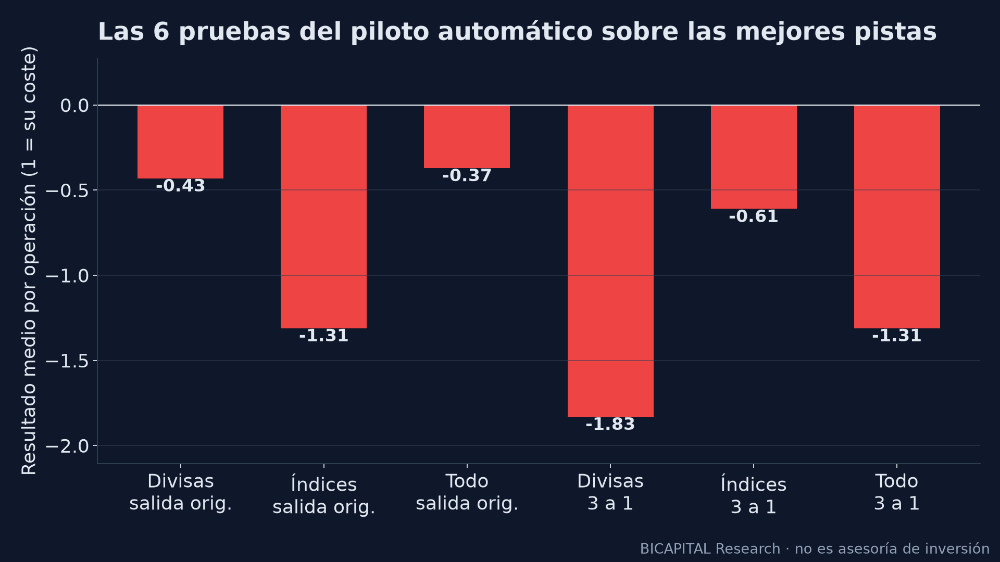
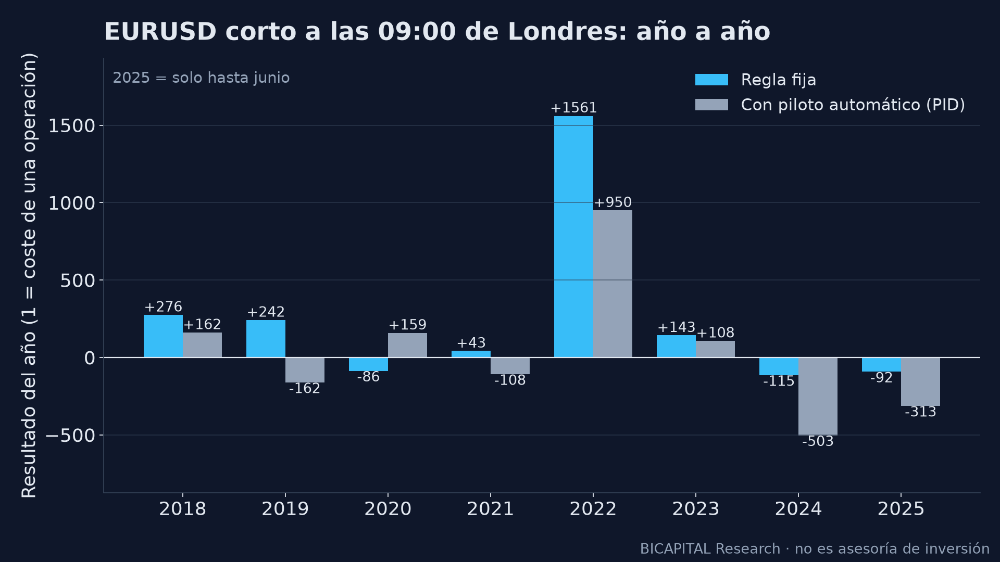
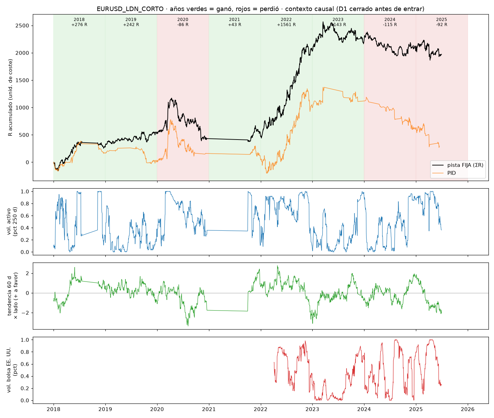
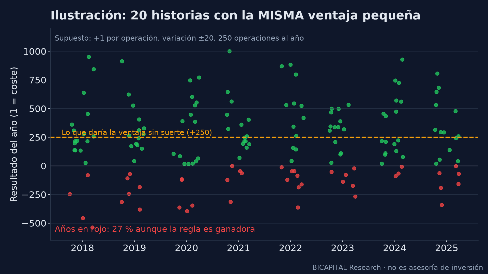
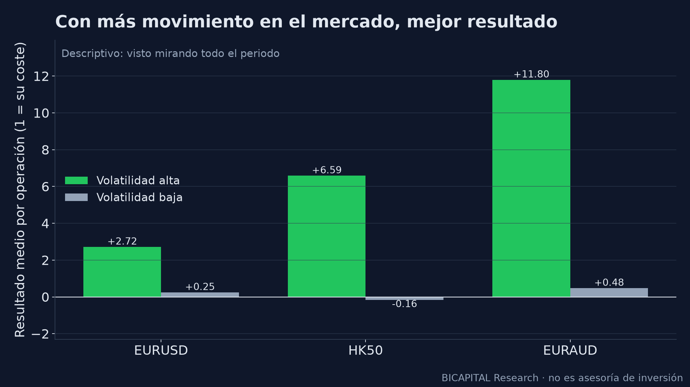

# Por qué unos años ganan y otros pierden con la misma regla

*Aplicamos el piloto automático a nuestras mejores pistas de dirección: 0 de 6 pruebas pasaron. Y al mirar año a año descubrimos algo útil: con una ventaja pequeña, los años malos son normales.*

Imagina una regla sencilla: vender euros contra dólares todos los días a las 9 de la mañana de Londres y cerrar 4 horas después. Un año gana mucho. Al siguiente, pierde. Tres años después vuelve a ganar. ¿Ha dejado de funcionar? ¿Ha vuelto? ¿Hay que cambiarla?

Este artículo junta dos estudios. El primero cierra nuestra serie sobre el «termostato» que se ajusta solo. El segundo responde a una pregunta que nos hacemos todos: por qué la misma regla tiene años tan distintos.

## Recordatorio: el piloto automático

En artículos anteriores probamos un controlador llamado **PID**. Funciona como el termostato de casa: si la temperatura se aleja de la deseada, corrige. Aquí, si la regla empieza a perder, el PID cambia sus parámetros: la hora de entrada, el plazo, el umbral.

Lo habíamos probado sobre reglas sin ventaja y no funcionó. La pregunta ahora era: ¿y si se lo aplicamos a las **mejores pistas** que encontramos en laboratorios anteriores? Si hay algo que mejorar, debería notarse ahí.

## Cómo lo medimos

Tomamos 15 pistas en 13 activos: divisas, índices y oro contra otras monedas. Cada pista es una regla concreta, como «corto en EURUSD a las 09:00 de Londres».

Medimos en «costes»: +1 significa ganar lo que cuesta una operación de ida y vuelta. Hicimos 6 pruebas: divisas, índices y todo junto, con dos tipos de salida (la original de la pista y otra con objetivo de 3 veces el stop).

**Cómo construimos el azar:** repetimos todo en 100 mundos de precios inventados. Se parecen a los reales (mismos movimientos), pero barajados por bloques para romper cualquier patrón. Si el resultado real no destaca sobre esos mundos, puede ser suerte.

## Resultado del piloto automático

**Cómo leer el gráfico:** cada barra es una de las 6 pruebas. Todas están en rojo: el piloto automático perdió de media en todas. La mejor, todo junto con la salida original, perdió 0,37 costes por operación en 6.466 operaciones. La peor, divisas con salida 3 a 1, perdió 1,83.

Ninguna de las 6 pasó. Y en la mayoría de los casos, el PID lo hizo peor que dejar la pista fija, sin tocar.

## La regla fija, año a año

Entonces miramos con lupa las 5 pistas fijas con más operaciones. La más clara es EURUSD corto a las 09:00 de Londres.

**Cómo leer el gráfico:** azul es la regla fija; gris, la misma regla con piloto automático. Cada par de barras es un año. La regla fija ganó en 2018, 2019, 2021, 2022 y 2023, y perdió en 2020, 2024 y la primera mitad de 2025. En 2022 ganó +1.560,7: el 79 % de todo lo que ganó en ocho años.

Dos lecciones salen de aquí. La primera: el piloto automático, que debía adaptarse, lo hizo peor que la fija en 4 de las 5 pistas. La segunda: sin 2022, la pista gana +0,30 por operación en lugar de +1,19. Desde su mejor momento, en marzo de 2023, lleva 580 operaciones sin recuperarlo.

**Cómo leer el gráfico:** es el gráfico original del análisis. Arriba, la ganancia acumulada: negra la fija y naranja el PID; los fondos verdes son años ganadores y los rojos, perdedores. Debajo hay tres paneles: cuánto se movía el euro, si su tendencia de 60 días iba a favor de la venta y cuánto se movía la bolsa de EE. UU. Fíjate en 2022: el euro bajaba con fuerza y la curva sube como un cohete.

## ¿Los años malos son mala suerte?

Aquí viene lo más útil. Hicimos una prueba sencilla: barajar los años de las operaciones, como si mezcláramos las cartas. Si los años reales se diferencian más que los barajados, hay algo especial. **En ninguna de las 5 pistas** los años se diferenciaban más de lo que da el azar.

En EURUSD hubo 3 años perdedores. Con la misma ventaja, el azar ya daba unos 2,1 de media.

**Cómo leer el gráfico:** es una ilustración nuestra, no datos reales. Cada punto es un año de una historia inventada. Todas tienen la misma ventaja: +1 por operación, con una variación de unos ±20 por operación y 250 operaciones al año, como en el estudio. La línea naranja es lo que daría la ventaja sin suerte. Aun así, en esta ilustración más de un año de cada cuatro sale en rojo.

Es como un buen jugador de baloncesto que acierta el 55 % de sus tiros. En un partido malo puede acertar el 45 %. No ha olvidado jugar. Es que pocos tiros dan mucho margen a la suerte. De hecho, lo que cambiaba entre años buenos y malos era el porcentaje de acierto (entre 49 % y 57 %), no el tamaño de las ganancias.

## Lo que acompaña a los años buenos

**Cómo leer el gráfico:** verde es el resultado medio por operación cuando el mercado se movía mucho (volatilidad alta); gris, cuando se movía poco. En EURUSD, +2,72 frente a +0,25. En HK50, +6,59 frente a −0,16. En EURAUD, +11,8 frente a +0,48. Cuando hay movimiento, el movimiento paga el coste.

Otro patrón: la venta de EURUSD ganaba mucho más cuando el euro ya venía bajando en los últimos 60 días: +1,94 frente a +0,30. En el oro, comprar tras un día bajista daba +2,98 en XAUAUD y +2,75 en XAUEUR; tras un día muy alcista, perdía.

Atención: esto se vio **mirando todo el periodo**. Es una descripción, no una regla probada. Intentamos usar estos patrones para «apagar» los años malos con un interruptor que solo miraba el pasado. **37 de 38 interruptores** no mejoraron o empeoraron. Y un mes bueno no anunciaba el siguiente.

## Qué me llevo

- El piloto automático no mejoró a nuestras mejores pistas: 0 de 6 pruebas pasaron.
- Con una ventaja pequeña, los años perdedores son normales. No siempre significan que la regla se rompió.
- Mirar cuánto pesa el mejor año es clave: en EURUSD, un solo año explicaba el 79 % de la ganancia.
- Los patrones que se ven a posteriori hay que probarlos en datos nuevos antes de creérselos. Esa prueba está pendiente.

*Contenido educativo. No es asesoría de inversión.*
