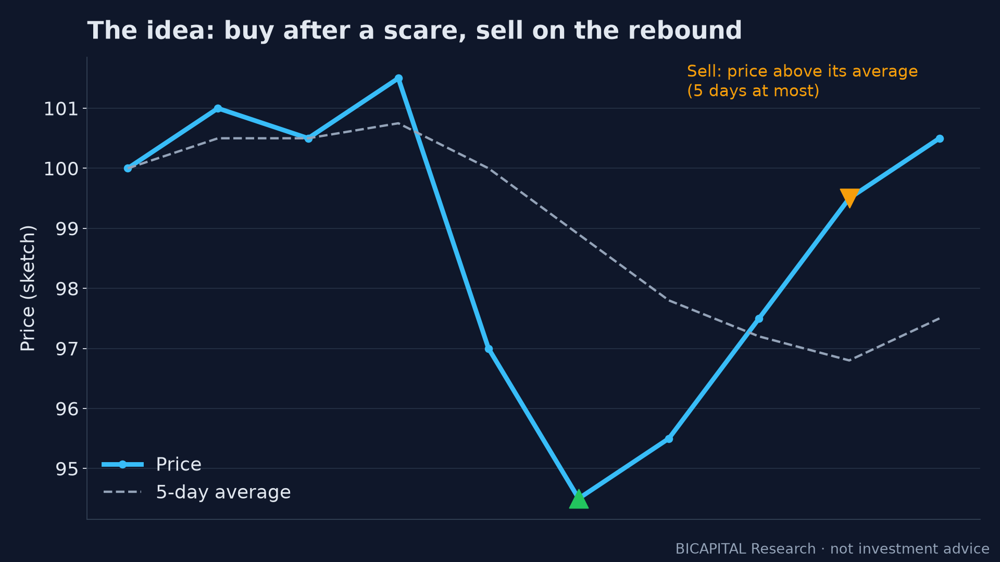
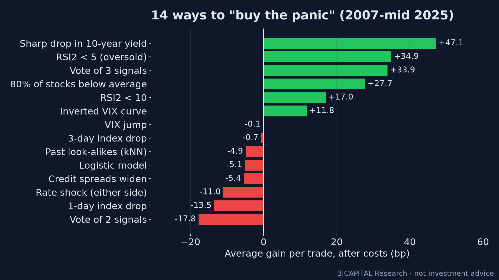
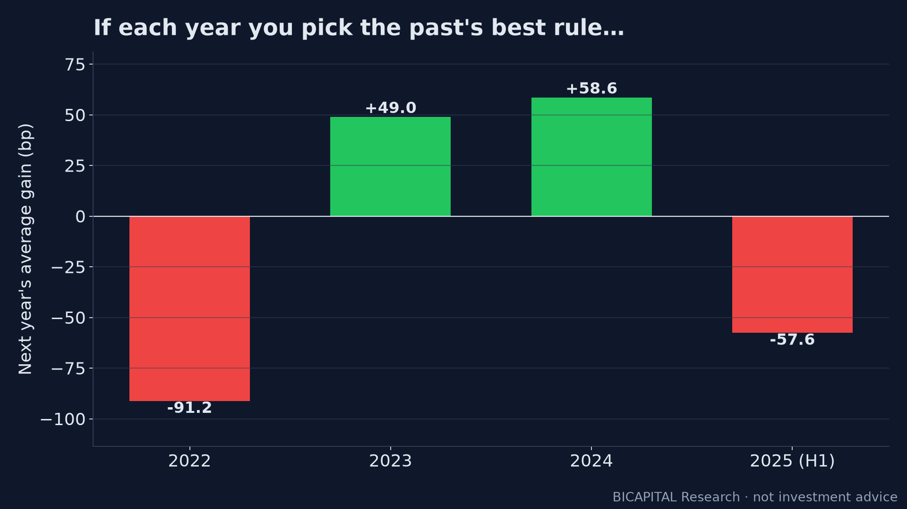
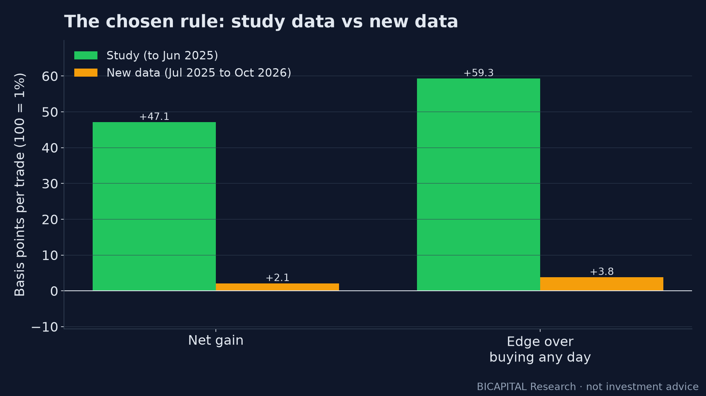

# Buying after a sharp drop: it seemed to work… until the new data

*We tested 14 ways to "buy the panic" on 42 US stocks and 4 US indices. The best one shone in the study. On 15 months of data it had never seen, its edge almost vanished.*

"Buy when there's blood in the streets." It is one of the most repeated phrases in investing. The idea sounds logical: when the market gets scared, prices fall more than they should and then bounce. Like the January sales: if you buy when everyone is running away, you buy cheap.

In this lab we wanted to measure that idea carefully. And we saw something very common in research: a rule that looked like a winner and, when faced with new data, shrank to almost nothing.

## What a market "scare" is

We defined 14 stress signals. All of them were known before buying, with no peeking at the future. Some of them:

- **Low RSI2:** an indicator that measures how much price has fallen over the last two days. Below 5, price is "oversold": it has dropped a lot, very fast.
- **Sharp drop in the 10-year yield:** when the interest rate on US government debt falls suddenly, it is often a sign of fear.
- **VIX jump:** the VIX is the stock market's "fear thermometer". When it jumps, people are nervous.
- **Breadth:** when 80% of stocks are below their 20-day average price.
- **Index drop:** the whole market falls a lot in one or three days.

## The buy and sell rule

After the signal, you buy near the close. You sell on the first day price rises above its **5-day average** (the mean of the last five closes), with a maximum of 5 days.

**How to read the chart:** this is a drawing, not real data. The blue line is price; the dashed grey line is its 5-day average. The green triangle is the purchase after the drop. The orange triangle is the sale: price is back above its average.

Results are measured in **basis points** (bp). 100 bp is 1%. If you buy at 100 and sell at 100.47, you made 47 bp. Everything is after the broker's costs.

## How we built "chance"

Buying US stocks has been profitable most of the time in these years. So winning is not enough. We compared each signal with **buying the same assets on any day**, with the same holding period. The difference between the two is the signal's "edge". If it is zero, the signal adds nothing: you are just riding the market's elevator.

We also tested with randomly chosen days to see how often chance achieves something similar.

## Phase 1: the study (up to June 2025)

**How to read the chart:** each bar is a signal, using the 5-day-average exit. Green is a gain and red a loss, per trade and after costs. At the top are the best: the sharp drop in the 10-year yield (+47.1 bp), RSI2 below 5 (+34.9 bp) and the vote of three signals (+33.9 bp). At the bottom, the one-day index drop and the vote of two signals, which lost money.

We have to be honest here. No variant passed every filter we set ourselves before starting. The best one failed two. Even so, under the rules fixed in advance, the best one was chosen as **exploratory**: the sharp drop in the 10-year yield. In the study, over 1,260 trades, it made +47.1 bp per trade and beat "buying on any day" by +59.3 bp.

## A hint of what was coming

We ran another test: imagine that each year you pick the rule that did best in the previous years and use it the following year. That is exactly what a real person would do.

**How to read the chart:** each bar is a year. It shows what the rule chosen with earlier data made, on average per trade. In 2022 it lost 91.2 bp. In 2023 and 2024 it made 49.0 and 58.6 bp. In the first half of 2025 it lost 57.6 bp. Two good years and two bad ones: choosing by looking at the past gave no safety.

## Phase 2: data the rule had never seen

We had kept data from July 2025 to October 2026 unseen. It is like the final exam: you cannot study the questions. The rule was applied exactly as it was, only once.

**How to read the chart:** green bars are the study; orange bars, the new data. The net gain went from +47.1 bp to +2.1 bp per trade. The edge over buying on any day went from +59.3 bp to +3.8 bp. Almost all of it evaporated.

With 180 new trades, the margin of error ran from −72.7 bp to +76.8 bp. In other words, the true result could be anywhere in that range, including a loss. With costs raised by 50%, it became −7.2 bp. Stocks made −5.3 bp and indices +77.3 bp, but indices had only 16 trades: far too few to conclude anything. In the random-days test, chance matched or beat the result almost half the time.

## Why this happens

When you test 14 signals, one of them will look good just by luck. It is like tossing 14 coins: one of them will land heads several times in a row. Picking the best and expecting it to keep going is asking that coin to repeat itself. That is why we keep data unseen: it is the only clean way to know whether there was something real.

There is also a deeper explanation. During the study years, the US stock market rose a lot. Any quick purchase had the wind at its back. What looked like "buying the panic" was, in part, simply "buying".

## An honest note about the data

On 7 November we found that the broker's data had the buy-sell cost recorded wrongly in parts of 2021 and in November-December 2023. **These results will be recalculated with corrected spread data; we will publish the update.**

## What I take away

- "Buying the panic" sounds good and seemed to work in the study. On new data, the edge almost disappeared.
- Testing many ideas and keeping the best one inflates results. That is why you must keep data unseen.
- Comparing with "buying on any day" stops you from mistaking a general market rise for an edge of your own.
- A result that does not hold up is not a failure: it is information. It saves us from risking money on something that was never clear.

*Educational content. Not investment advice.*
