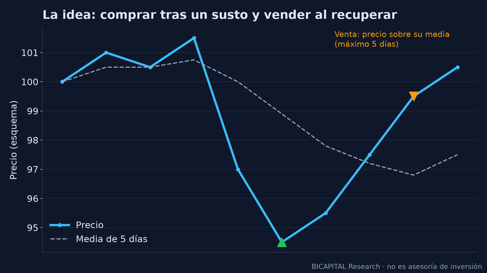
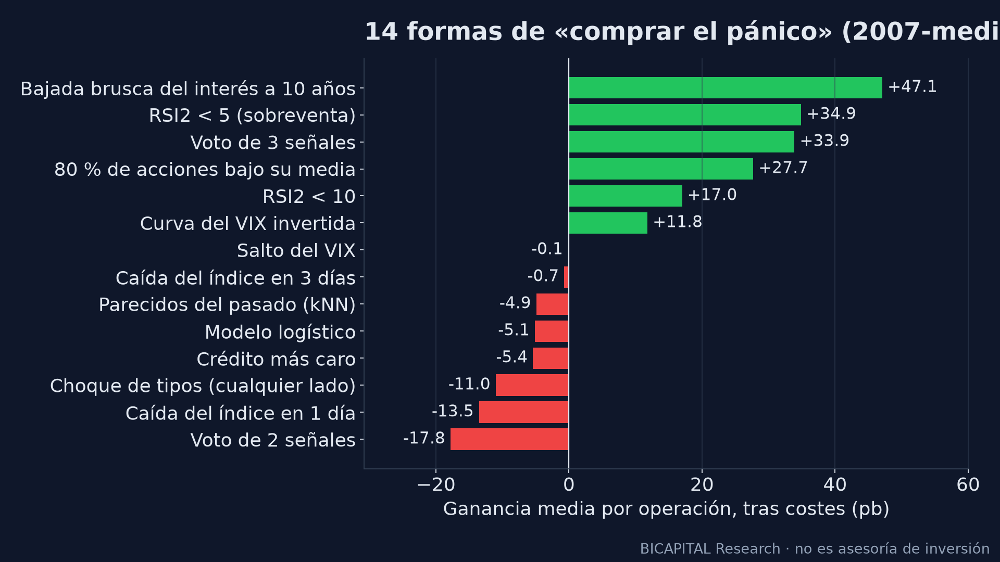
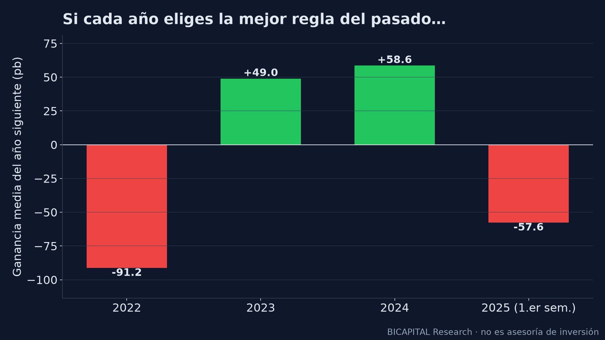
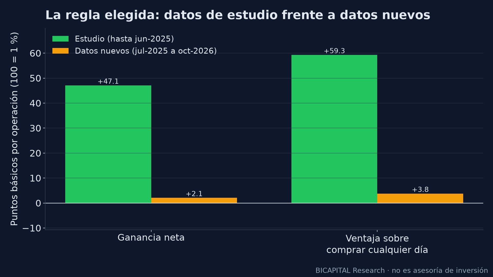

# Comprar tras una caída fuerte: parecía funcionar… hasta los datos nuevos

*Probamos 14 maneras de «comprar el pánico» en 42 acciones y 4 índices de EE. UU. La mejor brillaba en el estudio. Con 15 meses de datos que nunca había visto, su ventaja casi desapareció.*

«Compra cuando hay sangre en las calles». Es una de las frases más repetidas en bolsa. La idea suena lógica: cuando el mercado se asusta, los precios caen más de la cuenta y luego rebotan. Como las rebajas de enero: si compras cuando todos huyen, compras barato.

En este laboratorio quisimos medir esa idea con cuidado. Y vimos algo muy común en investigación: una regla que parecía ganadora y que, al enfrentarse a datos nuevos, se quedó en casi nada.

## Qué es un «susto» del mercado

Definimos 14 señales de estrés. Todas se conocían antes de comprar, sin mirar el futuro. Algunas:

- **RSI2 bajo:** un indicador que mide cuánto ha caído el precio en los últimos dos días. Por debajo de 5, el precio está «sobrevendido»: ha bajado mucho y muy rápido.
- **Bajada brusca del interés a 10 años:** cuando el tipo de interés de la deuda de EE. UU. cae de golpe, suele ser señal de miedo.
- **Salto del VIX:** el VIX es el «termómetro del miedo» de la bolsa. Cuando sube de golpe, hay nervios.
- **Amplitud:** cuando el 80 % de las acciones está por debajo de su precio medio de 20 días.
- **Caída del índice:** el mercado entero cae mucho en uno o tres días.

## La regla de compra y venta

Tras la señal, se compra cerca del cierre. Y se vende el primer día en que el precio supera su **media de 5 días** (el promedio de los últimos cinco cierres), con un máximo de 5 días.

**Cómo leer el gráfico:** es un dibujo, no datos reales. La línea azul es el precio; la gris discontinua, su media de 5 días. El triángulo verde es la compra tras la caída. El triángulo naranja es la venta: el precio vuelve a estar por encima de su media.

Los resultados se miden en **puntos básicos** (pb). 100 pb son un 1 %. Si compras por 100 y vendes por 100,47, has ganado 47 pb. Todo después de pagar los costes del bróker.

## Cómo construimos el azar

Comprar acciones de EE. UU. ha sido rentable casi siempre en estos años. Así que no basta con ganar. Comparamos cada señal con **comprar los mismos activos cualquier día**, con el mismo plazo. La diferencia entre las dos cosas es la «ventaja» de la señal. Si es cero, la señal no aporta nada: solo te subes al ascensor del mercado.

Además, probamos con días elegidos al azar para ver con qué frecuencia el azar consigue algo parecido.

## Fase 1: el estudio (hasta junio de 2025)

**Cómo leer el gráfico:** cada barra es una señal, con la venta por media de 5 días. Verde es ganancia y rojo, pérdida, por operación y después de costes. Arriba están las mejores: la bajada brusca del interés a 10 años (+47,1 pb), el RSI2 por debajo de 5 (+34,9 pb) y el voto de tres señales (+33,9 pb). Abajo, la caída del índice en un día o el voto de dos señales, que perdían.

Aquí hay que ser honestos. Ninguna variante pasó todos los filtros que nos pusimos antes de empezar. La mejor fallaba dos. Aun así, según las normas fijadas de antemano, se eligió la mejor como **exploratoria**: la bajada brusca del interés a 10 años. En el estudio, con 1.260 operaciones, ganaba +47,1 pb por operación y superaba a «comprar cualquier día» por +59,3 pb.

## Una pista de lo que venía

Hicimos otra prueba: imaginar que cada año eliges la regla que mejor fue en los años anteriores y la usas el año siguiente. Es exactamente lo que haría una persona real.

**Cómo leer el gráfico:** cada barra es un año. Muestra lo que ganó, de media por operación, la regla elegida con los datos anteriores. En 2022 perdió 91,2 pb. En 2023 y 2024 ganó 49,0 y 58,6 pb. En la primera mitad de 2025 perdió 57,6 pb. Dos años buenos y dos malos: elegir mirando el pasado no daba seguridad.

## Fase 2: datos que la regla nunca había visto

Teníamos guardados datos de julio de 2025 a octubre de 2026 sin mirar. Es como el examen final: no puedes estudiarte las preguntas. La regla se aplicó tal cual, una sola vez.

**Cómo leer el gráfico:** las barras verdes son el estudio; las naranjas, los datos nuevos. La ganancia neta pasó de +47,1 pb a +2,1 pb por operación. La ventaja sobre comprar cualquier día pasó de +59,3 pb a +3,8 pb. Casi todo se esfumó.

Con 180 operaciones nuevas, el margen de error iba de −72,7 pb a +76,8 pb. Es decir, el resultado real podía estar en cualquier punto de ese rango, incluido perder. Si subíamos los costes un 50 %, quedaba en −7,2 pb. Las acciones dieron −5,3 pb y los índices +77,3 pb, pero los índices solo tenían 16 operaciones: muy pocas para concluir nada. En la prueba de días al azar, el azar igualaba o superaba el resultado casi la mitad de las veces.

## Por qué pasa esto

Cuando pruebas 14 señales, alguna saldrá bien solo por suerte. Es como lanzar 14 monedas: alguna sacará varias caras seguidas. Elegir la mejor y esperar que siga igual es pedirle a esa moneda que repita. Por eso guardamos datos sin mirar: son la única forma limpia de saber si había algo real.

También hay una explicación de fondo. En los años del estudio, la bolsa de EE. UU. subió mucho. Cualquier compra rápida tenía el viento a favor. Lo que parecía «comprar el pánico» era, en parte, simplemente «comprar».

## Una nota honesta sobre los datos

El 7 de noviembre descubrimos que los datos del bróker tenían el coste de compraventa mal registrado en partes de 2021 y en noviembre-diciembre de 2023. **Estos resultados se recalcularán con datos de spread corregidos; publicaremos la actualización.**

## Qué me llevo

- «Comprar el pánico» suena bien y en el estudio parecía funcionar. En datos nuevos, la ventaja casi desapareció.
- Probar muchas ideas y quedarse con la mejor infla los resultados. Por eso hay que reservar datos sin mirar.
- Comparar con «comprar cualquier día» evita confundir una subida general del mercado con una ventaja propia.
- Un resultado que no se sostiene no es un fracaso: es información. Nos ahorra arriesgar dinero en algo que no estaba claro.

*Contenido educativo. No es asesoría de inversión.*
