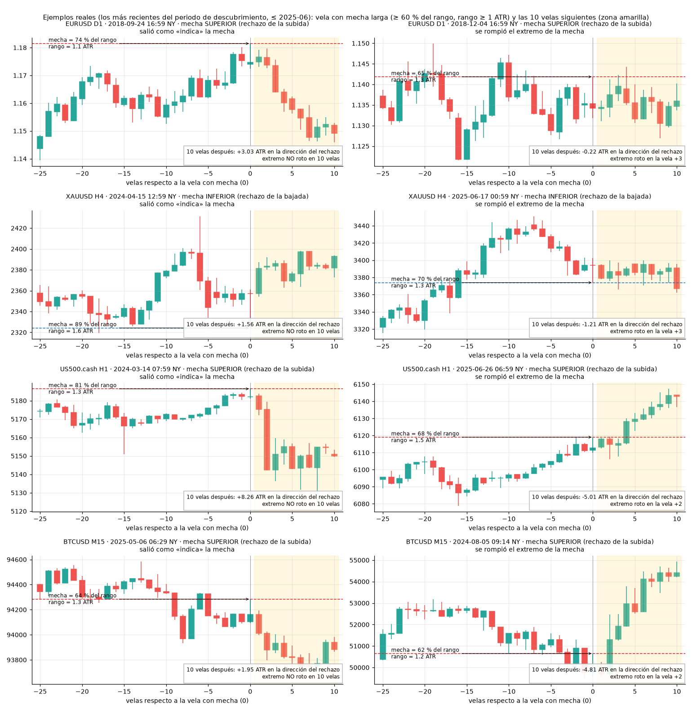
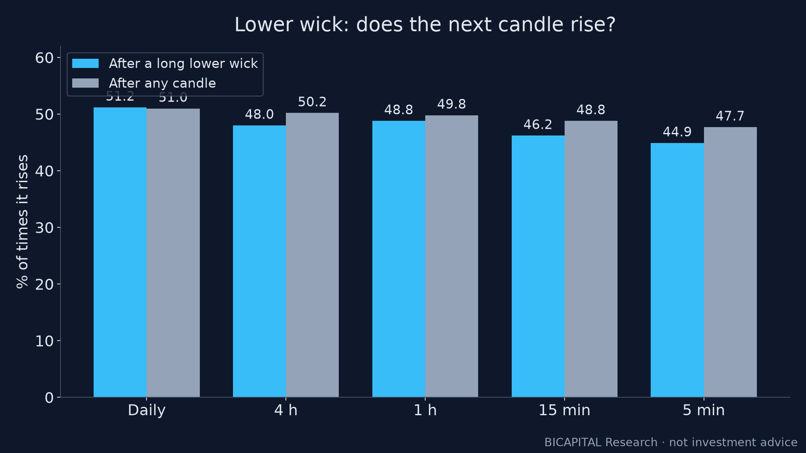
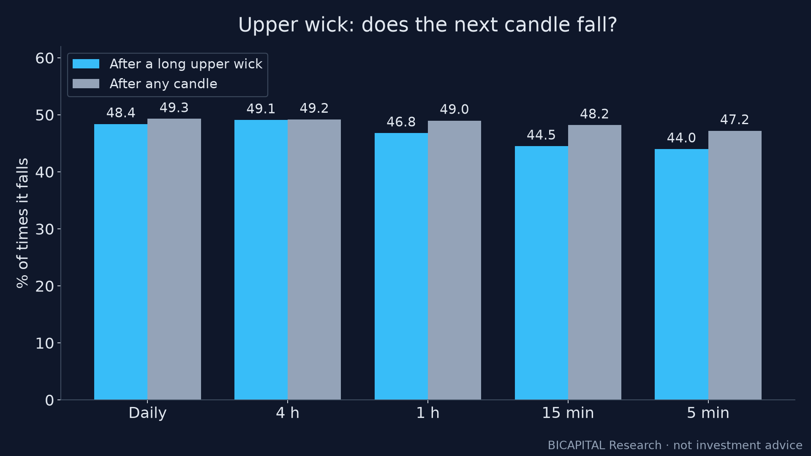
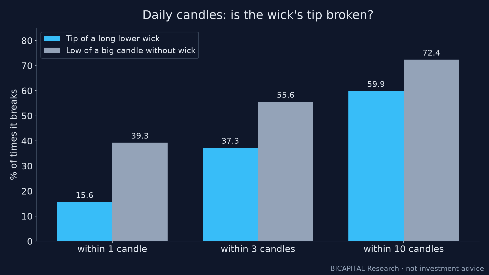
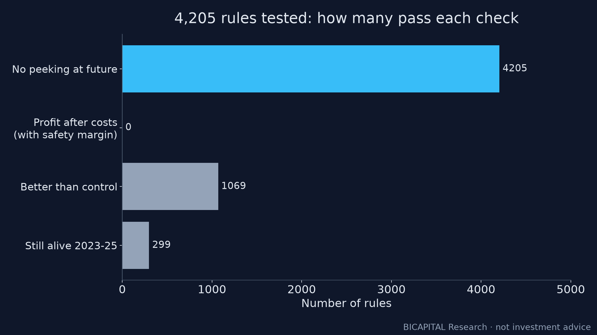

# The long-wick candle: what really happens next

*We measured thousands of long-wick candles in 125 markets. The famous «rejection» does not call the direction: afterwards, price behaves as it does after any candle.*

One of the first things beginners learn in trading is to look at wicks. A candle has a body (the thick part, between open and close) and wicks (the thin lines above and below, showing how far price went before pulling back).

When the wick is very long, people say there was a «rejection». For example, a long lower wick would mean price fell, buyers said «that's enough» and pushed it back. Like a ball bouncing off the floor: it hit bottom and goes up. That is why many courses teach you to buy after a long lower wick and sell after a long upper one.

We wanted to check whether that ball really bounces.

## What we counted as a «long wick»

To avoid cheating, we fixed the definition before looking at the results:

- The wick takes up at least 60 % of the candle's total size.
- The candle is big: at least as large as the average size of the previous 14 candles.
- **Lower wick** = price fell and was rejected; according to the theory, it «points» up.
- **Upper wick** = price rose and was rejected; it «points» down.

We measured everything with the candle already closed, without peeking at the future, across 125 markets (currencies, indices, gold, crypto, stocks) and five candle sizes: daily, 4 hours, 1 hour, 15 minutes and 5 minutes. We are talking about hundreds of thousands of wicks.

## How we measured whether it «works»

It is not enough to see whether price rises after the wick. Price rises roughly half the time after any candle. So we always compared with any candle from the same market and the same year. If the wick carries information, price should move in the «pointed» direction more often after it than after a normal candle.

It is like testing a lucky charm: winning 50 % of the time with it is not enough; you have to win more than without it.

## Real examples

**How to read the chart:** these are eight real cases from the lab (labels in Spanish). In each box, the long-wick candle sits at position 0, and the yellow area shows the next 10 candles. The dashed line marks the tip of the wick. The ones on the left went «as the wick suggests»; the ones on the right did the opposite: price broke the wick's tip within a few candles. Picking only the left-hand ones is what a video does to convince you. To know the truth you have to count them all.

## Result 1: lower wick, does price rise next?

**How to read the chart:** the blue bar is how often the next candle closed higher after a long lower wick. The grey one, the same after any candle. On daily candles, 51.2 % vs 51.0 %: practically equal. On 4-hour candles, 48.0 % vs 50.2 %. And on short candles, 15 and 5 minutes, the wick does even worse: 46.2 % vs 48.8 % and 44.9 % vs 47.7 %.

## Result 2: upper wick, does price fall next?

**How to read the chart:** same as before, but for the upward rejection. After a long upper wick, the next daily candle fell 48.4 % of the time; after any candle, 49.3 %. On 15 minutes, 44.5 % vs 48.2 %; on 5 minutes, 44.0 % vs 47.2 %.

On short candles, price tends to come back slightly towards the wick, the exact opposite of what the theory says. But careful: this is not a reverse opportunity. The differences are small and, as we will see, they do not pay the costs.

## Result 3: the wick's tip is not a wall

Many traders place their stop just beyond the tip of the wick, thinking it is a strong level.

**How to read the chart:** on daily candles, the blue bar shows how often the tip of a long lower wick breaks within 1, 3 and 10 candles: 15.6 %, 37.3 % and 59.9 %. The grey one is the same for the low of a big candle without a wick: 39.3 %, 55.6 % and 72.4 %. The wick's tip holds a bit better, but there is a simple reason: it is further from the close. Even so, within 10 candles it breaks six times out of ten.

We also saw that after a long wick the market moves a little more: the next 5 daily candles average 1.15 times the normal size, vs 1.04 after any candle. But after a big candle without a wick, also 1.15. In other words, what brings movement is a big candle, not the wick.

## Result 4: can you make money from it?

We tested 4,205 trading rules based on wicks: entering in the direction of the rejection, entering when a streak of wicks breaks, different stops and targets. We paid a broker's real costs.

**How to read the chart:** each bar is a check a rule must pass to be taken seriously. All 4,205 respect the no-peeking-at-the-future rule. But none, zero, managed to make money after costs with a reasonable safety margin. Some pass other checks separately (1,069 beat the control, 299 are still alive in 2023-2025), but none passes the main one.

These results will be recalculated with corrected spread data; we will publish the update.

## My takeaways

- After a long wick, price behaves as it does after any candle. On daily and 4-hour candles, almost the same; on short candles, even slightly the opposite.
- The wick's tip is not a wall: on daily candles it breaks six times out of ten within 10 candles.
- A big candle brings movement, but does not say which way.
- Out of 4,205 rules, none made money after costs.
- Wicks are still useful to describe what happened. What they do not do is guess what will happen.

*Educational content. Not investment advice.*
