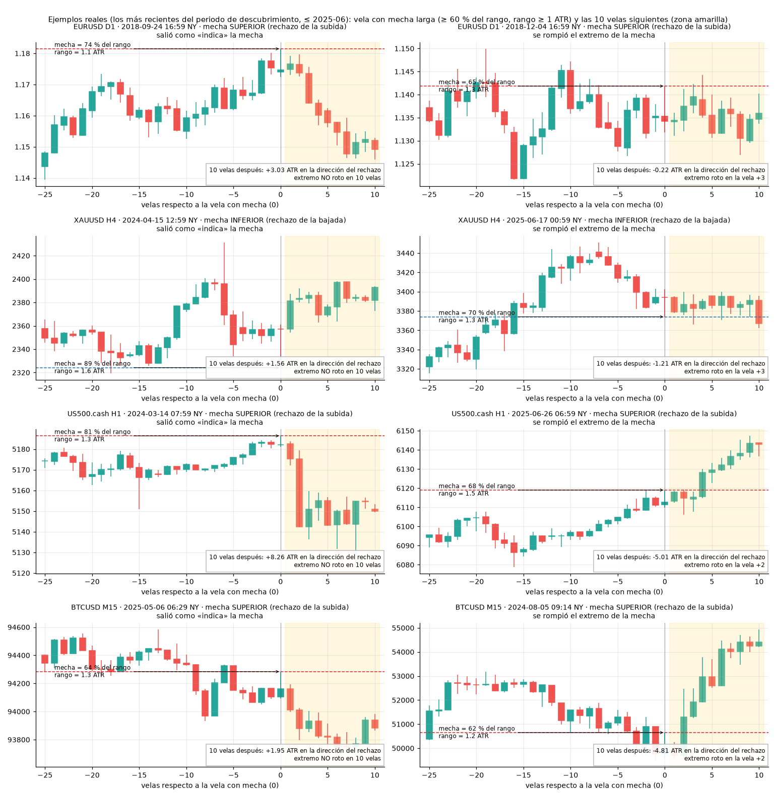
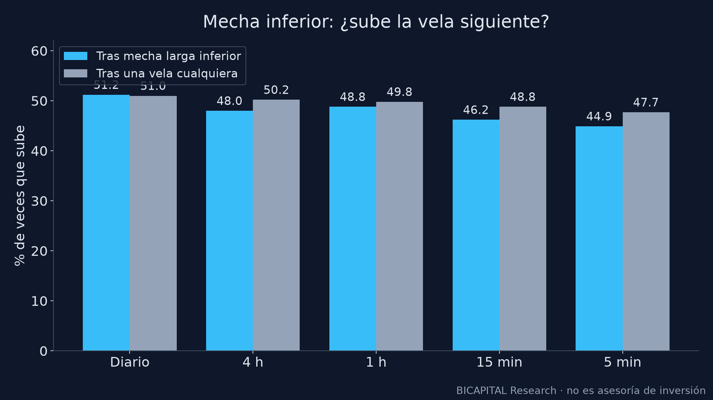
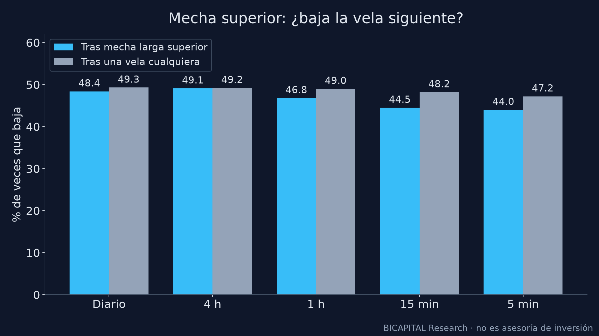
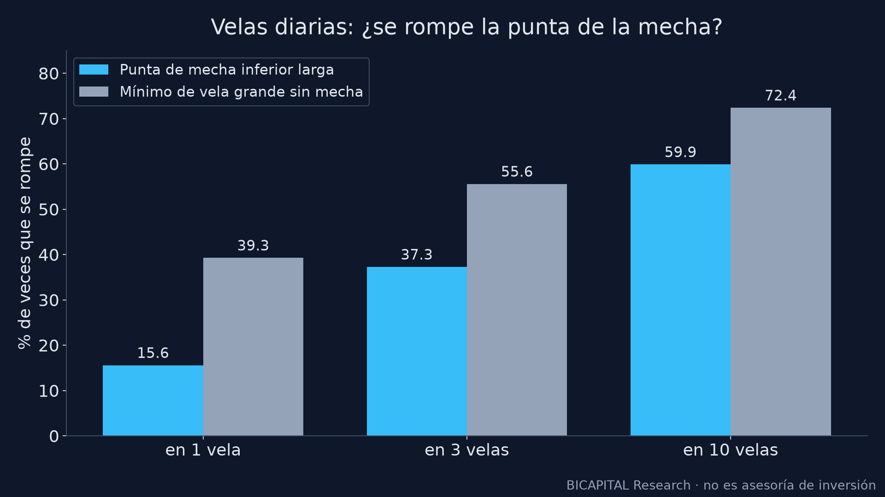
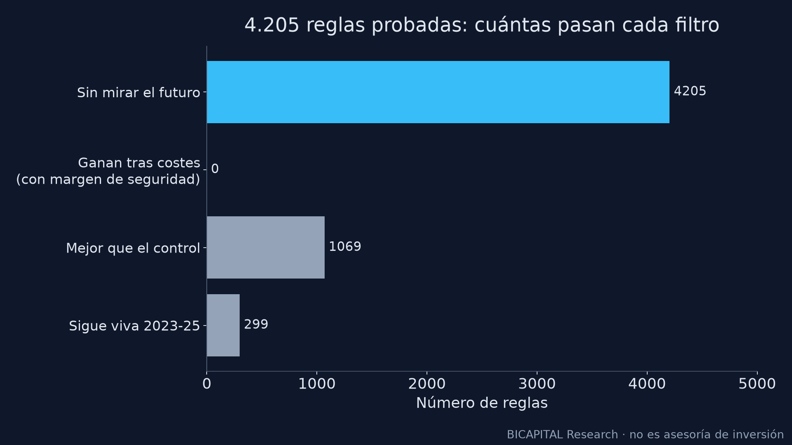

# La vela con mecha larga: qué pasa de verdad después

*Medimos miles de velas con mecha larga en 125 mercados. El famoso «rechazo» no anuncia la dirección: después, el precio se porta como tras una vela cualquiera.*

Una de las primeras cosas que aprende quien empieza en trading es a mirar las mechas. Una vela tiene un cuerpo (la parte gruesa, entre la apertura y el cierre) y unas mechas (las líneas finas arriba y abajo, que marcan hasta dónde llegó el precio y luego se retiró).

Cuando la mecha es muy larga, se suele decir que hubo un «rechazo». Por ejemplo, una mecha larga hacia abajo significaría que el precio bajó, los compradores dijeron «hasta aquí» y lo empujaron de vuelta. Sería como una pelota que bota en el suelo: tocó fondo y sube. Por eso muchos cursos enseñan a comprar tras una mecha larga inferior y a vender tras una superior.

Quisimos comprobar si esa pelota bota de verdad.

## Qué contamos como «mecha larga»

Para no hacer trampas, fijamos la definición antes de mirar los resultados:

- La mecha ocupa al menos el 60 % del tamaño total de la vela.
- La vela es grande: mide al menos lo mismo que el tamaño medio de las 14 velas anteriores.
- **Mecha inferior** = el precio bajó y fue rechazado; según la teoría, «indica» subida.
- **Mecha superior** = subió y fue rechazado; «indica» bajada.

Medimos todo con la vela ya cerrada, sin mirar el futuro, en 125 mercados (divisas, índices, oro, cripto, acciones) y en cinco tamaños de vela: diaria, 4 horas, 1 hora, 15 minutos y 5 minutos. Hablamos de cientos de miles de mechas.

## Cómo medimos si «funciona»

No basta con ver si después de la mecha el precio sube. El precio sube aproximadamente la mitad de las veces tras cualquier vela. Por eso comparamos siempre con una vela cualquiera del mismo mercado y del mismo año. Si la mecha da información, tras ella el precio debería ir más veces en la dirección «indicada» que tras una vela normal.

Es como probar un amuleto: no basta con ver que ganas el 50 % de las veces con él; tienes que ganar más que sin él.

## Ejemplos reales

**Cómo leer el gráfico:** son ocho casos reales del laboratorio. En cada recuadro, la vela con mecha larga está en la posición 0, y la zona amarilla muestra las 10 velas siguientes. La línea discontinua marca la punta de la mecha. Los de la izquierda salieron «como indica la mecha»; los de la derecha, al contrario: el precio rompió la punta de la mecha en pocas velas. Elegir solo los de la izquierda es lo que hace un vídeo para convencerte. Para saber la verdad hay que contarlos todos.

## Resultado 1: mecha inferior, ¿sube después?

**Cómo leer el gráfico:** la barra azul es el porcentaje de veces que la vela siguiente cerró más arriba tras una mecha inferior larga. La gris, lo mismo tras una vela cualquiera. En velas diarias, 51,2 % frente a 51,0 %: prácticamente igual. En velas de 4 horas, 48,0 % frente a 50,2 %. Y en velas cortas, de 15 y 5 minutos, la mecha lo hace incluso peor: 46,2 % frente a 48,8 % y 44,9 % frente a 47,7 %.

## Resultado 2: mecha superior, ¿baja después?

**Cómo leer el gráfico:** igual que el anterior, pero para el rechazo hacia arriba. Tras una mecha superior larga, la vela diaria siguiente bajó el 48,4 % de las veces; tras una vela cualquiera, el 49,3 %. En 15 minutos, 44,5 % frente a 48,2 %; en 5 minutos, 44,0 % frente a 47,2 %.

En velas cortas, el precio tiende a volver un poco hacia la mecha, justo lo contrario de lo que dice la teoría. Pero cuidado: no es una oportunidad al revés. Son diferencias pequeñas y, como veremos, no pagan los costes.

## Resultado 3: la punta de la mecha no es un muro

Muchos colocan el stop justo detrás de la punta de la mecha, pensando que es un nivel fuerte.

**Cómo leer el gráfico:** en velas diarias, la barra azul indica cuántas veces se rompe la punta de una mecha inferior larga en 1, 3 y 10 velas: 15,6 %, 37,3 % y 59,9 %. La gris es lo mismo para el mínimo de una vela grande sin mecha: 39,3 %, 55,6 % y 72,4 %. La punta de la mecha aguanta algo más, pero eso tiene una explicación sencilla: está más lejos del cierre. Aun así, en 10 velas se rompe seis de cada diez veces.

También vimos que tras una mecha larga el mercado se mueve un poco más: las 5 velas diarias siguientes miden de media 1,15 veces el tamaño normal, frente a 1,04 tras una vela cualquiera. Pero tras una vela grande sin mecha, también 1,15. Es decir, lo que trae movimiento es que la vela sea grande, no la mecha.

## Resultado 4: ¿se puede ganar dinero con ello?

Probamos 4.205 reglas de trading basadas en mechas: entrar a favor del rechazo, entrar al romper una racha de mechas, distintos stops y objetivos. Pagamos los costes reales de un bróker.

**Cómo leer el gráfico:** cada barra es un filtro que una regla debe superar para tomarla en serio. Las 4.205 respetan la regla de no mirar el futuro. Pero ninguna, cero, consiguió ganar dinero tras costes con un margen de seguridad razonable. Algunas pasan otros filtros por separado (1.069 son mejores que el control, 299 siguen vivas en 2023-2025), pero ninguna pasa el filtro principal.

Estos resultados se recalcularán con datos de spread corregidos; publicaremos la actualización.

## Qué me llevo

- Tras una mecha larga, el precio se comporta como tras una vela cualquiera. En velas diarias y de 4 horas, casi igual; en velas cortas, incluso un poco al revés.
- La punta de la mecha no es un muro: en velas diarias se rompe seis de cada diez veces en 10 velas.
- La vela grande trae movimiento, pero no dice hacia dónde.
- De 4.205 reglas, ninguna ganó tras costes.
- La mecha sigue siendo útil para describir lo que pasó. Lo que no hace es adivinar lo que pasará.

*Contenido educativo. No es asesoría de inversión.*
