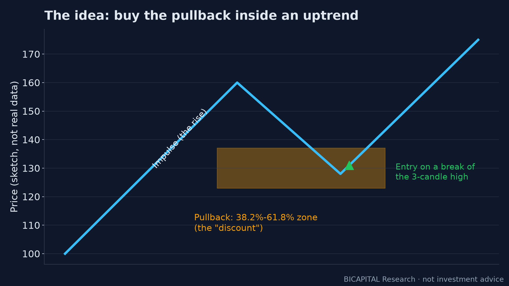
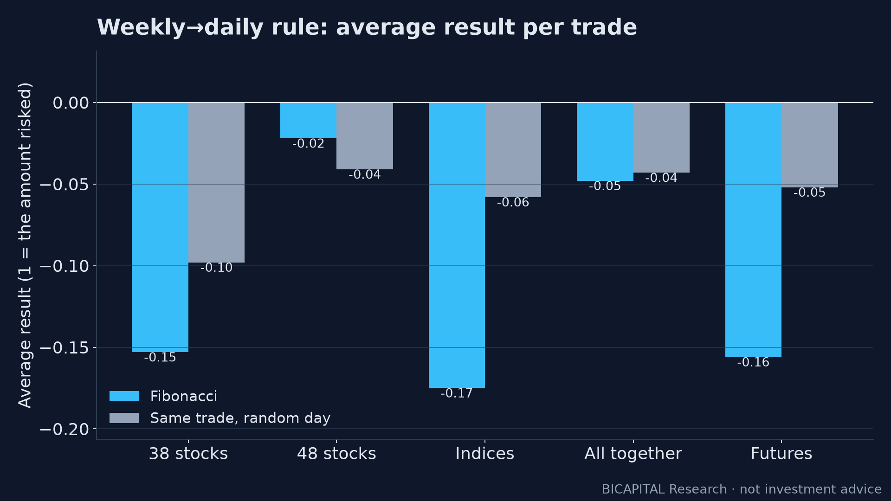
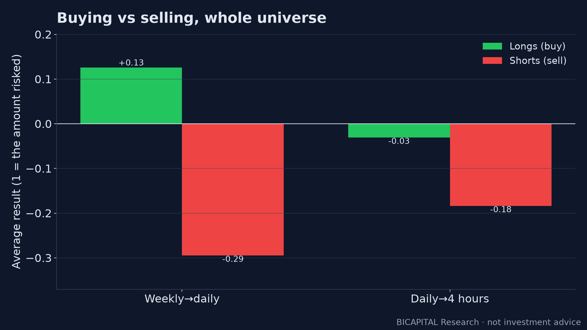
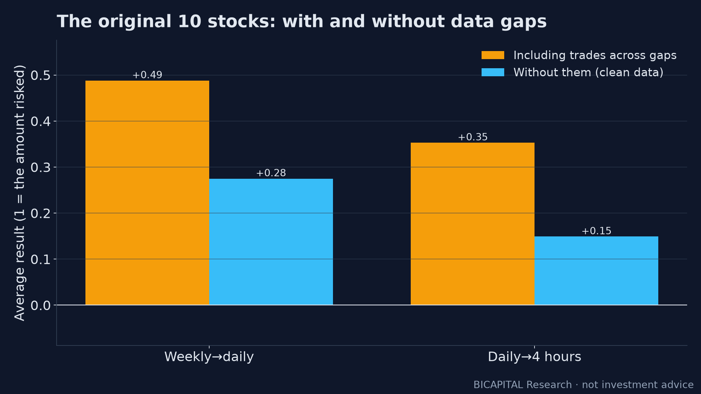
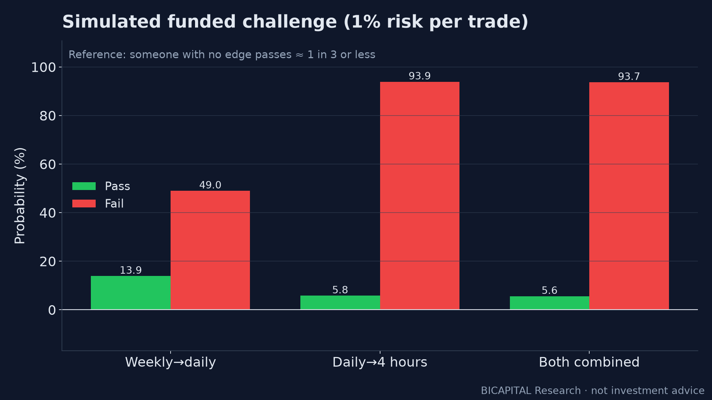
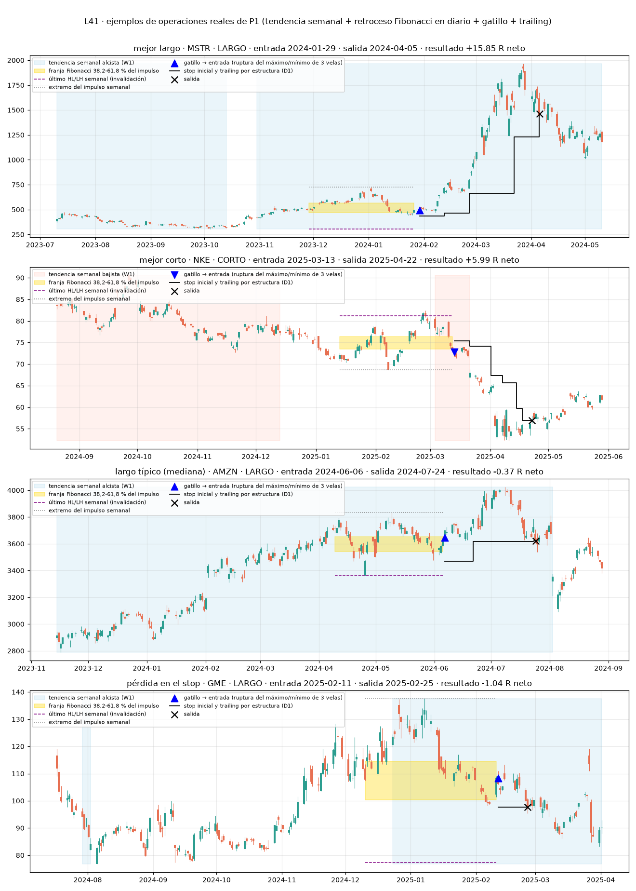

# Fibonacci in a trend: we tested it on 48 stocks and indices

*Buying the "discount" inside an uptrend is one of the most popular ideas in technical analysis. We measured it with real costs and against chance. None of the 310 tests passed every filter.*

If you have ever seen a chart with Fibonacci lines, you know the idea. Price rises strongly, then drops a little, and in theory that pullback is an opportunity: buy cheaper something that is still trending. It is like waiting for the sales to buy a jacket you were going to buy anyway.

We wanted to know whether that idea, exactly as it is usually taught, makes money after paying costs. We tested it on 48 stocks and 11 indices. The short answer is no. The long answer is more interesting.

## First, three words

- **Trend:** price keeps stepping up (or down). Like a staircase: each step a little higher than the last.
- **Impulse:** the strong leg of the move, the "push".
- **Fibonacci retracement:** a band between 38.2% and 61.8% of that impulse. If a stock rises from 100 to 160, the band runs from roughly 123 to 137. These percentages come from an old mathematical series; many traders draw them on their charts.

**How to read the chart:** this is a drawing, not real data. The blue line rises (impulse), falls into the orange band (the pullback) and rises again. The green triangle marks where the rule would enter: when price breaks the high of the last three candles, as a sign the pullback is over.

## How we tested it

We used two versions of the rule:

1. **Weekly → daily:** the trend is read on weekly candles and the entry on daily candles.
2. **Daily → 4 hours:** the trend is read on daily candles and the entry on 4-hour candles.

Every trade had a **stop**, a point where you get out if price goes against you. Think of it as the handbrake: it limits how much you can lose. The stop was moved up behind price as the trade gained (this is called *trailing*).

We measured results in "risks". If you risk 100 and win 100, the result is +1. If you lose the full stop, it is −1. Everything is after the broker's costs: the gap between buying and selling price, commission, slippage, and the cost of holding a position overnight.

## How we built "chance"

This is the important part. In an uptrend, almost any purchase makes something, because the wind is at your back. So winning is not enough: you have to win **more than entering blindly**.

For each real trade we created 200 copies. Same stock, same direction, same stop, same maximum length. The only thing that changes is the entry moment: a random day inside the same trend leg. If Fibonacci cannot beat those copies, what makes money is the trend, not the entry.

## What came out

**How to read the chart:** each group has two bars. Blue is the Fibonacci rule; grey is the same trade entered on a random day. A value of −0.15 means each trade lost, on average, 15% of the amount risked. In almost every group both bars are negative and Fibonacci is no better than chance.

Across the whole universe, the weekly rule made −0.048 per trade over 994 trades. The daily rule made −0.100 over 3,018 trades. The "neighbouring" rules (small variations of the same idea) did not win either: in most cases 0 of 7 neighbours ended up positive. When an idea really works, its close cousins usually work too.

## Buying yes, selling no

**How to read the chart:** green bars are buy trades; red bars are sell trades. In the weekly rule, buying made +0.126 and selling −0.295. Selling the pullbacks of downtrends was clearly worse.

Buying looks somewhat better, but there is a simple explanation: stocks rose a lot in these years. The same purchase entered on a random day made +0.011. Fibonacci came out a little above that, but the difference was not solid: within the margin of error it could have been zero or even negative.

## The trap of incomplete data

This rule came from an earlier lab with 10 stocks, where it seemed to win: +0.488 per trade. When we repeated it, we found a problem. Whole weeks of data were missing for some stocks. During those gaps the stop could not trigger, and some trades showed huge gains that would never have happened in real life.

**How to read the chart:** the orange bar includes trades that crossed a gap of more than 5 days with no data; the blue bar does not. In the weekly rule the result drops from +0.488 to +0.275. In the daily rule, from +0.353 to +0.149. Just 14 excluded trades explained a large part of the gain.

A useful reminder: sometimes a great result is not an edge, but a flaw in the data.

## And in a funded-account challenge?

We simulated a funded-account challenge thousands of times (reach a profit target without breaking a loss limit).

**How to read the chart:** green is the chance of passing; red, of failing. With 1% risk per trade, the weekly rule passes 13.9% of the time and fails 49.0%. The daily rule passes 5.8% and fails 93.9%. Someone with no edge at all passes roughly 1 in 3 times or less.

## Real trades, in context

**How to read the chart:** four real trades taken from the lab (labels are in Spanish). The yellow band is the Fibonacci zone; the blue or red background is the weekly trend; the triangle is the entry; the black stepped line is the rising stop; the X is the exit. At the top, the best buy (+15.85 risks). Below it, the best sell, a typical near-flat trade (−0.37) and one stopped out (−1.04). Pretty examples exist, but the average is what counts.

## An honest note about the data

On 7 November we found that the broker's data had the buy-sell cost recorded wrongly in parts of 2021 and in November-December 2023. **These results will be recalculated with corrected spread data; we will publish the update.** Since the result is already negative we do not expect the verdict to change, but we will check.

## What I take away

- Being famous does not make a tool profitable. Fibonacci on its own did not beat entering on any random day.
- Comparing against chance is essential. In a trend, almost everything looks like it works.
- A spectacular result deserves suspicion. Here, part of it came from incomplete data.
- Being wrong about a popular idea is also learning. Now we know where not to look.

*Educational content. Not investment advice.*
