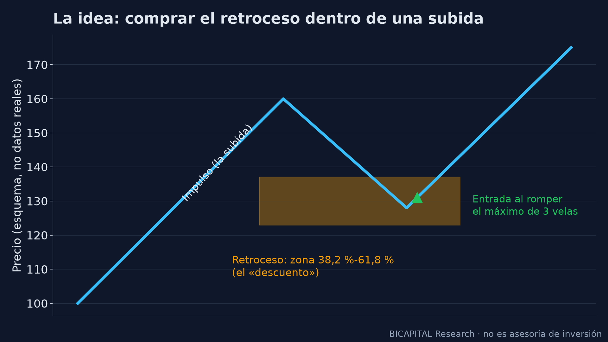
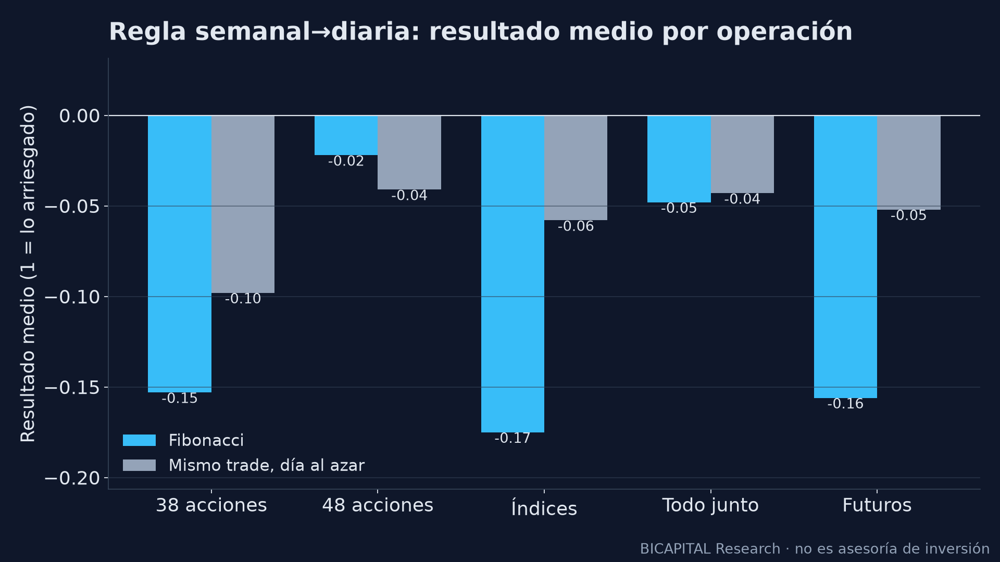
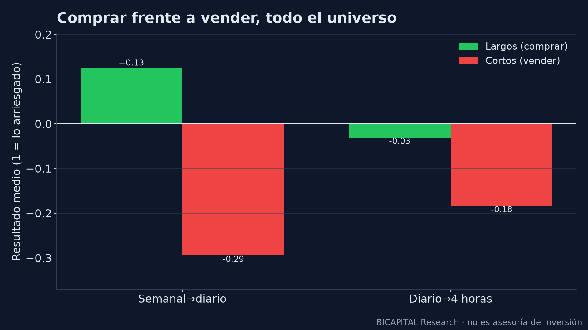
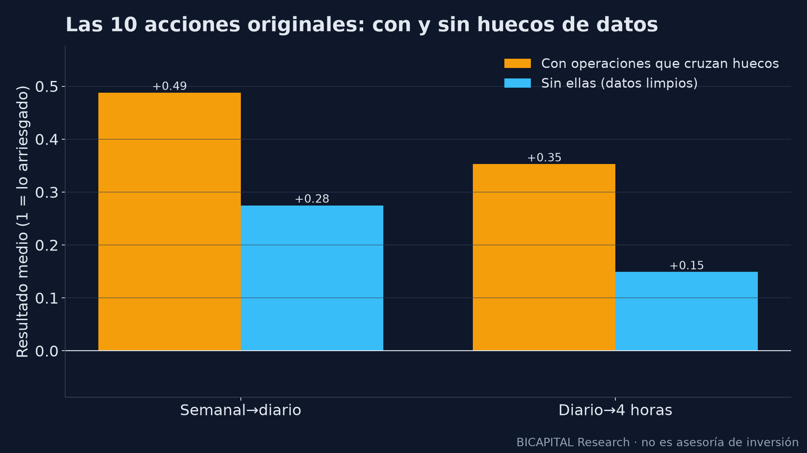
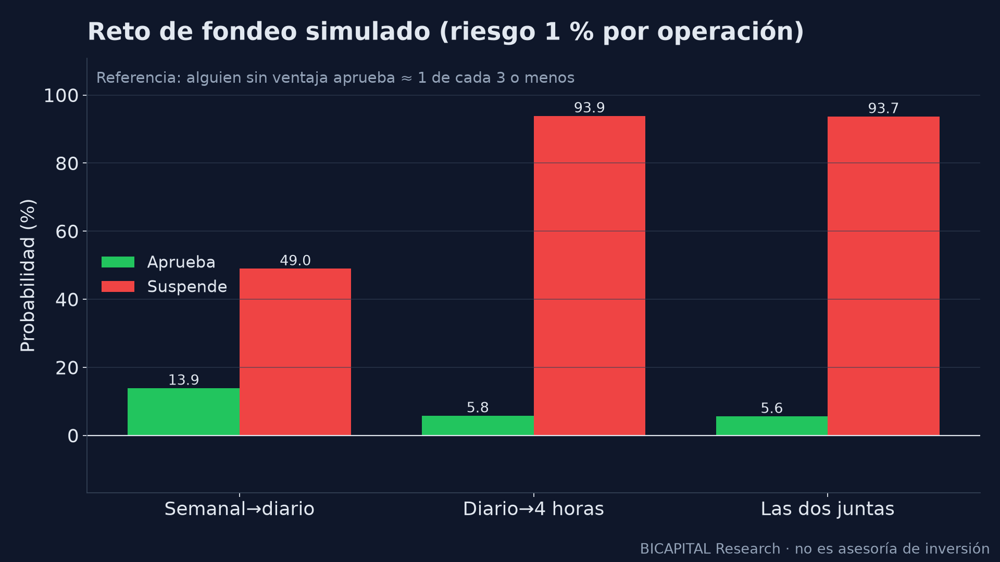
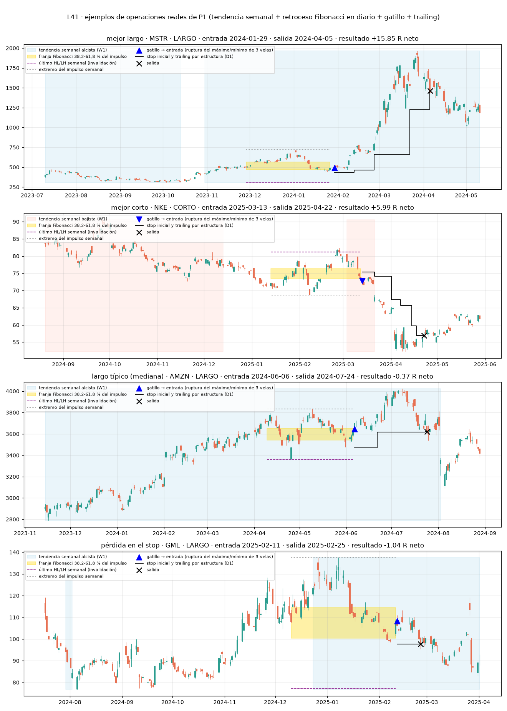

# Fibonacci en tendencia: lo probamos en 48 acciones e índices

*Comprar el «descuento» dentro de una subida es una de las ideas más populares del análisis técnico. La medimos con costes reales y contra el azar. Ninguna de las 310 pruebas pasó todos los filtros.*

Si has visto un gráfico con líneas de Fibonacci, conoces la idea. El precio sube con fuerza, luego baja un poco y, en teoría, ese retroceso es una oportunidad: comprar más barato algo que sigue en tendencia. Es como esperar a las rebajas para comprar una prenda que de todos modos ibas a comprar.

Queríamos saber si esa idea, tal cual se enseña, deja dinero después de pagar los costes. La probamos en 48 acciones y 11 índices. La respuesta corta es que no. La respuesta larga es más interesante.

## Primero, tres palabras

- **Tendencia:** el precio va marcando escalones hacia arriba (o hacia abajo). Como una escalera: cada peldaño un poco más alto que el anterior.
- **Impulso:** el tramo fuerte de la subida, el «empujón».
- **Retroceso de Fibonacci:** una franja entre el 38,2 % y el 61,8 % de ese impulso. Si una acción sube de 100 a 160, la franja va más o menos de 123 a 137. Son porcentajes que vienen de una vieja serie matemática; mucha gente los dibuja en sus gráficos.

**Cómo leer el gráfico:** es un dibujo, no datos reales. La línea azul sube (impulso), baja hasta la franja naranja (el retroceso) y vuelve a subir. El triángulo verde marca dónde entraría la regla: cuando el precio rompe el máximo de las tres últimas velas, como señal de que el retroceso terminó.

## Cómo lo probamos

Usamos dos versiones de la regla:

1. **Semanal → diario:** la tendencia se mira en velas semanales y la entrada en velas diarias.
2. **Diario → 4 horas:** la tendencia se mira en velas diarias y la entrada en velas de 4 horas.

Cada operación tenía un **stop**, es decir, un punto de salida si el precio iba en contra. Es como el freno de mano: limita lo que puedes perder. El stop se iba subiendo detrás del precio a medida que ganaba (eso se llama *trailing*).

Medimos el resultado en «riesgos». Si arriesgas 100 y ganas 100, el resultado es +1. Si pierdes el stop entero, es −1. Todo después de pagar los costes del bróker: la diferencia entre precio de compra y de venta, la comisión, el deslizamiento y el coste de mantener la posición abierta de un día a otro.

## Cómo construimos el azar

Aquí está la parte importante. En una tendencia alcista, casi cualquier compra gana algo, porque el viento sopla a favor. Así que no basta con ganar: hay que ganar **más que entrando a ciegas**.

Para cada operación real creamos 200 copias. Misma acción, mismo lado, mismo stop, misma duración máxima. Lo único que cambia es el momento de entrada: un día al azar dentro del mismo tramo de tendencia. Si Fibonacci no supera a esas copias, lo que gana es la tendencia, no la entrada.

## Lo que salió

**Cómo leer el gráfico:** cada grupo tiene dos barras. La azul es la regla de Fibonacci; la gris, la misma operación entrando un día al azar. Un valor de −0,15 significa que, de media, cada operación perdió el 15 % de lo arriesgado. En casi todos los grupos las dos barras son negativas y la de Fibonacci no es mejor que la del azar.

En el universo completo, la regla semanal hizo −0,048 por operación en 994 operaciones. La diaria, −0,100 en 3.018 operaciones. Las reglas «vecinas» (pequeñas variaciones de la misma idea) tampoco ganaban: en la mayoría de los casos 0 de 7 vecinas quedaban en positivo. Cuando una idea funciona de verdad, sus primas cercanas suelen funcionar también.

## Comprar sí, vender no

**Cómo leer el gráfico:** las barras verdes son operaciones de compra; las rojas, de venta. En la regla semanal, comprar dio +0,126 y vender −0,295. Vender en retrocesos de tendencias bajistas fue claramente peor.

Comprar parece algo mejor, pero tiene explicación sencilla: en estos años las acciones subieron mucho. La misma compra entrando un día al azar dio +0,011. Fibonacci quedó algo por encima, pero la diferencia no fue firme: con el margen de error, podía ser cero o incluso negativa.

## La trampa de los datos incompletos

Esta regla venía de un laboratorio anterior con 10 acciones, donde parecía ganar: +0,488 por operación. Al repetirlo descubrimos un problema. Faltaban semanas enteras de datos en algunas acciones. Durante esos huecos, el stop no podía saltar, y algunas operaciones aparecían con ganancias enormes que en la vida real no habrían existido.

**Cómo leer el gráfico:** la barra naranja incluye las operaciones que cruzaban un hueco de más de 5 días sin datos; la azul, no. En la regla semanal el resultado cae de +0,488 a +0,275. En la diaria, de +0,353 a +0,149. Solo 14 operaciones excluidas explicaban buena parte de la ganancia.

Este es un recordatorio útil: a veces un buen resultado no es una ventaja, sino un fallo en los datos.

## ¿Y en un reto de fondeo?

Simulamos miles de veces un reto de cuenta fondeada (pasar un objetivo de ganancia sin superar un límite de pérdida).

**Cómo leer el gráfico:** verde es la probabilidad de aprobar; roja, la de suspender. Con un riesgo del 1 % por operación, la regla semanal aprueba el 13,9 % de las veces y suspende el 49,0 %. La diaria aprueba el 5,8 % y suspende el 93,9 %. Alguien sin ninguna ventaja aprueba más o menos 1 de cada 3 veces o menos.

## Operaciones reales, con su contexto

**Cómo leer el gráfico:** son cuatro operaciones reales sacadas del laboratorio. La franja amarilla es la zona de Fibonacci; el fondo azul o rojo, la tendencia semanal; el triángulo, la entrada; la línea negra escalonada, el stop que sube; la X, la salida. Arriba, la mejor compra (+15,85 riesgos). Debajo, la mejor venta, una operación típica casi plana (−0,37) y una que salta en el stop (−1,04). Los ejemplos bonitos existen, pero la media es lo que cuenta.

## Una nota honesta sobre los datos

El 7 de noviembre descubrimos que los datos del bróker tenían el coste de compraventa mal registrado en partes de 2021 y en noviembre-diciembre de 2023. **Estos resultados se recalcularán con datos de spread corregidos; publicaremos la actualización.** Dado que el resultado ya es negativo, no esperamos que cambie el veredicto, pero lo comprobaremos.

## Qué me llevo

- Que una herramienta sea famosa no significa que gane dinero. Fibonacci, solo, no superó a entrar un día cualquiera.
- Comparar con el azar es imprescindible. En tendencia, casi todo parece funcionar.
- Un resultado espectacular merece sospecha. Aquí, parte venía de datos incompletos.
- Equivocarse en una idea popular también es aprender. Ahora sabemos dónde no buscar.

*Contenido educativo. No es asesoría de inversión.*
