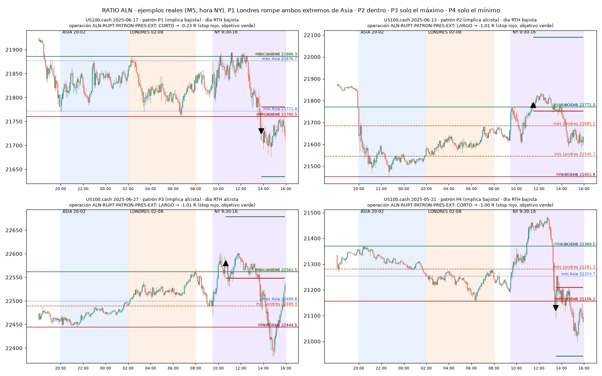
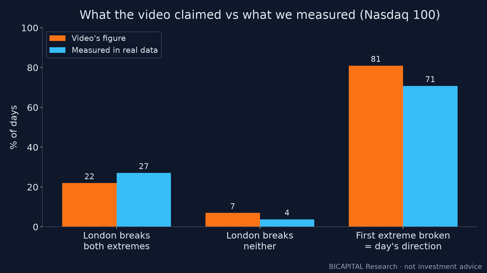
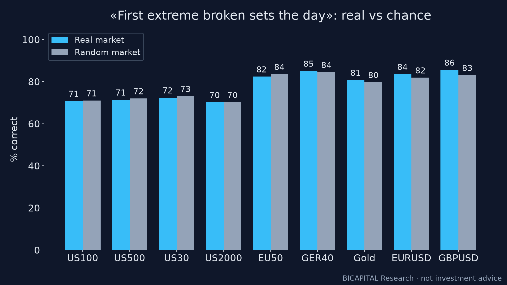
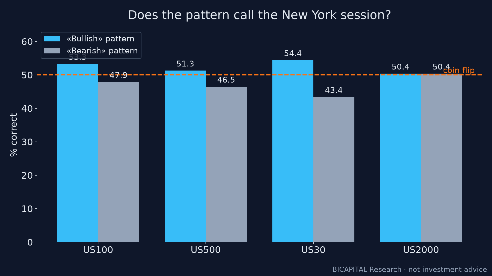
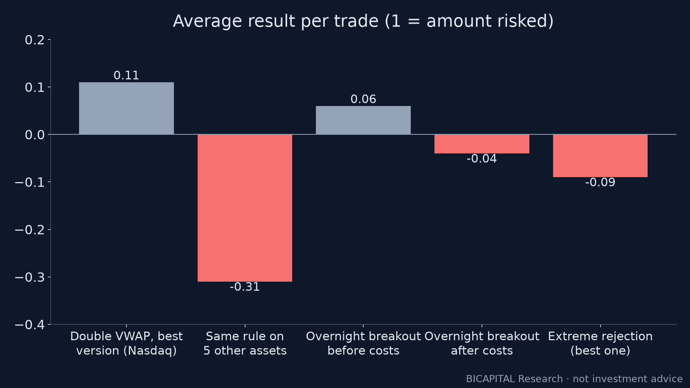

# Two viral short-video strategies, checked with data

*One promised to read the day from the Asia and London range; the other, to profit from two average-price lines. We measured their numbers: they do not hold and no rule won after costs.*

Short trading videos have something in common: round, confident numbers. «81 % of the time this happens». «This pattern shows up on 7 % of days and almost never fails». They sound like science. But has anyone checked them?

We picked two strategies that circulate widely in short videos. We will not say whose they are, because this is not about people, it is about ideas. We turned them into exact rules and measured them with several years of data in nine markets: four US indices, two European ones, gold and two currency pairs.

## Strategy 1: the overnight range

For a New York trader, the night has two parts: the **Asian** session (20:00 to 02:00, New York time) and the **London** session (02:00 to 08:00). Each leaves a high and a low. The strategy classifies the day by what London does with the Asian box:

- **Pattern 1:** London breaks both sides of the Asian box.
- **Pattern 2:** London breaks neither; it stays inside.
- **Pattern 3:** it only breaks the high. According to the video, a bullish day.
- **Pattern 4:** it only breaks the low. According to the video, a bearish day.

Then, during the New York session, you trade when price tests an overnight extreme, either breaking it or bouncing off it.

## Strategy 2: the double VWAP

The **VWAP** is the average price at which trading has happened, giving more weight to busier moments. Think of it as the average price of the whole market's shopping basket. The strategy uses two: one starting at 18:00 (the day's) and one starting at 9:30 (New York's). When they are apart and a candle closes beyond New York's VWAP, the target would be the day's VWAP.

**How to read the chart:** four real Nasdaq 100 days, one per pattern (labels in Spanish). The coloured bands are the sessions: blue Asia, orange London, purple New York. The horizontal lines mark the overnight highs and lows. The triangles are the strategy's entries; the red line is the stop and the green one the target. In these four examples, three trades lost a full unit of risk and the other lost a bit less.

## How we built chance

For each market we created a «random walk»: an invented price that moves with candles the same size as the real ones, but with the direction decided at random, like flipping a coin on each candle. That invented market also has Asia, London, extremes and patterns. If a number comes out the same in the real and the invented market, it says nothing about the market: it is geometry.

## Result 1: the video's numbers do not hold

**How to read the chart:** orange is what the video said; blue, what we measured on the Nasdaq 100. The video said London breaks both sides on 22 % of days: we measured 27.1 % (and chance gives 29.0 %). It said it stays inside 7 % of the time: we measured 3.8 % (36 days in four years). And it said the first extreme New York breaks sets the day's direction 81 % of the time: the closest definition gives 70.8 %.

One number did seem to hold: on pattern 2 days, the Nasdaq 100 broke the overnight high 91.7 % of the time (the video said 81 %). But that was only 36 days. On other indices it came out at 63 % and 67 %, below what happens on any ordinary day. With so few days, a high number can be pure luck.

## Result 2: «the first extreme sets the day» is geometry

**How to read the chart:** in each market, the blue bar is how often the first overnight extreme New York breaks matches the day's direction. The grey one is the same in the invented market. They are almost identical in all nine: for example, 70.8 % vs 71.0 % on the Nasdaq 100, or 83.6 % vs 81.9 % on euro-dollar.

Why so accurate, if it is chance? Because if price breaks the high first, it is already going up. It is like saying whoever leads halfway through a race usually leads at the end: true, but it tells you nothing you did not already know.

## Result 3: the bullish and bearish patterns miss

**How to read the chart:** the blue bar is the hit rate of the «bullish» pattern (only breaks the high); the grey one, the «bearish» pattern. The orange line is a coin's 50 %. The bullish one is right between 50.4 % and 54.4 %. The bearish one, between 43.4 % and 50.4 %: worse than a coin. Overall, the direction each pattern «implies» is right on 49 % to 52 % of days.

## Result 4: with costs, it does not pay

With the double VWAP, price reached the day's VWAP before moving the same distance against you between 53 % and 62 % of the time. Sounds good, but the same happens WITHOUT the video's entry candle. The candle adds nothing. And half the time price does not get there before the close.

**How to read the chart:** we measure in «risk units»: 1 means winning as much as you risk. The best double VWAP version on the Nasdaq made +0.11 per trade, but with only 218 trades in four years, and the range of doubt runs from −0.17 to +0.42. It also does not beat entering in a random direction, and on five other markets the same rule gives −0.31. The overnight breakout makes +0.06 before costs and −0.04 after: costs eat it up. Bouncing off the extreme always loses, between −0.09 and −0.20.

In total, 0 of 32 rules passed every check.

These results will be recalculated with corrected spread data; we will publish the update.

## My takeaways

- The videos' round numbers do not repeat in the data.
- A high number based on few days (36) can be luck. Check whether it repeats in other markets.
- «The first extreme sets the day» is right a lot, but chance is right just as often.
- None of the 32 rules won after costs.
- Before believing a number, ask: how many days? in which markets? and what does chance give?

*Educational content. Not investment advice.*
