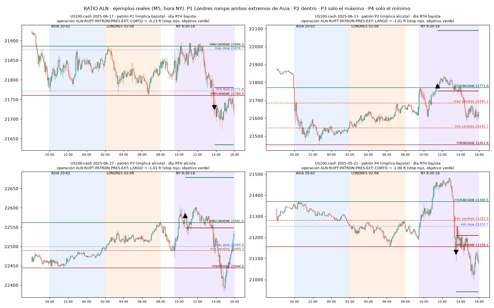
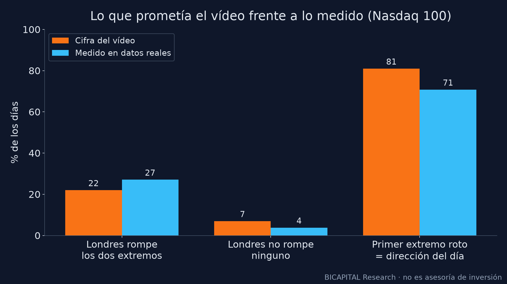
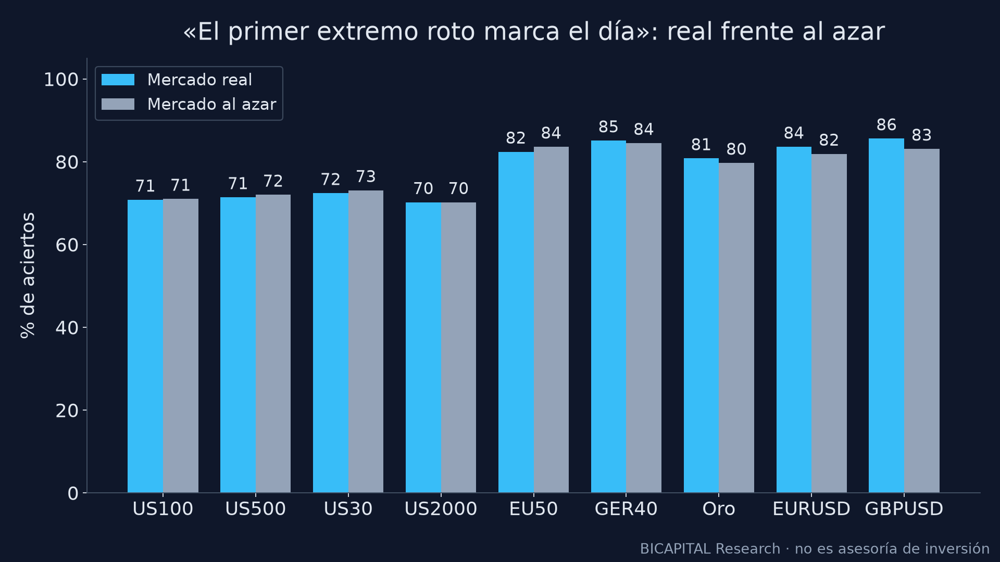
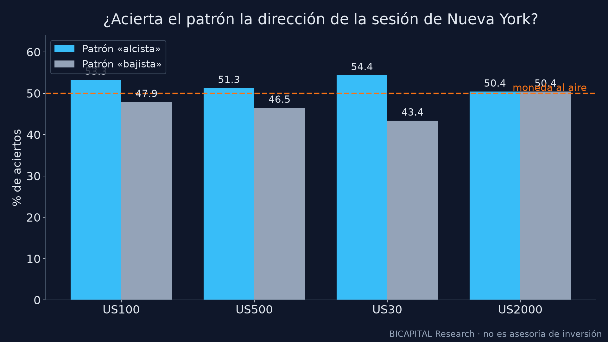
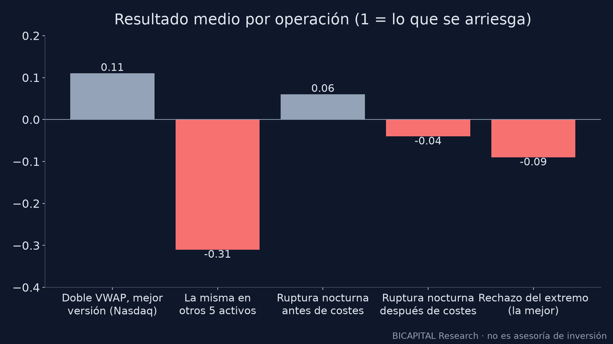

# Dos estrategias virales de vídeos cortos, comprobadas con datos

*Una prometía leer el día con el rango de Asia y Londres; otra, ganar con dos líneas de precio medio. Medimos sus cifras: no se confirman y ninguna regla ganó tras costes.*

Los vídeos cortos de trading tienen algo en común: cifras redondas y seguras. «El 81 % de las veces pasa esto». «Este patrón aparece el 7 % de los días y casi nunca falla». Suenan a ciencia. Pero, ¿alguien las ha comprobado?

Escogimos dos estrategias que circulan mucho en vídeos cortos. No vamos a decir de quién son, porque no se trata de las personas, sino de las ideas. Las tradujimos a reglas exactas y las medimos con datos de varios años en nueve mercados: cuatro índices de EE. UU., dos europeos, oro y dos parejas de divisas.

## Estrategia 1: el rango de la noche

La noche, para un trader de Nueva York, tiene dos partes: la sesión de **Asia** (de 20:00 a 02:00, hora de Nueva York) y la de **Londres** (de 02:00 a 08:00). Cada una deja un máximo y un mínimo. La estrategia clasifica el día según lo que hace Londres con la caja de Asia:

- **Patrón 1:** Londres rompe los dos lados de la caja de Asia.
- **Patrón 2:** Londres no rompe ninguno; se queda dentro.
- **Patrón 3:** solo rompe el máximo. Según el vídeo, día alcista.
- **Patrón 4:** solo rompe el mínimo. Según el vídeo, día bajista.

Luego, en la sesión de Nueva York, se opera cuando el precio prueba un extremo de la noche, ya sea rompiéndolo o rebotando en él.

## Estrategia 2: el doble VWAP

El **VWAP** es el precio medio al que se ha negociado, dando más peso a los momentos con más volumen. Es como el precio medio de la cesta de la compra de todo el mercado. La estrategia usa dos: uno que empieza a las 18:00 (el del día) y otro que empieza a las 9:30 (el de Nueva York). Cuando están separados y una vela cierra al otro lado del VWAP de Nueva York, el objetivo sería ir hasta el VWAP del día.

**Cómo leer el gráfico:** son cuatro días reales del Nasdaq 100, uno por patrón. Las franjas de color son las sesiones: azul Asia, naranja Londres, violeta Nueva York. Las líneas horizontales marcan los máximos y mínimos de la noche. Los triángulos son las entradas de la estrategia; la línea roja, el stop, y la verde, el objetivo. En estos cuatro ejemplos, tres operaciones perdieron una unidad completa de riesgo y la otra perdió un poco menos.

## Cómo fabricamos el azar

Para cada mercado creamos un «paseo aleatorio»: un precio inventado que se mueve con velas del mismo tamaño que las reales, pero con la dirección decidida al azar, como lanzar una moneda en cada vela. En ese mercado inventado también hay Asia, Londres, extremos y patrones. Si una cifra sale igual en el real y en el inventado, no dice nada del mercado: es geometría.

## Resultado 1: las cifras del vídeo no se confirman

**Cómo leer el gráfico:** naranja es lo que decía el vídeo; azul, lo que medimos en el Nasdaq 100. El vídeo decía que Londres rompe los dos lados el 22 % de los días: medimos 27,1 % (y el azar da 29,0 %). Decía que se queda dentro el 7 %: medimos 3,8 % (36 días en cuatro años). Y decía que el primer extremo que rompe Nueva York marca la dirección del día el 81 %: la definición más cercana da 70,8 %.

Hubo una cifra que sí pareció cumplirse: en los días del patrón 2, el Nasdaq 100 rompió el máximo de la noche el 91,7 % de las veces (el vídeo decía 81 %). Pero eran solo 36 días. En otros índices salió 63 % y 67 %, por debajo de lo que pasa en un día cualquiera. Con tan pocos días, una cifra alta puede ser pura suerte.

## Resultado 2: «el primer extremo marca el día» es geometría

**Cómo leer el gráfico:** en cada mercado, la barra azul es cuántas veces el primer extremo de la noche que rompe Nueva York coincide con la dirección del día. La gris es lo mismo en el mercado inventado. Son casi idénticas en los nueve: por ejemplo, 70,8 % frente a 71,0 % en el Nasdaq 100, o 83,6 % frente a 81,9 % en el euro-dólar.

¿Por qué acierta tanto, si es azar? Porque si el precio rompe primero el máximo, es que ya está subiendo. Es como decir que quien va primero a mitad de carrera suele ir delante al final: es cierto, pero no te dice nada que no sepas ya.

## Resultado 3: los patrones alcista y bajista no aciertan

**Cómo leer el gráfico:** la barra azul es el acierto del patrón «alcista» (solo rompe el máximo); la gris, el del patrón «bajista». La línea naranja es el 50 % de una moneda. El alcista acierta entre el 50,4 % y el 54,4 %. El bajista, entre el 43,4 % y el 50,4 %: peor que una moneda. En conjunto, la dirección que «implica» cada patrón acierta entre el 49 % y el 52 % de los días.

## Resultado 4: con costes, no paga

En el doble VWAP, el precio llegó al VWAP del día antes de alejarse lo mismo en contra entre el 53 % y el 62 % de las veces. Parece bueno, pero pasa lo mismo SIN la vela de entrada del vídeo. La vela no añade nada. Y la mitad de las veces el precio no llega antes del cierre.

**Cómo leer el gráfico:** lo medimos en «unidades de riesgo»: 1 es ganar lo mismo que arriesgas. La mejor versión del doble VWAP en el Nasdaq ganó +0,11 por operación, pero con solo 218 operaciones en cuatro años, y el margen de duda va de −0,17 a +0,42. Además, no supera a entrar en una dirección al azar, y en otros cinco mercados la misma regla da −0,31. La ruptura de la noche gana +0,06 antes de costes y −0,04 después: los costes se lo comen. Rebotar en el extremo pierde siempre, entre −0,09 y −0,20.

En total, 0 de 32 reglas pasaron todos los filtros.

Estos resultados se recalcularán con datos de spread corregidos; publicaremos la actualización.

## Qué me llevo

- Las cifras redondas de los vídeos no se repiten en los datos.
- Una cifra alta con pocos días (36) puede ser suerte. Mira si se repite en otros mercados.
- «El primer extremo marca el día» acierta mucho, pero el azar acierta lo mismo.
- Ninguna de las 32 reglas ganó tras costes.
- Antes de creer una cifra, pregunta: ¿cuántos días?, ¿en qué mercados?, ¿y cuánto da el azar?

*Contenido educativo. No es asesoría de inversión.*
