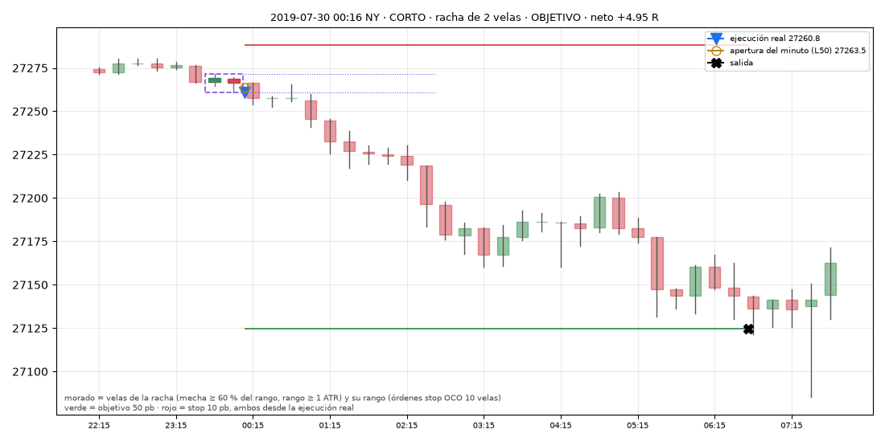
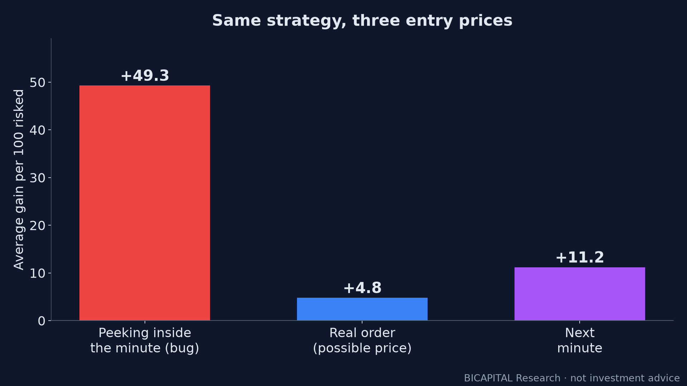
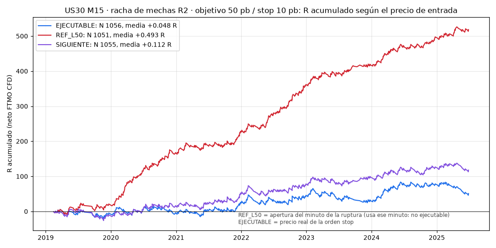
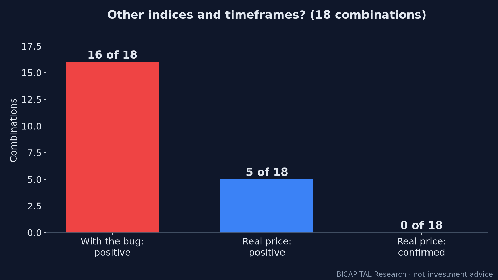
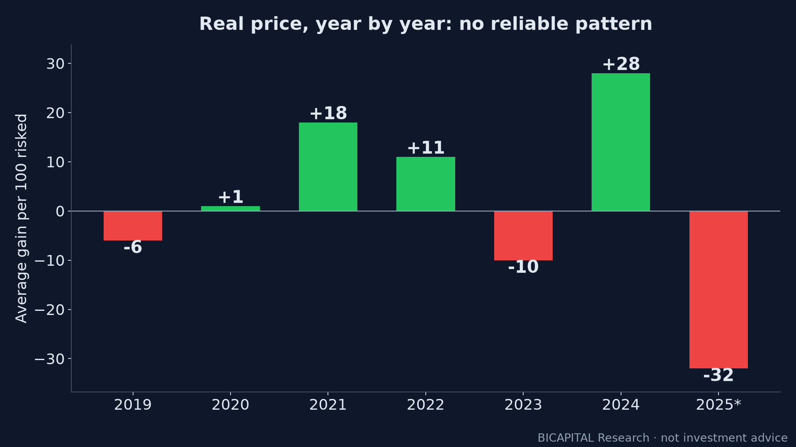

# The only "winner" in my search was a calculation error

*An index strategy seemed to earn almost half its risk on every trade. Once we checked the entry price, the edge nearly vanished. This is how you catch a false positive.*

There is a very dangerous moment in trading research: when something finally works. After many failed tests, a rule shows up that wins again and again. The temptation is to celebrate. The right move is to be suspicious.

This article tells a real case from our lab. A rule on stock indices was the only one that survived every filter of an earlier study. Before accepting it, we ran a study just to confirm it. The result: it was not a market edge. It was a mistake in how the entry price was calculated.

## The idea being tested

The rule looked at 15-minute charts of the Dow Jones index (labelled US30 in the study). It searched for a "wick streak": several candles in a row with long tails. A wick is the thin line sticking out of a candle. It shows the price reached that level but did not stay there.

When the streak appeared, the range of those candles was marked. If price broke the range upwards, the rule bought. If it broke downwards, it sold. This is done with a "stop order": an order that says "if price reaches this level, get in". It is like telling the doorman: "if the parcel arrives, open the door".

Each trade had a profit target and a loss limit. The report measures everything in units of risk: how much is won or lost per unit risked. Here we translate it as "per 100 risked".

## The bug: peeking inside the minute

The original version bought at the **opening price of the minute in which price broke the range**. It looks harmless. It is not.

Think of it like betting on a race when you already know, in that same minute, that your horse will cross the line. In that minute the program already "knew" price would cross the level. But a real stop order does not fill before the level. It fills at the level, or slightly worse.

The average gap between both prices was 33 per 100 risked on every trade. With such a tight loss limit (only 0.10% of the price), that gap was almost the whole "edge".

There was a second, more technical bug: the breakout minute had been stored with low precision and got rounded. Because of that, 24.6% of entries landed one minute **before** the breakout. Even more "future" in its favour.

**How to read the chart:** these are real 15-minute candles (labels in Spanish). The purple box marks the wick streak. The blue triangle is where a real order would have filled; the yellow circle is the opening price the buggy version used. Here the gap is only a few points, but since the loss limit is very tight, those few points weigh a lot on the result.

## What happens when the price is fixed

We replayed exactly the same trades with three different entry prices.

**How to read the chart:** each bar is the same strategy with a different entry price. The red one is the buggy version: it earned 49.3 per 100 risked. The blue one is the real order: only 4.8. The purple one enters at the open of the next minute: 11.2. The rule did not change; only one assumption about price did.

**How to read the chart:** each line adds up results trade after trade, from 2019 to mid-2025 (labels in Spanish). The red line (buggy) climbs non-stop, like a dream. The blue line (real order) stays almost flat, with ups and downs. Both use about 1,050 trades. A line as pretty as the red one should trigger alarms, not hope.

## Does it work on other indices?

A real edge usually shows up, at least a bit, in similar markets. We tested 18 combinations of indices and timeframes.

**How to read the chart:** with the wrong price, 16 of 18 combinations came out as winners. With the real price, only 5 of 18 stayed positive, and none clearly enough to rule out luck. Something that "works everywhere" only with the bug is the typical fingerprint of a calculation error, not a market effect.

## Year by year and against chance

**How to read the chart:** each bar is one year using the real price. Green is positive, red is negative. There are good years (2024: +28 per 100) and bad ones (first half of 2025: −32). Only 4 of 7 years were positive. There is no pattern you can trust.

We also compared it with chance. How is chance built here? We take the same times and the same entry prices, but decide whether to buy or sell by flipping a coin. We repeat this many times and look at what pure luck produces. The rule with the real price did not stand apart from those coins as clearly as we required in advance.

Another test was even clearer: entering a few candles earlier or later, **with no breakout at all**, gave between 7 and 10 per 100. That is equal to or more than the rule (4.8). The streak breakout added nothing.

## What we decided

The rule is not kept. It does not move to the next phase. More importantly: all earlier results that used the same way of calculating the entry are now flagged as "not executable".

This is not a failure. It is exactly what a good method is for: so that you find the error yourself, not the market with real money.

## What I take away

- If a results curve rises too beautifully, check the entry price first. It is the most common and most expensive mistake.
- A real stop order fills at the level or worse, never before. Any simulation that assumes otherwise is peeking at the future.
- A real edge survives small changes. If it disappears when one calculation detail changes, it was not an edge.
- Always compare with chance. If entering at any random moment gives the same, the signal adds nothing.

*Educational content. Not investment advice.*
