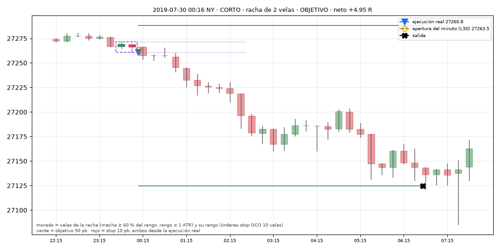
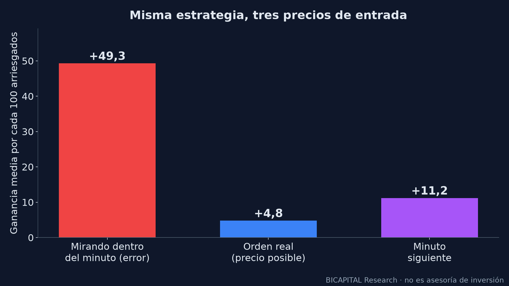
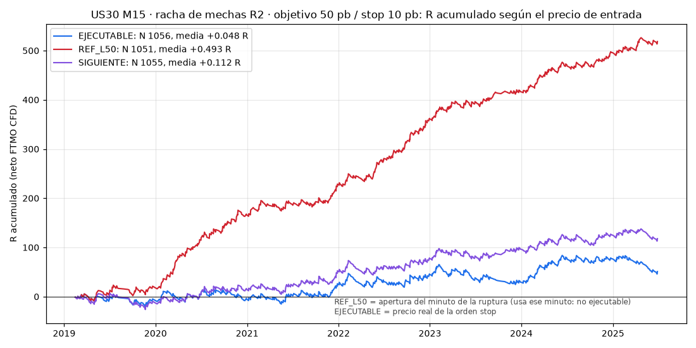
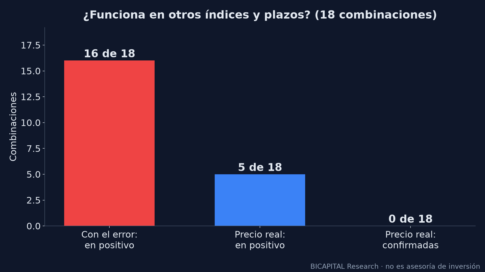
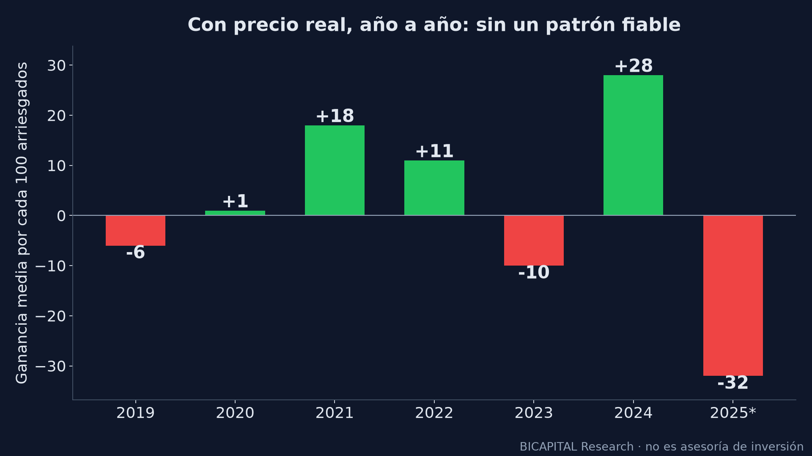

# El único «ganador» de mi búsqueda era un error de cálculo

*Una estrategia en índices parecía ganar casi media apuesta por operación. Al revisar el precio de entrada, la ventaja casi desapareció. Así se caza un falso positivo.*

Hay un momento muy peligroso en la investigación de trading: cuando por fin algo funciona. Después de muchísimas pruebas sin éxito, aparece una regla que gana una y otra vez. La tentación es celebrarlo. Lo correcto es sospechar.

Este artículo cuenta un caso real de nuestro laboratorio. Una regla sobre índices bursátiles fue la única que sobrevivió a todos los filtros de un estudio anterior. Antes de darla por buena, hicimos un estudio solo para confirmarla. El resultado: no era una ventaja del mercado. Era un error en cómo se calculaba el precio de entrada.

## La idea que se estaba probando

La regla miraba gráficos de 15 minutos del índice Dow Jones (en el estudio aparece como US30). Buscaba una «racha de mechas»: varias velas seguidas con colas largas. Una mecha es la línea fina que sale de una vela: indica que el precio llegó hasta allí, pero no se quedó.

Cuando aparecía esa racha, se marcaba el rango de esas velas. Si el precio rompía el rango por arriba, se compraba. Si lo rompía por abajo, se vendía. Esto se hace con una «orden stop»: una orden que dice «si el precio llega a este nivel, entra». Es como dejar dicho al portero: «si llega el paquete, ábrele la puerta».

Cada operación tenía un objetivo de ganancia y un límite de pérdida. En el informe se mide todo en unidades de riesgo: cuánto se gana o se pierde por cada unidad arriesgada. Aquí lo traduciremos a «por cada 100 arriesgados».

## El error: mirar dentro del minuto

La versión original compraba al precio de **apertura del minuto en que el precio rompía el rango**. Parece inocente. No lo es.

Piénsalo así: es como apostar a una carrera sabiendo ya, en ese mismo minuto, que tu caballo va a cruzar la línea. En ese minuto el programa ya «sabía» que el precio iba a cruzar el nivel. Pero una orden stop real no se llena antes del nivel. Se llena en el nivel, o un poco peor.

La diferencia media entre ambos precios era de 33 por cada 100 arriesgados en cada operación. Con un límite de pérdida tan pequeño (solo 0,10 % del precio), esa diferencia era casi toda la «ventaja».

Había además un segundo fallo, más técnico: el minuto de ruptura se había guardado con poca precisión y se redondeaba. Por eso un 24,6 % de las entradas caía un minuto **antes** de la ruptura. Es decir, todavía más «futuro» a su favor.

**Cómo leer el gráfico:** son velas reales de 15 minutos. El recuadro morado marca la racha de mechas. El triángulo azul es dónde se habría llenado una orden real; el círculo amarillo, el precio de apertura que usaba la versión con error. En este ejemplo la diferencia es de pocos puntos, pero como el límite de pérdida es muy estrecho, esos pocos puntos pesan mucho en el resultado.

## Lo que pasa al corregir el precio

Repetimos exactamente las mismas operaciones con tres precios de entrada distintos.

**Cómo leer el gráfico:** cada barra es la misma estrategia con un precio de entrada distinto. La roja es la versión con error: ganaba 49,3 por cada 100 arriesgados. La azul es la orden real: solo 4,8. La morada entra al abrir el minuto siguiente: 11,2. La regla no cambió; solo cambió una suposición sobre el precio.

**Cómo leer el gráfico:** cada línea suma los resultados operación tras operación, de 2019 a mediados de 2025. La roja (con error) sube sin parar, como un sueño. La azul (orden real) se queda casi plana, con subidas y bajadas. Las dos usan unas 1.050 operaciones. Una línea tan bonita como la roja debería encender alarmas, no ilusión.

## ¿Funciona en otros índices?

Una ventaja real suele aparecer, al menos algo, en mercados parecidos. Probamos 18 combinaciones de índices y plazos.

**Cómo leer el gráfico:** con el precio erróneo, 16 de 18 combinaciones salían ganadoras. Con el precio real, solo 5 de 18 quedaban en positivo, y ninguna con suficiente claridad para descartar la suerte. Que algo «funcione en todas partes» solo con el error es la huella típica de un fallo de cálculo, no de un efecto del mercado.

## Año a año y frente al azar

**Cómo leer el gráfico:** cada barra es un año con el precio real. Verde es positivo y rojo, negativo. Hay años buenos (2024: +28 por cada 100) y años malos (primera mitad de 2025: −32). Solo 4 de 7 años fueron positivos. No hay un patrón en el que se pueda confiar.

También lo comparamos con el azar. ¿Cómo se construye el azar aquí? Se toman las mismas horas y los mismos precios de entrada, pero se decide comprar o vender lanzando una moneda. Se repite muchas veces y se mira qué resultados da la pura suerte. La regla con precio real no se separó de esas monedas con la claridad que exigimos de antemano.

Otra prueba fue aún más clara: entrar unas velas antes o después, **sin ninguna ruptura**, daba entre 7 y 10 por cada 100. Es igual o más que la regla (4,8). La ruptura de la racha no aportaba nada.

## Qué decidimos

No se guarda la regla. No pasa a la siguiente fase. Y algo más importante: todos los resultados de estudios anteriores que usaban esa misma forma de calcular la entrada se marcan como «no ejecutables».

No es un fracaso. Es justo para lo que sirve un buen método: para que el error lo encuentre uno mismo, y no el mercado con dinero real.

## Qué me llevo

- Si una curva de resultados sube demasiado bonita, revisa primero el precio de entrada. Es el error más común y el más caro.
- Una orden stop real se llena en el nivel o peor, nunca antes. Cualquier simulación que suponga otra cosa está mirando el futuro.
- Una ventaja real resiste pequeños cambios. Si desaparece al cambiar un detalle del cálculo, no era ventaja.
- Compara siempre con el azar. Si entrar en cualquier momento da lo mismo, la señal no aporta.

*Contenido educativo. No es asesoría de inversión.*
