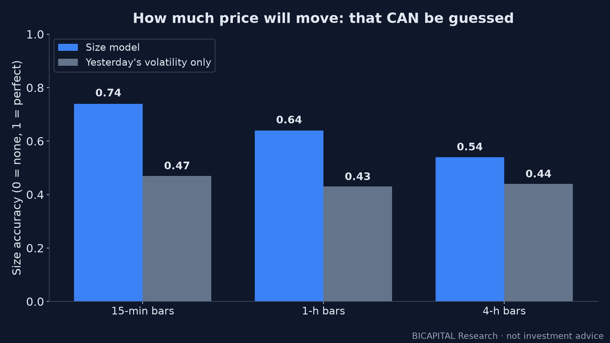
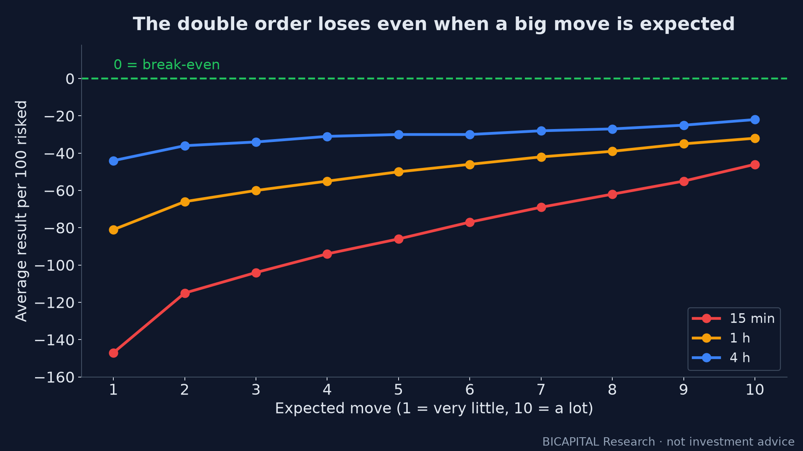
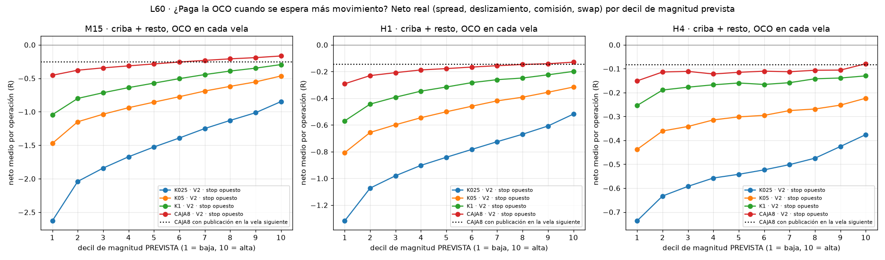
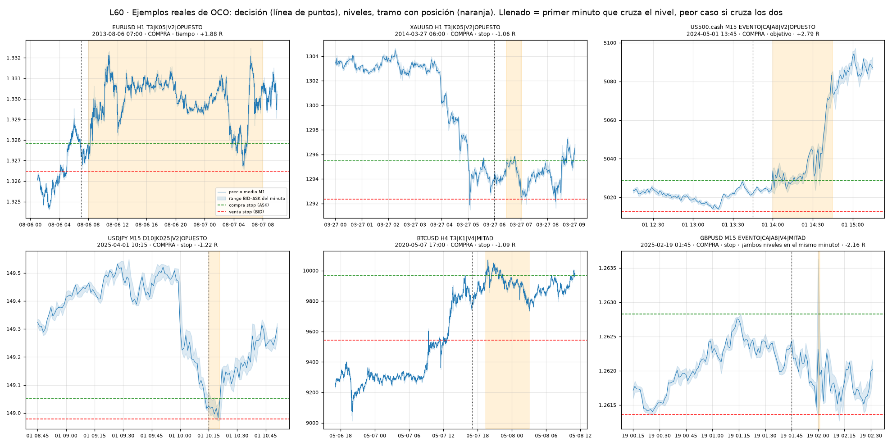
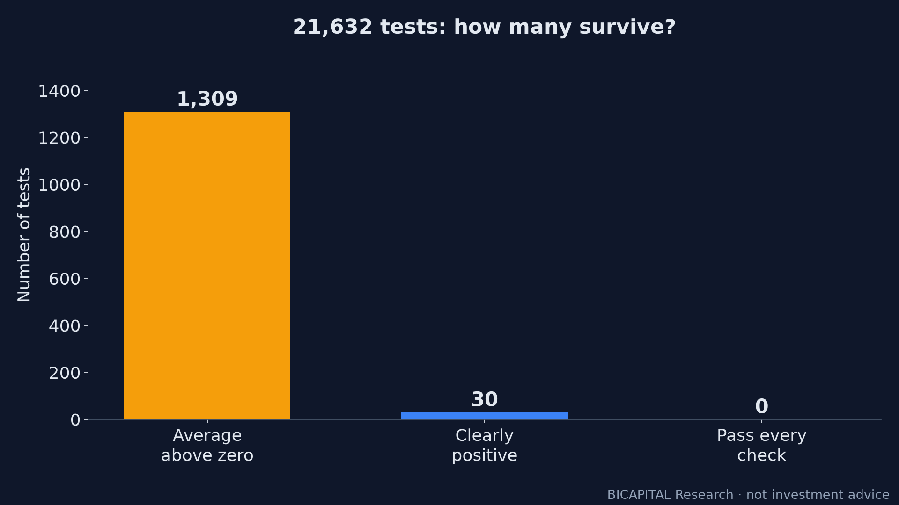

# "It will move, I don't know which way": the double order doesn't pay

*Guessing how much price will move works quite well. Making money from it, with a buy order above and a sell order below, does not. We checked it across 21,632 tests.*

You have surely heard it: "I don't know if it will go up or down, but it will move hard". It happens before a big economic release or after very quiet days. And there is a way of trading designed exactly for that: the double order.

In this lab we tested it very carefully. The conclusion is clear: the first half of the idea is true, the second half is not.

## What the double order is

You place two orders at once. One to buy a little above the current price. Another to sell a little below. The first one triggered wins, and the other one is cancelled. It is called OCO ("one cancels the other").

An everyday example: you wait at a stop served by two bus lines, one going north and one going south. You don't care which. You take the first one that arrives. The idea is that if price "shoots off", the side doesn't matter: you will catch it.

Each trade also had a loss limit and a profit target. The report measures everything in units of risk. Here we translate it as "per 100 risked".

## Step 1: can we guess how much it will move?

Yes. We built a model that, at every candle (15 minutes, 1 hour or 4 hours), estimates how much price will move over the next 4 candles. The model only learns from the past and is retrained every 6 months. It never sees the future.

**How to read the chart:** the score goes from 0 (gets nothing right) to 1 (always gets the order of moves right, from small to large). Blue bars are our model; grey bars are a simple rule that only looks at the volatility (how much price moved) of the last day. The model scores 0.74 on 15-minute candles, 0.64 on 1 hour and 0.54 on 4 hours. Always better than the simple rule. Predicting the size of the move works.

## Step 2: does the double order pay when a big move is expected?

Here is the problem. To measure it honestly, we simulated execution as in real life:

- The order fills in the first minute in which the buy or sell price crosses the level.
- If price jumps past the level, it fills at the worse price.
- Slippage is added: the small gap between the price you ask for and the one you get, larger in news minutes.
- The spread between buy and sell price, commission and overnight cost are paid.
- If price crosses both levels in the same minute, the worse side is counted.

We sorted all candles into 10 groups, from the one expecting the least movement (1) to the one expecting the most (10).

**How to read the chart:** each line is a candle size. The further right, the more movement was expected. The dashed green line is "break-even". All three lines rise to the right: when more movement is expected, you lose less. But none reaches zero. Even in the biggest-move group you lose: 46 per 100 risked on 15 minutes, 32 on 1 hour and 22 on 4 hours.

**How to read the chart:** this is the original lab chart (labels in Spanish), with four ways of placing the two orders (closer to or further from price, or at the extremes of the last 8 candles). Every curve sits below zero on all three timeframes. The one closest to zero (red) uses the extremes of the last candles, but it does not cross to the positive side either. The dotted line is the same right before a major economic release: it does not win either.

## What it looks like in real trades

**How to read the chart:** each panel is a real case. The dashed green line is the buy order; the red one, the sell order. The orange area is the time the trade was open. Top right, price breaks out strongly and the trade wins. But bottom right, price crosses both levels in the same minute, a whipsaw: that is the worst case and the loss is bigger than planned. Those whipsaws are common exactly when there is a lot of movement.

## 21,632 tests, none approved

We tested 125 markets (currencies, indices, commodities, stocks and crypto), data from 2010 to mid-2025, three timeframes, 24 order variants and three triggers: a big expected move, a fairly high expected move, or an economic release in the next candle.

**How to read the chart:** out of 21,632 tests, 1,309 made something on average. Only 30 did so with some clarity. And none passed every filter. When you run so many tests, some come out well by luck alone, just as when you toss thousands of coins one of them will land ten heads in a row.

How did we check for luck? One test flips the direction of each trade at random, like tossing a coin, and checks whether the real result stands apart from those coins. Another asks: "if I take the best of all tests, is it better than the best of many random searches?". For the best test, the answer was no: it was what you would expect by pure chance.

An example: the best variant, gold against the euro on 4-hour candles, seemed to make 33 per 100. But it had only 132 trades in 15 years and failed the multiple-testing filter. And the basket of the main markets, with thousands of trades, lost in every version.

## Why it doesn't work

The idea fails on direction, not on size. The double order needs price to **keep going** in that direction after triggering. But price often crosses a level and turns around. On top of that, entering right when price jumps is expensive: slippage, spread and whipsaws eat what little is left.

## What I take away

- Knowing how much price will move is not the same as knowing how to profit from it. The first can be predicted; the second, in these tests, cannot.
- The double order gets bad prices at the worst moment: when everything moves fast.
- If one test looks good among thousands, ask whether it beats the best of many random tests.
- The expected size is useful for something else: adjusting risk or avoiding very hectic moments.

*Educational content. Not investment advice.*
