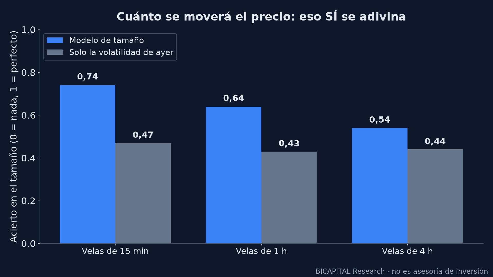
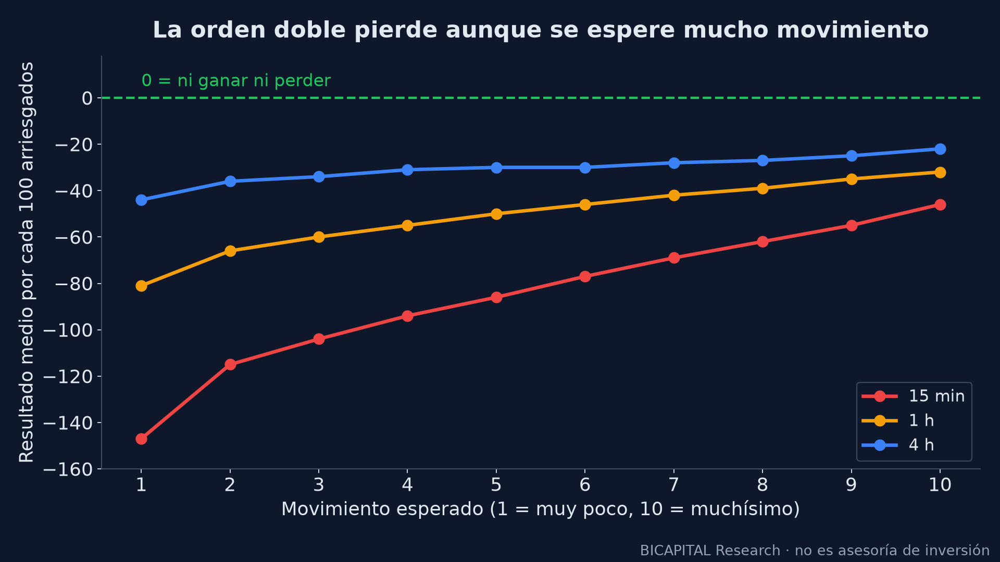
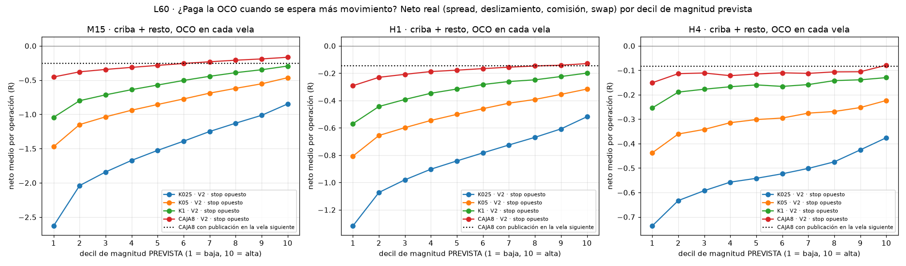
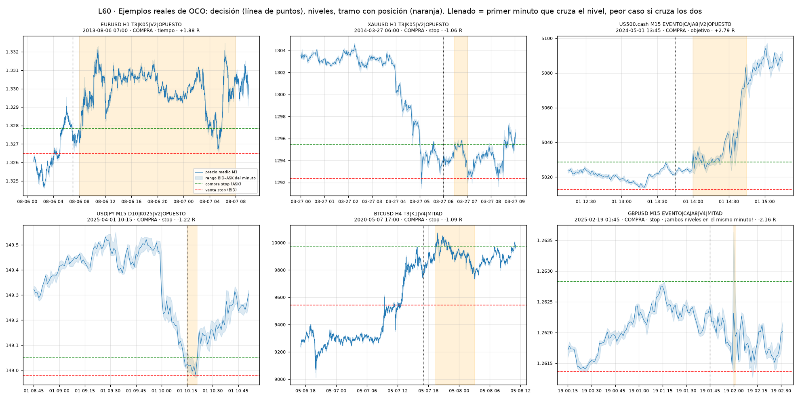
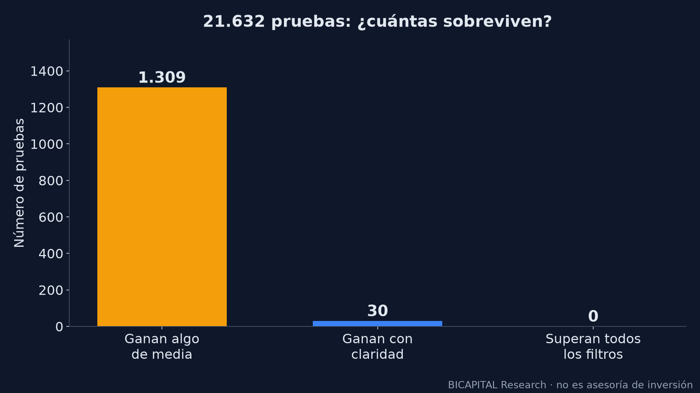

# «Se va a mover, no sé hacia dónde»: la orden doble no paga

*Adivinar cuánto se moverá el precio funciona bastante bien. Ganar dinero con eso, poniendo una orden de compra arriba y otra de venta abajo, no. Lo comprobamos en 21.632 pruebas.*

Seguro que lo has oído alguna vez: «no sé si va a subir o a bajar, pero se va a mover fuerte». Pasa antes de un dato económico importante o después de días muy tranquilos. Y existe una forma de operar pensada justo para eso: la orden doble.

En este laboratorio la pusimos a prueba con mucho cuidado. La conclusión es clara: la primera mitad de la idea es cierta, la segunda no.

## Qué es la orden doble

Se colocan dos órdenes a la vez. Una de compra un poco por encima del precio actual. Otra de venta un poco por debajo. La primera que se activa manda, y la otra se cancela. En inglés se llama OCO («una cancela a la otra»).

Un ejemplo cotidiano: esperas un autobús en una parada donde pasan dos líneas, una hacia el norte y otra hacia el sur. No te importa cuál. Subes al primero que llegue. La idea es que, si el precio «sale disparado», da igual el lado: lo vas a pillar.

Cada operación tenía también un límite de pérdida y un objetivo de ganancia. En el informe todo se mide en unidades de riesgo. Aquí lo traducimos a «por cada 100 arriesgados».

## Paso 1: ¿se puede adivinar cuánto se moverá?

Sí. Construimos un modelo que, en cada vela (de 15 minutos, 1 hora o 4 horas), estima cuánto se moverá el precio en las 4 velas siguientes. El modelo solo aprende del pasado y se vuelve a entrenar cada 6 meses. Nunca ve el futuro.

**Cómo leer el gráfico:** la nota va de 0 (no acierta nada) a 1 (acierta siempre el orden de los movimientos, de pequeño a grande). Las barras azules son nuestro modelo; las grises, una regla simple que solo mira la volatilidad (cuánto se movió el precio) del último día. El modelo saca 0,74 en velas de 15 minutos, 0,64 en 1 hora y 0,54 en 4 horas. Siempre mejor que la regla simple. Predecir el tamaño del movimiento funciona.

## Paso 2: ¿paga la orden doble cuando se espera mucho movimiento?

Aquí está el problema. Para medirlo de forma honesta, simulamos la ejecución como en la vida real:

- La orden se llena en el primer minuto en que el precio de compra o de venta cruza el nivel.
- Si el precio salta más allá del nivel, se llena al precio peor.
- Se suma un deslizamiento: la pequeña diferencia entre el precio que pides y el que te dan, mayor en minutos de noticias.
- Se paga el diferencial entre compra y venta (spread), comisión y coste de mantener la posición.
- Si en un mismo minuto el precio cruza los dos niveles, se cuenta el peor lado.

Ordenamos todas las velas en 10 grupos, del que menos movimiento esperaba (1) al que más (10).

**Cómo leer el gráfico:** cada línea es un tamaño de vela. Cuanto más a la derecha, más movimiento se esperaba. La línea verde discontinua es «ni ganar ni perder». Las tres líneas suben hacia la derecha: cuando se espera más movimiento, se pierde menos. Pero ninguna llega a cero. Incluso en el grupo de máximo movimiento se pierde: 46 por cada 100 arriesgados en 15 minutos, 32 en 1 hora y 22 en 4 horas.

**Cómo leer el gráfico:** es el gráfico original del laboratorio, con cuatro formas de colocar las dos órdenes (más cerca o más lejos del precio, o en los extremos de las 8 últimas velas). Todas las curvas están por debajo de cero en los tres plazos. La más cercana a cero (roja) usa los extremos de las últimas velas, pero tampoco cruza al lado positivo. La línea de puntos es lo mismo justo antes de una publicación económica importante: tampoco gana.

## Cómo se ve en operaciones reales

**Cómo leer el gráfico:** cada panel es un caso real. La línea verde discontinua es la orden de compra; la roja, la de venta. La zona naranja es el tiempo con la operación abierta. Arriba a la derecha, el precio sale con fuerza y la operación gana. Pero abajo a la derecha el precio cruza los dos niveles en el mismo minuto, un latigazo: es el peor caso y se pierde más de lo previsto. Esos latigazos son frecuentes justo cuando hay mucho movimiento.

## 21.632 pruebas, ninguna aprobada

Probamos 125 mercados (divisas, índices, materias primas, acciones y cripto), datos de 2010 a mediados de 2025, tres plazos, 24 variantes de la orden y tres disparadores: mucho movimiento esperado, movimiento algo alto o publicación económica en la vela siguiente.

**Cómo leer el gráfico:** de 21.632 pruebas, 1.309 ganaban algo de media. Solo 30 ganaban con cierta claridad. Y ninguna superó todos los filtros. Cuando se hacen tantas pruebas, algunas salen bien solo por suerte, igual que si lanzas miles de monedas alguna sacará diez caras seguidas.

¿Cómo comprobamos la suerte? Una de las pruebas cambia la dirección de cada operación al azar, como lanzando una moneda, y mira si el resultado real se separa de esas monedas. Otra pregunta: «si cojo la mejor de todas las pruebas, ¿es mejor de lo que daría la mejor de muchas búsquedas al azar?». Para la mejor prueba, la respuesta fue no: era lo que cabe esperar por pura casualidad.

Un ejemplo: la mejor variante, en oro frente al euro con velas de 4 horas, parecía ganar 33 por cada 100. Pero solo tenía 132 operaciones en 15 años y no pasó el filtro de multiplicidad. Y la cesta de los mercados principales, con miles de operaciones, perdía en todas sus versiones.

## Por qué no funciona

La idea falla por el lado de la dirección, no del tamaño. La orden doble necesita que, tras activarse, el precio **siga** en esa dirección. Pero muchas veces el precio cruza un nivel y se da la vuelta. Además, entrar justo cuando el precio salta sale caro: deslizamiento, spread y latigazos se comen lo poco que queda.

## Qué me llevo

- Saber cuánto se moverá el precio no es lo mismo que saber ganar con ello. Lo primero se predice; lo segundo, en estas pruebas, no.
- La orden doble paga precio malo en el peor momento: cuando todo se mueve rápido.
- Si una prueba sale bien entre miles, pregúntate si es mejor que la mejor de muchas pruebas al azar.
- El tamaño esperado sí sirve para otra cosa: ajustar el riesgo o evitar operar en momentos muy agitados.

*Contenido educativo. No es asesoría de inversión.*
