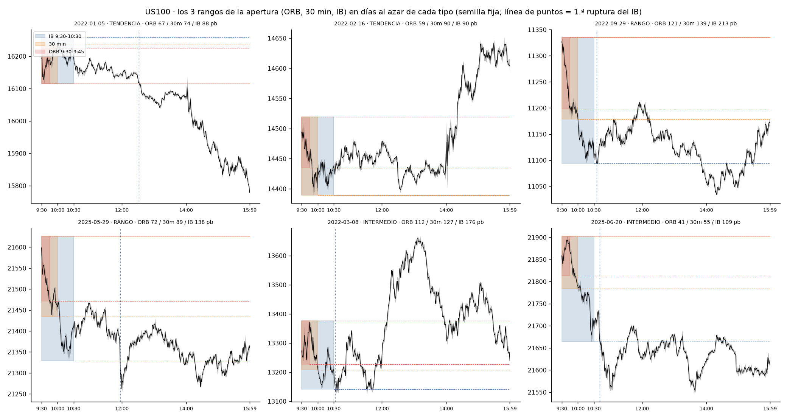
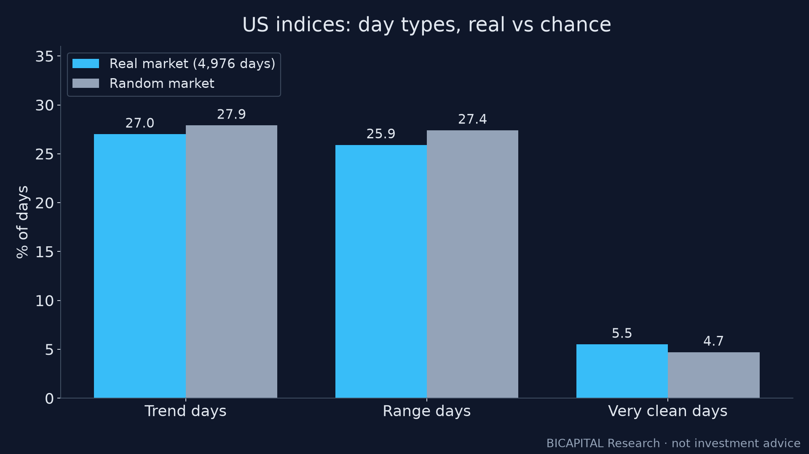
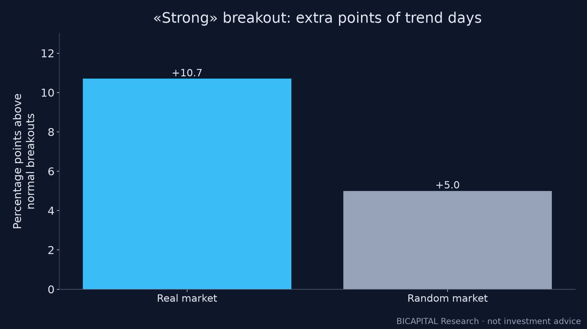
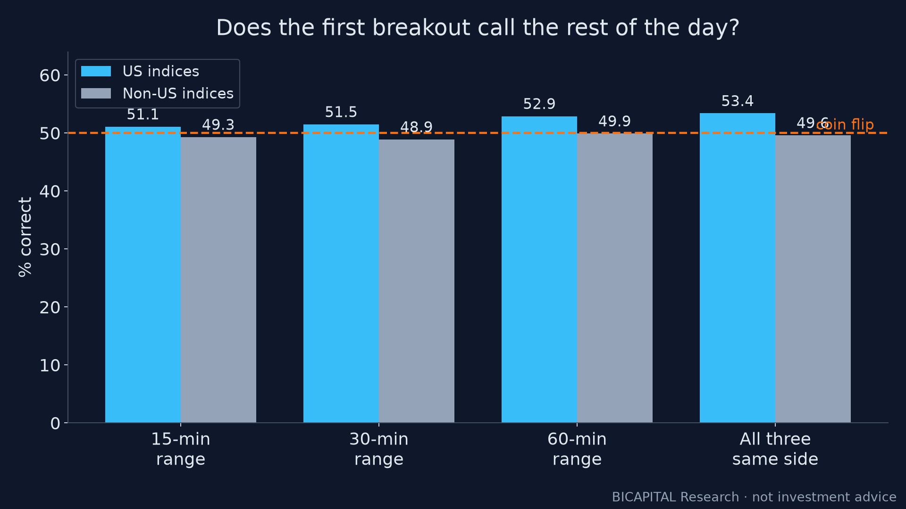
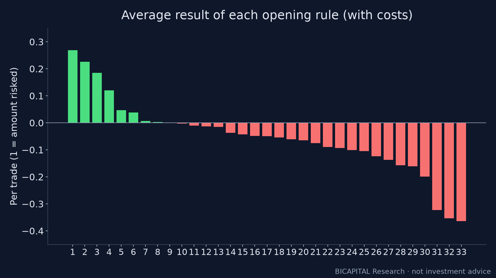

# The opening range and trend days: what the data says

*The opening range breakout is one of the most popular strategies. We measured it on eight indices and 34 rules: day types look random and no rule passed.*

The New York stock market opens at 9:30. During the first minutes price goes up and down looking for its place. Many traders draw a box with the high and low of that stretch: the **opening range**. The idea is simple: if price leaves the box through the top, you buy; through the bottom, you sell.

It is like watching a horse at the start of a race: does the one that jumps out first win? Sometimes yes. The question is whether it happens more often than pure chance would allow.

A widely viewed short video also suggested combining three boxes and telling «range» days (price stays inside) from «trend» days (it travels far in one direction). We checked it with data.

## The three boxes, explained

- **15-minute box** (9:30-9:45). The most classic one.
- **30-minute box** (9:30-10:00).
- **60-minute box** (9:30-10:30). In trading slang it is called the *initial balance*.

And two day types, defined before looking at the results:

- **Trend day:** price closes outside the 60-minute box and moves away from it by at least the box's own size.
- **Range day:** price closes inside the box and barely peeks outside.

**How to read the chart:** each panel is a real Nasdaq 100 day, from 9:30 to 16:00 (labels in Spanish). The three coloured boxes are the 15, 30 and 60-minute ranges. The dotted vertical line marks the first time price leaves the 60-minute box. Above each panel is the day type: two trend days («TENDENCIA»), two range days («RANGO») and two in between. Notice how, on some trend days, price first breaks one side and then heads to the other.

## How we built chance

For each index we built invented markets with the same amount of movement as the real one, minute by minute, but with the direction shuffled. If the real market has many more trend days than the invented one, the market «has intention». If it has the same, trend days are simple geometry: with that much movement, they happen on their own.

For direction we also used a matched chance: same index, same weekday and same level of market nervousness.

## Result 1: day types look like chance

**How to read the chart:** these are 4,976 days from four US indices. The blue bar is the real market; the grey one, the invented market. Trend days: 27.0 % real vs 27.9 % random. Range days: 25.9 % vs 27.4 %. Very clean days (price moves in almost a straight line): 5.5 % vs 4.7 %. They are almost the same. Knowing that «trend days exist» gives you no edge: there are as many as in a market without intention.

## Result 2: breaking out «with force» does not guarantee a trend

Many say that if the breakout is strong (big candle and lots of volume) the day will trend.

**How to read the chart:** in the US, when the breakout was strong, the day ended up trending 35.4 % of the time, vs 24.7 % for normal breakouts: 10.7 points more. Sounds like a lot. But in the invented market the same flag also adds 5.0 points, because a strong breakout already leaves price further away. Also, there were only 99 cases, and with so few the remaining difference may be luck. Outside the US, strong breakouts even produced slightly fewer trend days.

## Result 3: direction, almost a coin flip

**How to read the chart:** each pair of bars is one box. Blue is the hit rate on US indices; grey, outside the US. The orange line is the 50 % of a coin flip. In the US there is something small: the 60-minute box breakout was right 52.9 % of the time and, when all three boxes break on the same side, 53.4 %. That sits slightly above what chance gives (between 48.8 % and 51.6 %). Outside the US there is nothing: 48.9 % to 49.9 %.

That small edge in the US is worth about 2 cents per 100 dollars per trade (1.8 to 2.2 basis points). Now let us see whether it covers the costs.

## Result 4: 34 rules, none passes

We tested 34 rules fixed in advance: entering with an order at the breakout, waiting for confirmation, trading against the breakout, adding filters. We paid a broker's real costs and required a target of at least three times the risk.

**How to read the chart:** each bar is a rule, sorted from best to worst. We measure it in «risk units»: 1 means winning as much as you risk. Green is positive; red, negative. The first four look good (up to +0.269), but they have very few trades: between 78 and 122 over the whole period, fewer than one every two weeks. With so few, the range of doubt goes from losing to winning a lot. Rules with thousands of trades are almost all red. Trading against the breakout was the worst: between −0.32 and −0.36.

Final result: none of the 34 rules passed every check. And the comparison with chance says the best of the 34 is what you would expect to find by luck when testing so many.

These results will be recalculated with corrected spread data; we will publish the update.

## My takeaways

- Trend and range days appear in almost the same proportion as in a random market.
- Breaking out «with force» seems to announce a trend, but a good part of the effect also appears by chance.
- In the US there is a small direction hint after the 60-minute box, but it is too small to pay the costs.
- Out of 34 rules, none passed. The ones that look good have very few trades.
- The opening range is useful to understand the day. On its own, it is not a money-making system.

*Educational content. Not investment advice.*
