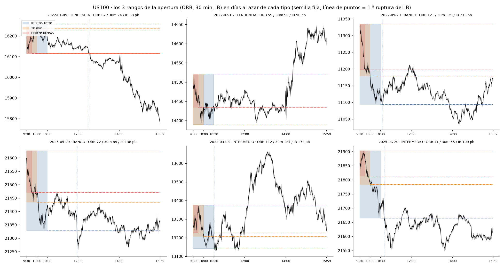
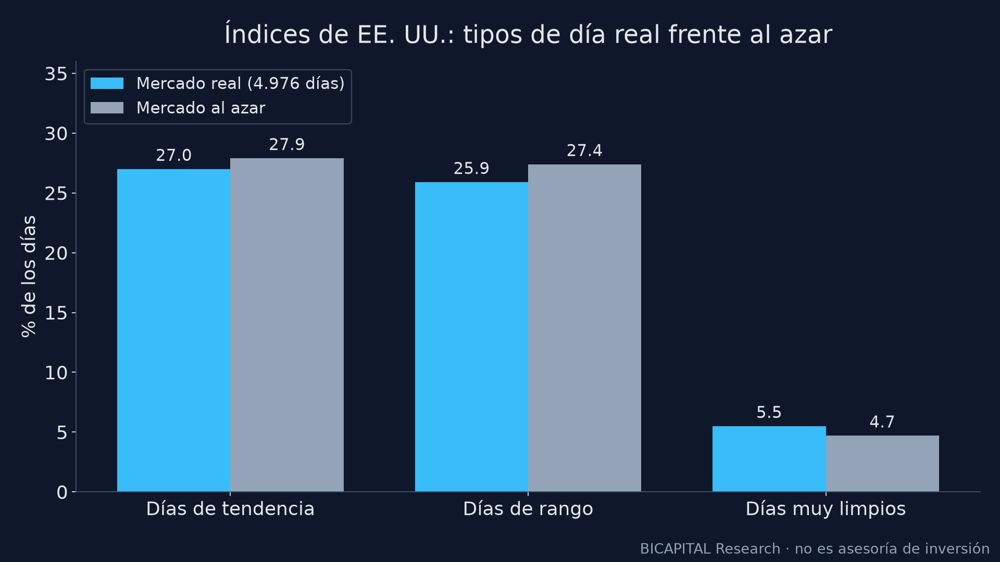
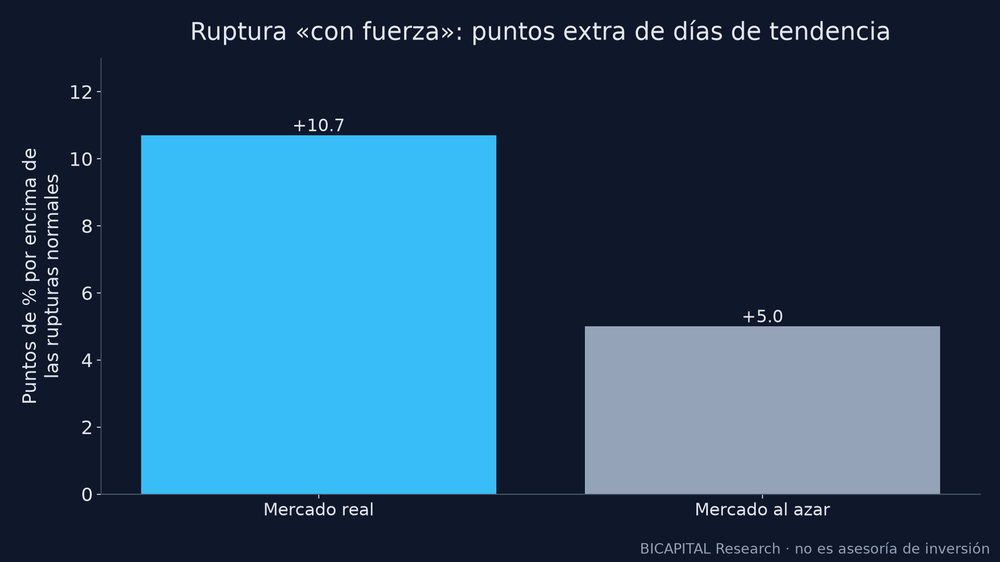
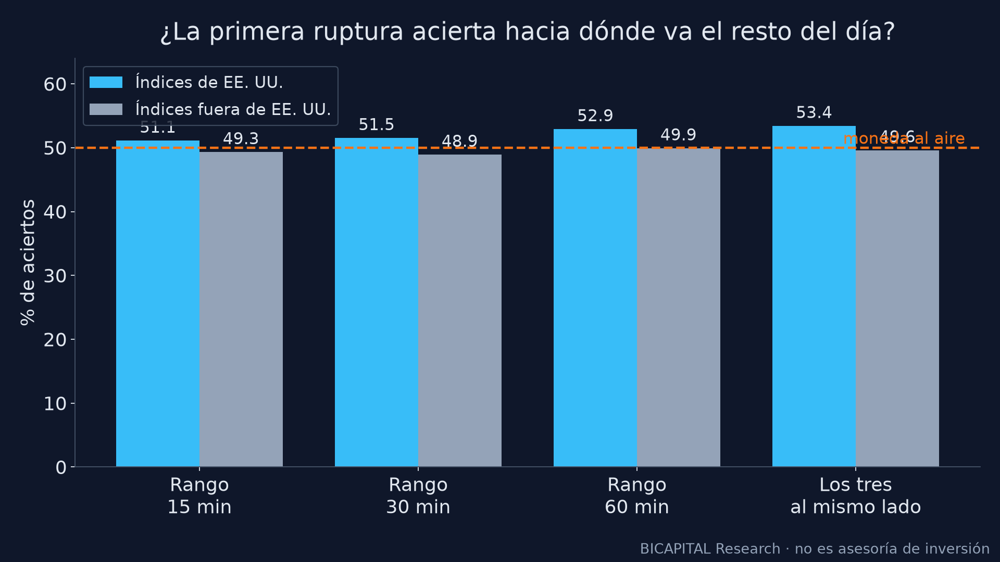
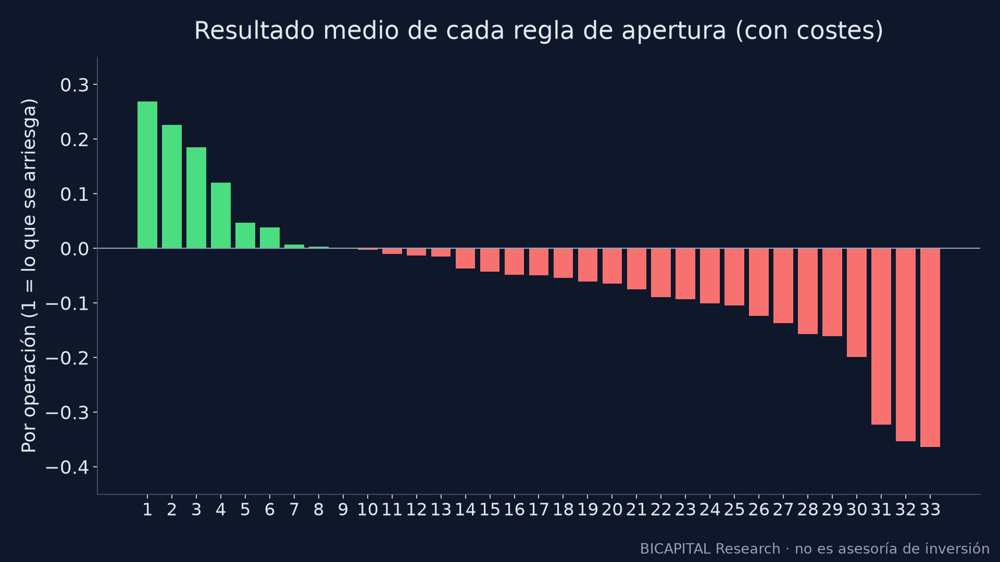

# El rango de apertura y los días de tendencia: lo que dicen los datos

*La ruptura del rango de los primeros minutos es de las estrategias más populares. La medimos en ocho índices y 34 reglas: los tipos de día salen como al azar y ninguna regla pasó.*

Abre la bolsa de Nueva York a las 9:30. Durante los primeros minutos el precio sube y baja buscando su sitio. Muchos traders dibujan una caja con el máximo y el mínimo de ese rato: es el **rango de apertura**. La idea es sencilla: si el precio sale de la caja por arriba, compras; si sale por abajo, vendes.

Es como ver a un caballo en la salida de una carrera: el que arranca primero, ¿gana la carrera? A veces sí. La pregunta es si pasa más a menudo de lo que pasaría por pura casualidad.

Un vídeo corto muy visto proponía además combinar tres cajas y distinguir días «de rango» (el precio se queda dentro) de días «de tendencia» (se va lejos en una dirección). Lo comprobamos con datos.

## Las tres cajas, explicadas

- **Caja de 15 minutos** (9:30-9:45). La más clásica.
- **Caja de 30 minutos** (9:30-10:00).
- **Caja de 60 minutos** (9:30-10:30). En la jerga se llama *initial balance*, «equilibrio inicial».

Y dos tipos de día, definidos antes de mirar los resultados:

- **Día de tendencia:** el precio cierra fuera de la caja de 60 minutos y se aleja de ella al menos lo mismo que mide la caja.
- **Día de rango:** el precio cierra dentro de la caja y apenas se asoma fuera.

**Cómo leer el gráfico:** cada recuadro es un día real del Nasdaq 100, de 9:30 a 16:00. Las tres cajas de colores son los rangos de 15, 30 y 60 minutos. La línea vertical de puntos marca la primera vez que el precio sale de la caja de 60 minutos. Arriba de cada recuadro pone el tipo de día: dos de tendencia, dos de rango y dos intermedios. Mira cómo, en algunos días de tendencia, el precio sale primero por un lado y luego se va al otro.

## Cómo fabricamos el azar

Para cada índice construimos mercados inventados que tienen el mismo tamaño de movimiento que el real, minuto a minuto, pero con la dirección barajada. Si en el mercado real hay muchos más días de tendencia que en el inventado, el mercado «tiene intención». Si hay los mismos, los días de tendencia son simple geometría: con ese nivel de movimiento, salen solos.

Para la dirección usamos además un azar emparejado: mismo índice, mismo día de la semana y mismo nivel de nerviosismo del mercado.

## Resultado 1: los tipos de día salen como al azar

**Cómo leer el gráfico:** son 4.976 días de cuatro índices de EE. UU. La barra azul es el mercado real; la gris, el inventado. Días de tendencia: 27,0 % real frente a 27,9 % al azar. Días de rango: 25,9 % frente a 27,4 %. Días muy limpios (el precio va casi en línea recta): 5,5 % frente a 4,7 %. Son casi iguales. Saber que «hay días de tendencia» no te da ventaja: salen tantos como en un mercado sin intención.

## Resultado 2: romper «con fuerza» no asegura tendencia

Muchos dicen que si la ruptura es fuerte (vela grande y mucho volumen) el día será de tendencia.

**Cómo leer el gráfico:** en EE. UU., cuando la ruptura fue fuerte, el día acabó en tendencia el 35,4 % de las veces, frente al 24,7 % de las rupturas normales: 10,7 puntos más. Parece mucho. Pero en el mercado inventado la misma bandera también da 5,0 puntos más, porque una ruptura fuerte ya deja el precio más lejos. Además, solo hubo 99 casos, y con tan pocos la diferencia restante puede ser suerte. Fuera de EE. UU., la ruptura fuerte dio incluso un poco menos de tendencia.

## Resultado 3: la dirección, casi una moneda

**Cómo leer el gráfico:** cada pareja de barras es una caja. La azul es el acierto en índices de EE. UU.; la gris, fuera de EE. UU. La línea naranja es el 50 % de una moneda al aire. En EE. UU. hay algo pequeño: la ruptura de la caja de 60 minutos acertó el 52,9 % y, cuando las tres cajas rompen al mismo lado, el 53,4 %. Eso queda un poco por encima de lo que da el azar (entre el 48,8 % y el 51,6 %). Fuera de EE. UU. no hay nada: 48,9 % a 49,9 %.

Ese pequeño acierto en EE. UU. equivale a unos 2 céntimos de cada 100 euros por operación (1,8 a 2,2 puntos básicos). Ahora veremos si alcanza para pagar los costes.

## Resultado 4: 34 reglas, ninguna pasa

Probamos 34 reglas fijadas de antemano: entrar con orden en la ruptura, esperar confirmación, operar al revés de la ruptura, añadir filtros. Pagamos los costes reales de un bróker y exigimos un objetivo de al menos tres veces el riesgo.

**Cómo leer el gráfico:** cada barra es una regla, ordenada de mejor a peor. Lo medimos en «unidades de riesgo»: 1 es ganar lo mismo que arriesgas. Verde es positivo; rojo, negativo. Las cuatro primeras parecen buenas (hasta +0,269), pero tienen muy pocas operaciones: entre 78 y 122 en todo el periodo, menos de una cada dos semanas. Con tan pocas, el margen de duda va desde perder hasta ganar mucho. Las reglas con miles de operaciones están casi todas en rojo. Operar al revés de la ruptura fue lo peor: entre −0,32 y −0,36.

Resultado final: ninguna de las 34 reglas pasó todos los filtros. Y la comparación con el azar dice que la mejor de las 34 es lo que esperarías encontrar por suerte al probar tantas.

Estos resultados se recalcularán con datos de spread corregidos; publicaremos la actualización.

## Qué me llevo

- Los días de tendencia y de rango salen casi en la misma proporción que en un mercado al azar.
- Romper «con fuerza» parece anunciar tendencia, pero buena parte del efecto también aparece en el azar.
- En EE. UU. hay una pista pequeña de dirección tras la caja de 60 minutos, pero es demasiado pequeña para pagar los costes.
- De 34 reglas, ninguna pasó. Las que parecen buenas tienen muy pocas operaciones.
- El rango de apertura es útil para entender el día. No es, por sí solo, un sistema que gane dinero.

*Contenido educativo. No es asesoría de inversión.*
