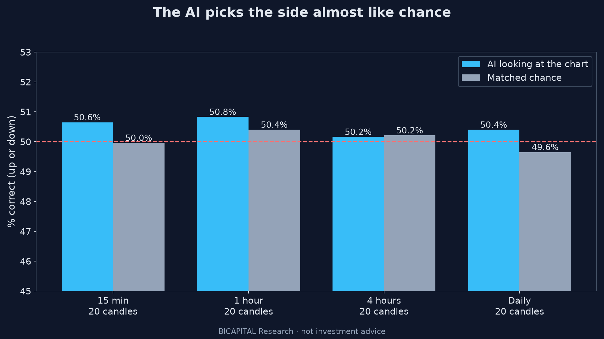
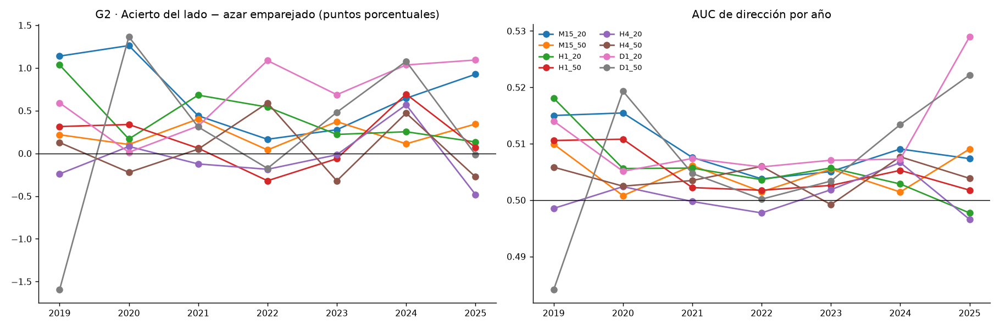
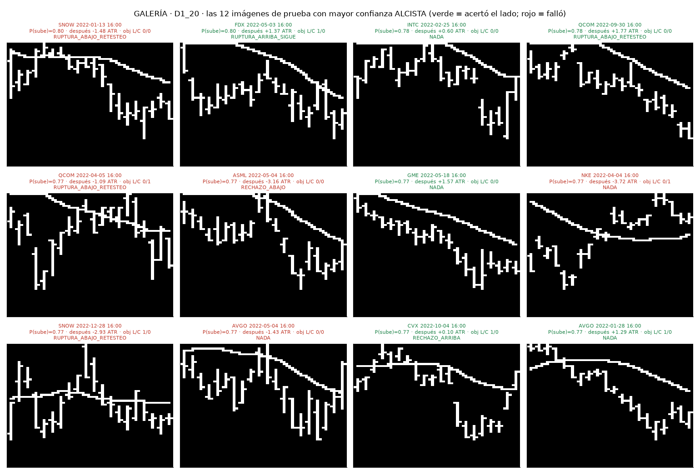
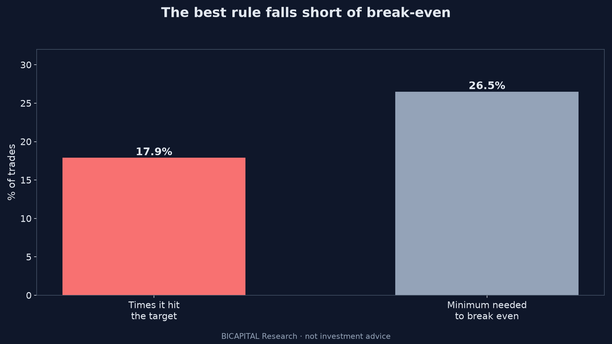

# An AI that looks at charts like photos can't guess where price goes

*I trained a neural network on hundreds of thousands of candlestick charts, the way you teach a computer to spot cats in photos. Can it tell whether price will rise or fall? Barely better than a coin flip.*

Many people look at a chart and "see" things: a ceiling, a floor, a pattern that promises a rally. This lab asks a simple question: if an artificial intelligence looks at those same pictures, does it find something we miss?

The idea isn't mine. It comes from an academic study published in 2023 in a very serious finance journal (Jiang, Kelly and Xiu, *Journal of Finance*). They turned charts into black-and-white images and trained a network to read them. I repeated the idea with my own data and very strict rules.

## What is a "network that looks at photos"?

An image neural network is a program that learns from examples. Think of a child who sees a thousand photos of dogs and a thousand of cats: in the end they can tell them apart without anyone explaining the rules.

Here, instead of dogs and cats, I showed it candlestick charts. Each candle is a small bar that summarizes price over a period: where it started, where it ended, the highest and the lowest point. Under each chart was the answer: afterwards, did price go up or down?

I tested 8 image types:

- Candles of 15 minutes, 1 hour, 4 hours and 1 day.
- Each with 20 or 50 candles in the picture.

## How I set up the test so I wouldn't fool myself

The most important thing in an experiment like this is not to cheat by accident. So:

1. The network trained on 5 years of data and was then tested on the following year, which it had never seen. It was retrained every year. Like studying with old exams and then sitting a new one.
2. The test ran from 2019 to mid-2025. For the hourly and minute charts that meant 280,000 images per type.
3. I compared the network with "matched chance". What's that? Picture a fortune-teller who doesn't look at the chart, but does know which asset it is, the hour, the day, and how much it usually moves. If the network can't beat that fortune-teller, it isn't "seeing" anything special in the picture.
4. I also compared it with a simple model that uses the same candles as numbers, with no image.
5. And as a control, I shuffled the answers: I showed it charts with "up/down" swapped at random. Such a network should be right exactly half the time.

## Result 1: it picks the side almost like chance

**How to read the chart:** each pair of bars is one image type. Blue is the percentage of times the network correctly said whether price would go up or down. Grey is what the matched-chance fortune-teller gets. The red line marks 50%, a coin flip. Every bar sits right on that line.

In numbers: the network was right between 50.2% and 50.8% of the time, depending on the image type. Matched chance, between 49.6% and 50.5%. The gap is under one point. Out of 100 bets, the network gets at most one more right than the coin.

Was there any image type that beat both matched chance and the simple model? None of the 8. And the network trained on shuffled answers, which cannot know anything, scored very similar figures to the real one.

## Result 2: it doesn't improve over the years

**How to read the chart:** this is the lab's own chart (labels in Spanish). On the left, each line is an image type and shows how many points of accuracy the network scores above (or below) matched chance each year. On the right, another accuracy measure where 0.50 is the coin. The lines bounce around the chance line with no clear trend: in no year does the network truly pull away.

## What the network does see: size, not direction

There was an interesting surprise. When I asked something else, "will price reach a distant target before hitting a loss limit?", the network did noticeably better. But looking closely, what it had learned was whether a big move was coming, not which way. Like a weather forecaster who correctly predicts strong wind but can't say whether it will blow from the north or the south. To make money you need the side.

## The gallery: what the network found most obvious

**How to read the chart:** these are the 12 daily-candle images where the network was most confident price would rise (labels in Spanish). This is how the network "sees" charts: white strokes on a black background, and the curved line is a price average. The title is green if it was right and red if it was wrong. Of the 12, 7 are red: even when it was most convinced, it was wrong more often than right.

## Result 3: turning it into rules doesn't make money

I tested 216 buy and sell rules based on what the network said, with real costs. None passed every check.

**How to read the chart:** we take the best of the 216 rules. The red bar is the share of trades that reached the target: 17.9%. The grey bar is the minimum it needed to avoid losing money after costs: 26.5%. It is almost 9 points short.

That best rule made 474 trades. Risking 1% per trade, it would have lost around 5% a year, and in its worst stretch it fell almost 40%.

## Why this doesn't discourage me

The network not guessing direction is not a failed experiment. It's an answer. It says that the shape of a chart, on its own, does not hide the future direction of price, at least not in a way you can exploit after paying costs. It matches my earlier studies with networks that read numbers instead of pictures.

And it saves something valuable: time and money chasing patterns that, under a magnifying glass, behave like a coin.

## What I take away

- If an AI trained on hundreds of thousands of charts can't get even one point of edge, be wary of "never-fail" patterns.
- Predicting whether a big move is coming is easier than predicting its direction. Don't confuse the two.
- Always compare against a well-built chance that knows the hour, the asset and how busy the market is. Beating a plain coin isn't enough.
- A 50.5% hit rate sounds nice, but costs eat it up quickly.

*Educational content. Not investment advice.*
