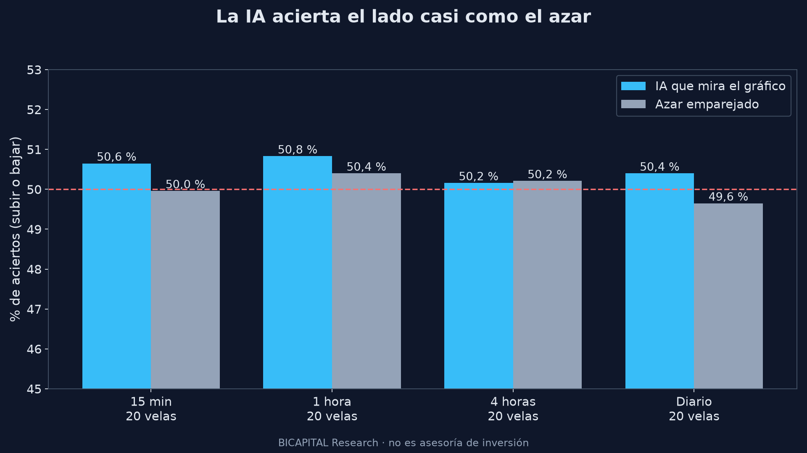
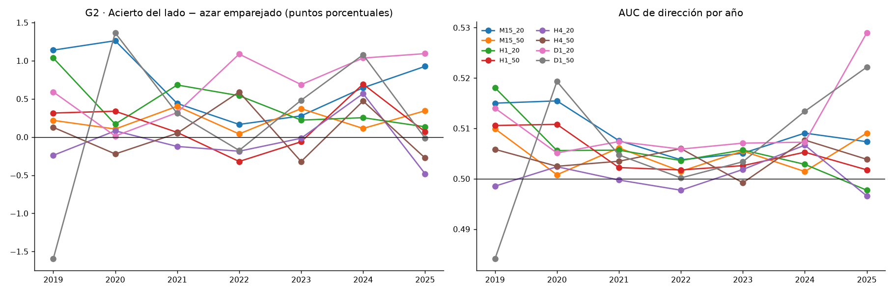
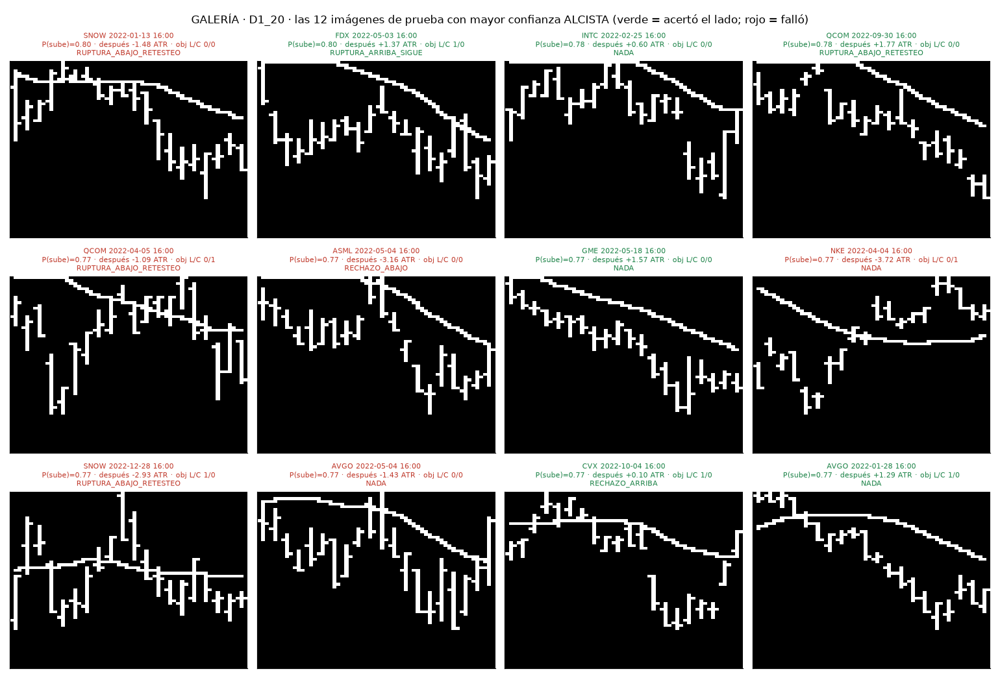
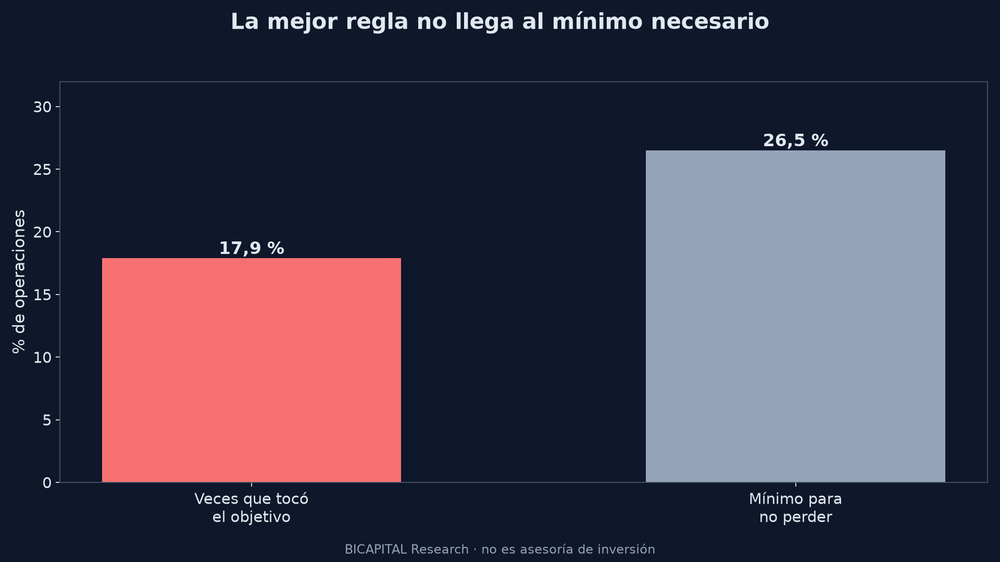

# Una IA que mira gráficos como fotos no adivina hacia dónde va el precio

*Entrené una red neuronal con cientos de miles de gráficos de velas, como quien enseña a reconocer gatos en fotos. ¿Sabe decir si el precio subirá o bajará? Casi igual que lanzar una moneda.*

Mucha gente mira un gráfico y «ve» cosas: un techo, un suelo, una figura que promete subida. La pregunta de este laboratorio es sencilla: si una inteligencia artificial mira esos mismos dibujos, ¿encuentra algo que nosotros no vemos?

La idea no es mía. Viene de un estudio académico publicado en 2023 en una revista de finanzas muy seria (Jiang, Kelly y Xiu, *Journal of Finance*). Ellos convirtieron gráficos en imágenes en blanco y negro y entrenaron una red para leerlas. Yo repetí la idea con mis propios datos y con reglas muy estrictas.

## Qué es una «red que mira fotos»

Una red neuronal de imágenes es un programa que aprende a base de ejemplos. Es como un niño al que le enseñas mil fotos de perros y mil de gatos: al final distingue uno de otro sin que le expliques las reglas.

Aquí, en lugar de perros y gatos, le enseñé gráficos de velas. Cada vela es un rectángulo que resume el precio en un rato: dónde empezó, dónde acabó, el punto más alto y el más bajo. Debajo de cada gráfico iba la respuesta: después, ¿subió o bajó?

Probé 8 tipos de imagen:

- Velas de 15 minutos, 1 hora, 4 horas y 1 día.
- Cada una con 20 o con 50 velas en la imagen.

## Cómo hice la prueba para no engañarme

Lo más importante de un experimento así es no hacer trampa sin querer. Por eso:

1. La red se entrenó con 5 años de datos y luego se examinó con el año siguiente, que nunca había visto. Cada año se volvía a entrenar. Es como estudiar con exámenes antiguos y presentarse a uno nuevo.
2. El examen cubrió desde 2019 hasta mediados de 2025. En los gráficos de horas y minutos fueron 280.000 imágenes por tipo.
3. Comparé a la red con un «azar emparejado». ¿Qué es eso? Imagina un adivino que no mira el gráfico, pero sí sabe qué activo es, a qué hora y qué día, y cuánto se suele mover. Si la red no gana a ese adivino, no está «viendo» nada especial en el dibujo.
4. También la comparé con un modelo simple que usa las mismas velas en forma de números, sin imagen.
5. Y como control, barajé las respuestas: le enseñé gráficos con el «subió/bajó» cambiado al azar. Una red así debe acertar justo la mitad.

## Resultado 1: acierta el lado casi como el azar

**Cómo leer el gráfico:** cada pareja de barras es un tipo de imagen. La azul es el porcentaje de veces que la red acertó si el precio subiría o bajaría. La gris es lo que acierta el adivino del azar emparejado. La línea roja marca el 50 %, que es lanzar una moneda. Todas las barras están pegadas a esa línea.

En números: la red acertó entre el 50,2 % y el 50,8 % según el tipo de imagen. El azar emparejado, entre el 49,6 % y el 50,5 %. La diferencia es de menos de un punto. De cada 100 apuestas, la red acierta como mucho una más que la moneda.

¿Hubo algún tipo de imagen que ganara a la vez al azar emparejado y al modelo simple? Ninguno de los 8. Y la red con respuestas barajadas, que no puede saber nada, sacó cifras muy parecidas a la red de verdad.

## Resultado 2: no mejora con los años

**Cómo leer el gráfico:** es un gráfico del propio laboratorio. A la izquierda, cada línea es un tipo de imagen y muestra cuántos puntos de acierto saca la red por encima (o por debajo) del azar emparejado cada año. A la derecha, otra medida de acierto donde 0,50 es la moneda. Las líneas suben y bajan alrededor de la raya del azar sin una tendencia clara: ningún año la red se despega de verdad.

## Lo que la red sí ve: el tamaño, no la dirección

Hubo una sorpresa interesante. Cuando le pregunté otra cosa, «¿llegará el precio a un objetivo lejano antes que a un tope de pérdida?», la red mejoró bastante. Pero al mirarlo de cerca, lo que estaba aprendiendo era si se avecinaba un movimiento grande, no hacia dónde. Es como un meteorólogo que acierta que habrá viento fuerte, pero no sabe si soplará del norte o del sur. Para ganar dinero hace falta saber el lado.

## La galería: lo que la red creía más claro

**Cómo leer el gráfico:** son las 12 imágenes de velas diarias en las que la red estaba más segura de que el precio subiría. Así «ve» la red los gráficos: rayas blancas sobre fondo negro, y la línea curva es una media de precios. El título está en verde si acertó y en rojo si falló. De las 12, 7 están en rojo: incluso cuando estaba más convencida, falló más de lo que acertó.

## Resultado 3: convertirlo en reglas no da dinero

Probé 216 reglas de compra y venta usando lo que decía la red, con costes reales. Ninguna pasó todos los filtros.

**Cómo leer el gráfico:** tomamos la mejor regla de las 216. La barra roja es el porcentaje de operaciones en que llegó al objetivo: 17,9 %. La gris es el mínimo que necesitaba para no perder dinero tras los costes: 26,5 %. Le faltan casi 9 puntos.

Esa mejor regla hizo 474 operaciones. Arriesgando un 1 % por operación, habría perdido alrededor de un 5 % al año, y en su peor racha cayó casi un 40 %.

## Por qué no me desanima

Que la red no adivine la dirección no es un fracaso del experimento. Es una respuesta. Dice que la forma del gráfico, por sí sola, no esconde la dirección futura del precio, al menos no de manera que se pueda aprovechar tras pagar costes. Es lo mismo que mis estudios anteriores con redes que leían números en lugar de imágenes.

Y nos ahorra algo valioso: tiempo y dinero persiguiendo figuras que, vistas con lupa, se comportan como una moneda.

## Qué me llevo

- Si una IA entrenada con cientos de miles de gráficos no saca ni un punto de ventaja, conviene desconfiar de las figuras «infalibles».
- Predecir si habrá un movimiento grande es más fácil que predecir su dirección. No confundas una cosa con la otra.
- Compara siempre con un azar bien hecho, que sepa la hora, el activo y lo movido que está el mercado. Ganar a una moneda pura no basta.
- Una cifra de acierto del 50,5 % suena bien, pero los costes se la comen enseguida.

*Contenido educativo. No es asesoría de inversión.*
