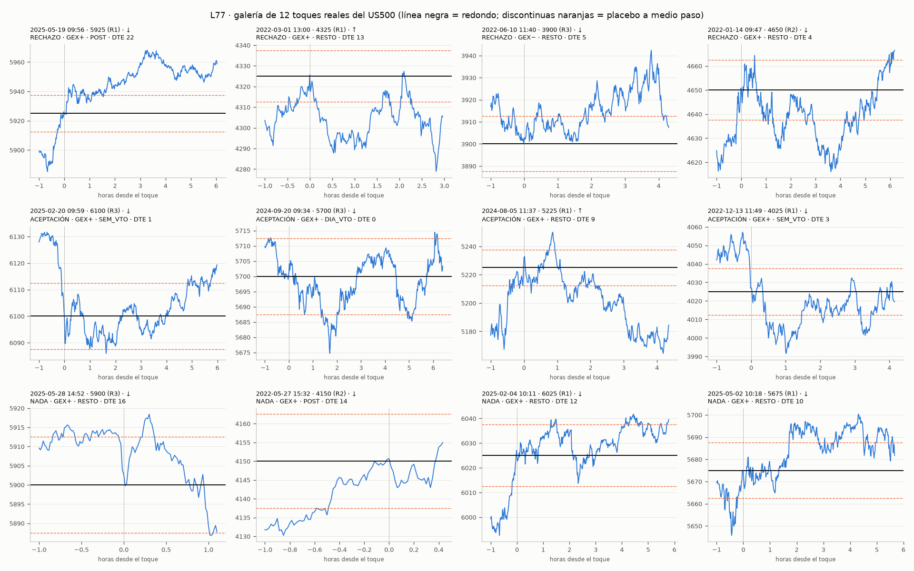
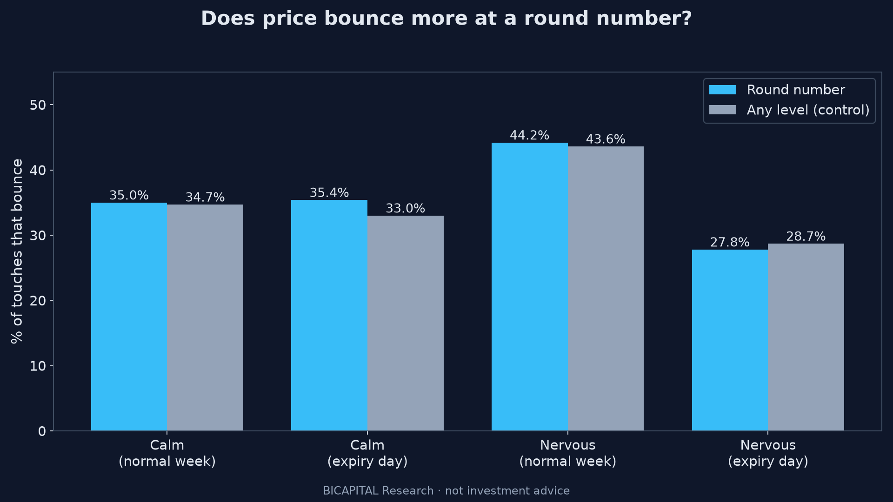
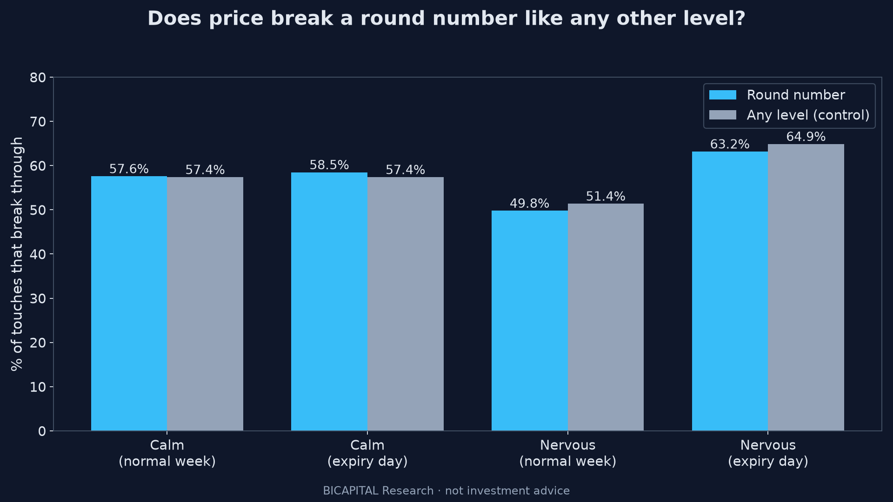
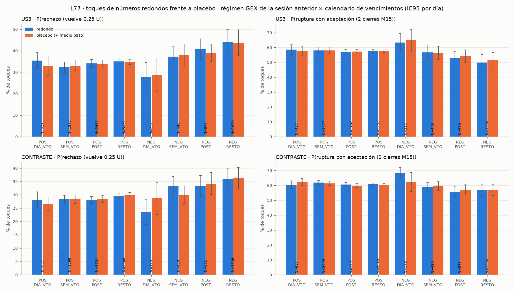
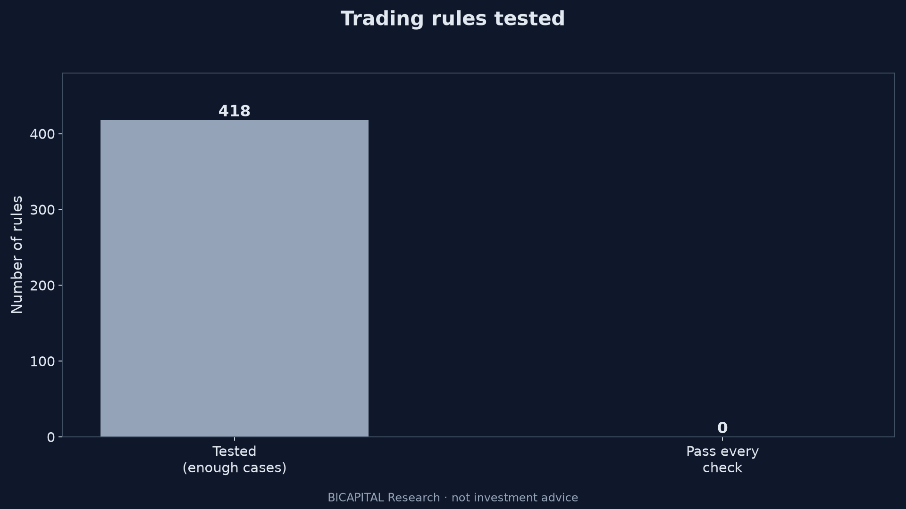

# Do round numbers stop price? About as much as any other level

*People say price "bumps into" round numbers like 5,000 or 5,100. I checked thousands of touches in indices, gold and euro-dollar, comparing them with made-up levels. The difference is practically zero.*

If you've watched trading videos, you've surely heard it: "price respects round numbers." That when an index reaches 5,000 points it slows down, bounces or stalls. There's even a fancier version, the "gamma walls". This lab tests both.

## The "gamma walls" idea, in plain words

In the options market (contracts that give the right to buy or sell at a fixed price), some prices collect a huge number of contracts. They are usually round numbers. The theory says the banks that sell those contracts hedge by buying and selling in a way that keeps price "trapped" near that number, like a wall.

It is also said that the effect changes with the market's mood:

- On "calm" days (when those banks' hedging dampens moves), walls should hold more.
- On "nervous" days (when hedging speeds moves up), they should break harder.
- And on the monthly options expiry day (the third Friday of each month), price should get "pinned" to a round number.

I don't have the exact historical data on how many contracts sat at each price (it's paid data). So I used round numbers as a stand-in, since that's exactly where contracts tend to pile up.

## The markets I looked at

- Three US indices: S&P 500, Nasdaq 100 and Dow Jones (from 2019 or 2021 to mid-2025).
- As a contrast, markets outside those options: the European EU50 index, gold and euro-dollar (some since 2000).

In the S&P 500, for example, I checked multiples of 25, 50 and 100 points. The S&P alone gave about 4,000 touches.

## The trick to avoid fooling myself: the control level

This is the key to the experiment. Counting how often price bounces at a round number isn't enough. Price bounces everywhere, because it goes up and down all the time.

So I created a "control level": a line with the same spacing as the round numbers, but shifted half a step. If the S&P round numbers are 5,000, 5,025, 5,050…, the control sits at 5,012.5, 5,037.5… Never a pretty number. If the round number has something special, it should stop price more than its control.

I measured each first touch of the day between 9:30 and 15:44 New York time:

- **Bounce**: price pulls back a quarter of its typical move.
- **Break**: two consecutive 15-minute candles close on the other side.

**How to read the chart:** this is the lab's own chart (labels in Spanish), with 12 real S&P 500 touches. The blue line is price, from an hour before the touch to several hours after. The black line is the round number. The dashed orange lines are the control levels, half a step above and below. Above each panel it says whether it was a bounce ("RECHAZO"), a break ("ACEPTACIÓN") or nothing ("NADA"). At a glance, price crosses the black and orange lines just as easily.

## Result 1: it bounces the same at a round number as at any level

**How to read the chart:** each pair of bars is a market situation for the US indices. Blue is the share of touches where price bounced at a round number. Grey is the same at the control level. The pairs are almost twins: 35.0% versus 34.7% on a normal calm day; 44.2% versus 43.6% on a normal nervous day.

What does change is the market's mood: on nervous days everything bounces more. But that happens equally to the round number and to the control. It isn't the number: it's the day.

## Result 2: it breaks the same way

**How to read the chart:** the same, but now counting the times price went through the level and stayed on the other side. Again, nearly identical bars: 57.6% versus 57.4% on normal calm days. If round numbers were walls, the blue bar should be clearly lower. It isn't.

**How to read the chart:** this is the lab's full version (labels in Spanish). Top, the US indices; bottom, the contrast markets. Left, bounces; right, breaks. Blue is the round number ("redondo") and orange the control ("placebo"). The small vertical lines on each bar show the margin of doubt: when they overlap, as they almost always do, you can't say one bar differs from the other.

## Result 3: no "pinning" on expiry day either

I checked whether the S&P 500 closes closer to a multiple of 25, 50 or 100 on the monthly expiry day, on calm days. No: the distance is practically the same as on other days. Of all the questions I set myself before starting (more than 20, written down before looking at the data), none came out in favor of the walls.

## Result 4: no trading rule holds up

**How to read the chart:** I tested 486 ways of trading the touches (buying the bounce, selling the break, with different targets and filters). 418 had enough cases to judge. None passed every check, which include real costs, costs higher than normal, and working across different years.

The best-looking one had only 40 trades, too few to trust.

## The limits, honestly

- Round numbers are only a stand-in for the real walls.
- The US indices only have 4 to 6 years of minute-by-minute data.
- Since 2022 there are options that expire every day, which dilutes the monthly expiry effect.

Even so, with thousands of touches, the picture is clear.

## What I take away

- A round number is not a wall. Price bounces and breaks there just like at any other level.
- To judge a level, always compare it with a similar "control" level. Without that comparison, everything seems to work.
- The market's mood does matter: on nervous days there are more bounces everywhere.
- Round numbers can be a visual reference, but not a reason to enter a trade.

*Educational content. Not investment advice.*
