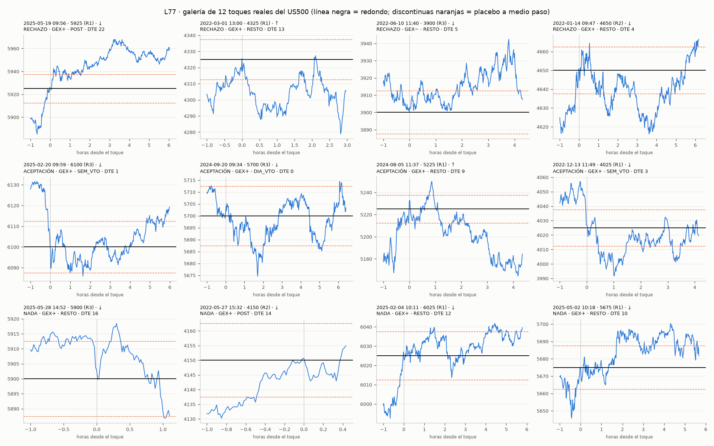
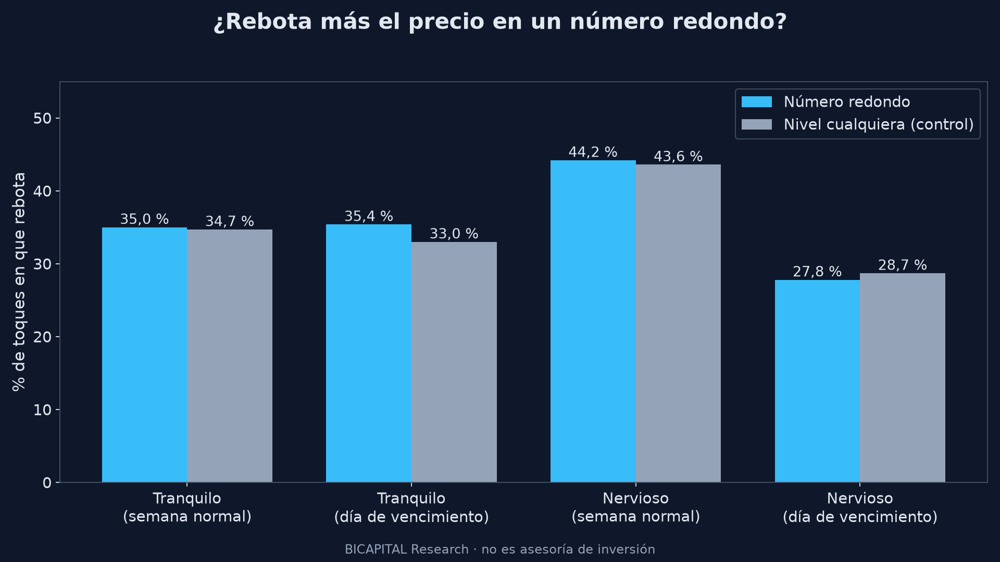
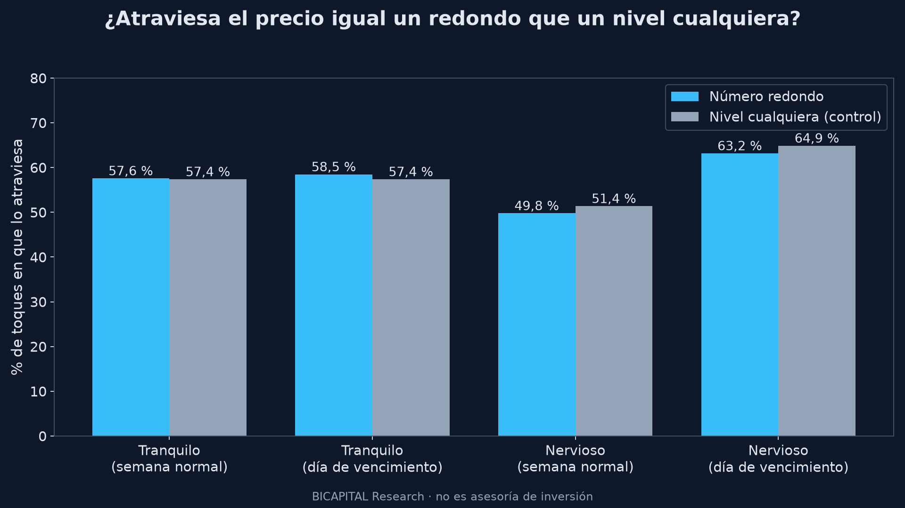
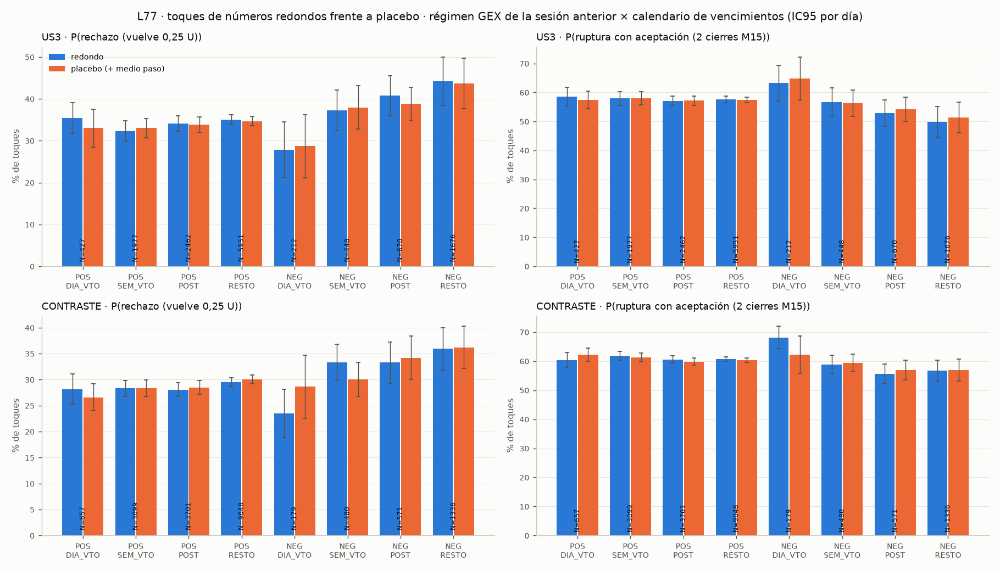
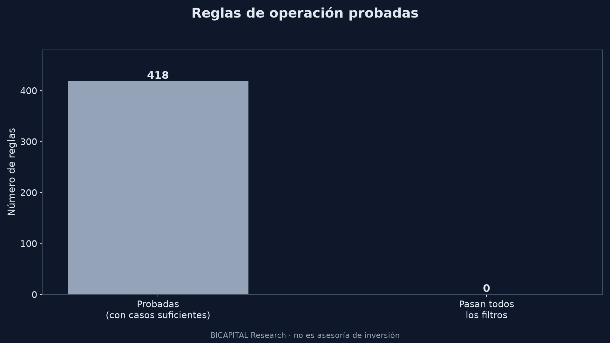

# ¿Los números redondos frenan el precio? Casi igual que un nivel cualquiera

*Se dice que el precio «choca» contra los números redondos, como 5.000 o 5.100. Lo comprobé con miles de toques en índices, oro y euro-dólar, comparando con niveles inventados. La diferencia es prácticamente cero.*

Si has visto vídeos de trading, seguro que has oído esto: «el precio respeta los números redondos». Que al llegar a 5.000 puntos el índice frena, rebota o se queda dando vueltas. Hay incluso una versión más sofisticada, la de las «paredes de gamma». Este laboratorio pone las dos a prueba.

## La idea de las «paredes de gamma», en sencillo

En el mercado de opciones (contratos que dan derecho a comprar o vender a un precio fijo) hay precios donde se acumulan muchísimos contratos. Suelen ser números redondos. La teoría dice que los bancos que venden esos contratos se cubren comprando y vendiendo de forma que el precio queda «atrapado» cerca de ese número, como una pared.

Además, se dice que el efecto cambia según el ánimo del mercado:

- En días «tranquilos» (cuando la cobertura de esos bancos frena los movimientos), las paredes deberían frenar más.
- En días «nerviosos» (cuando la cobertura los acelera), deberían romperse con más fuerza.
- Y el día del vencimiento mensual de las opciones (el tercer viernes de cada mes), el precio debería quedarse «clavado» en un redondo.

No tengo el dato histórico exacto de cuántos contratos había en cada precio (es de pago). Así que usé los números redondos como aproximación, que es justo donde suelen acumularse.

## Qué mercados miré

- Tres índices de Estados Unidos: S&P 500, Nasdaq 100 y Dow Jones (de 2019 o 2021 hasta mediados de 2025).
- Como contraste, mercados fuera de esas opciones: el índice europeo EU50, el oro y el euro-dólar (algunos desde el año 2000).

En el S&P 500, por ejemplo, revisé los múltiplos de 25, 50 y 100 puntos. Solo el S&P dio unos 4.000 toques.

## El truco para no engañarme: el nivel de control

Aquí está la clave del experimento. No basta con contar cuántas veces el precio rebota en un redondo. El precio rebota en todas partes, porque sube y baja constantemente.

Por eso creé un «nivel de control»: una línea con la misma separación que los redondos, pero desplazada medio paso. Si los redondos del S&P están en 5.000, 5.025, 5.050…, el control está en 5.012,5, 5.037,5… Nunca es un número bonito. Si el redondo tiene algo especial, debería frenar más que su control.

Medí cada primer toque del día entre las 9:30 y las 15:44 de Nueva York:

- **Rebote**: el precio vuelve atrás un cuarto de su movimiento típico.
- **Ruptura**: dos cierres seguidos de velas de 15 minutos al otro lado.

**Cómo leer el gráfico:** es un gráfico del propio laboratorio, con 12 toques reales del S&P 500. La línea azul es el precio, desde una hora antes del toque hasta varias horas después. La línea negra es el número redondo. Las discontinuas naranjas son los niveles de control, medio paso por encima y por debajo. Arriba de cada panel pone si fue rebote («RECHAZO»), ruptura («ACEPTACIÓN») o nada. A simple vista el precio cruza las líneas negras y las naranjas con la misma soltura.

## Resultado 1: rebota igual en un redondo que en un nivel cualquiera

**Cómo leer el gráfico:** cada pareja de barras es una situación del mercado de los índices de EE. UU. La azul es el porcentaje de toques en que el precio rebotó en un redondo. La gris, lo mismo en el nivel de control. Las parejas son casi gemelas: 35,0 % frente a 34,7 % en un día tranquilo normal; 44,2 % frente a 43,6 % en un día nervioso normal.

Lo que sí cambia es el ánimo del mercado: en días nerviosos todo rebota más. Pero eso le pasa igual al redondo que al control. No es el número: es el día.

## Resultado 2: se atraviesa igual

**Cómo leer el gráfico:** lo mismo, pero ahora contando las veces que el precio atravesó el nivel y se quedó al otro lado. De nuevo, barras casi iguales: 57,6 % frente a 57,4 % en días tranquilos normales. Si los redondos fueran paredes, la barra azul debería ser claramente más baja. No lo es.

**Cómo leer el gráfico:** es la versión completa del laboratorio. Arriba, los índices de EE. UU.; abajo, los mercados de contraste. A la izquierda, rebotes; a la derecha, rupturas. Azul es el redondo y naranja el control. Las rayitas verticales sobre cada barra marcan el margen de duda: cuando se solapan, como pasa casi siempre, no se puede decir que una barra sea distinta de la otra.

## Resultado 3: tampoco se «clava» el día de vencimiento

Revisé si el S&P 500 cierra más cerca de un múltiplo de 25, 50 o 100 el día de vencimiento mensual, en días tranquilos. No: la distancia es prácticamente la misma que en el resto de días. De todas las preguntas que me hice antes de empezar (más de 20, apuntadas por escrito antes de mirar los datos), ninguna salió a favor de las paredes.

## Resultado 4: ninguna regla de operación aguanta

**Cómo leer el gráfico:** probé 486 formas de operar en los toques (comprar el rebote, vender la ruptura, con distintos objetivos y filtros). 418 tenían casos suficientes para juzgarlas. Ninguna pasó todos los filtros, que incluyen costes reales, costes más caros de lo normal y que funcione en años distintos.

La que mejor pintaba tenía solo 40 operaciones, demasiado pocas para fiarse.

## Los límites, con honestidad

- Los redondos son solo una aproximación de las paredes reales.
- Los índices de EE. UU. solo tienen entre 4 y 6 años de datos minuto a minuto.
- Desde 2022 hay opciones que vencen cada día, lo que diluye el efecto del vencimiento mensual.

Aun así, con miles de toques, la foto es clara.

## Qué me llevo

- Un número redondo no es una pared. El precio rebota y rompe allí igual que en cualquier otro nivel.
- Para juzgar un nivel, compáralo siempre con un nivel «de control» parecido. Sin esa comparación, todo parece funcionar.
- El ánimo del mercado sí importa: en días nerviosos hay más rebotes en todas partes.
- Los redondos pueden servir como referencia visual, pero no como razón para entrar en una operación.

*Contenido educativo. No es asesoría de inversión.*
