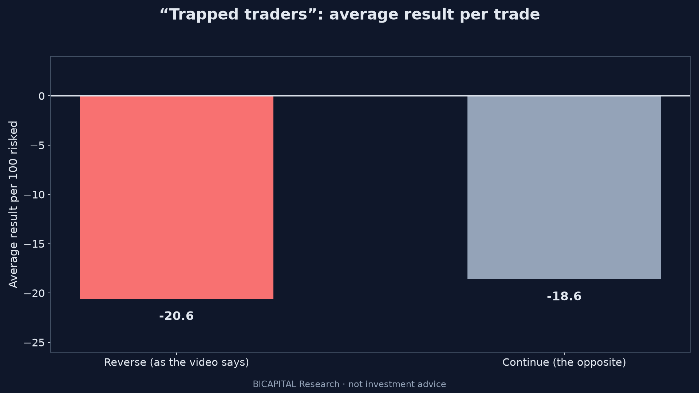
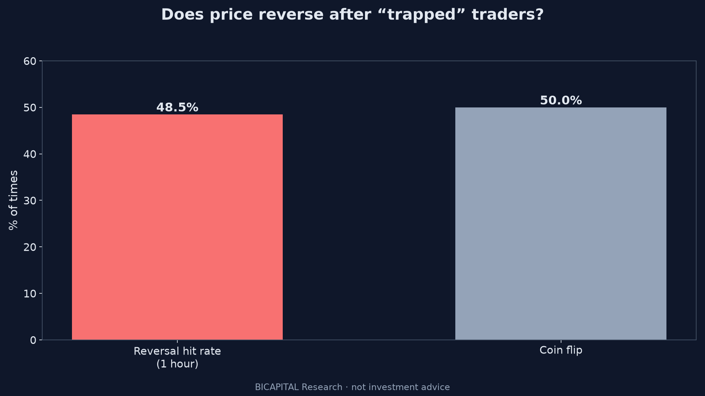
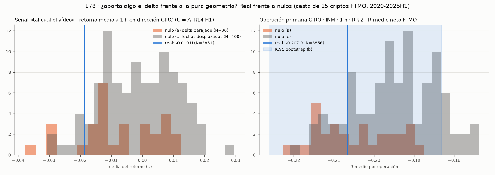
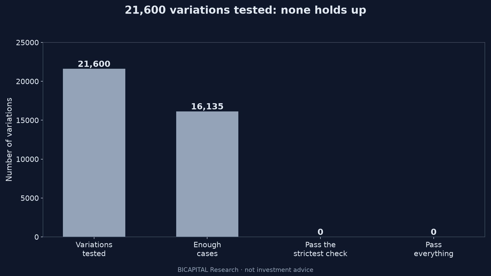

# I tested a video about "trapped traders" in crypto: it doesn't hold up

*A widely watched video teaches how to spot "trapped" buyers and trade the reversal. I reproduced it to the letter on 15 cryptos over five and a half years: it loses money and the reversal is a coin flip.*

Social media is full of videos with methods that look professional. One of the most popular talks about "trapped traders" and uses a type of chart called a *footprint*, which shows how much is bought and sold at each price level. I wanted to know if it really works.

## What the video says, in plain words

Picture an auction. Suddenly lots of people bid in a hurry: aggressive buying outnumbers selling 4 to 1. Normally price would rise. But it doesn't: it stands still.

Then the other side shows up. Sellers start to dominate strongly (this is called "absorption"). According to the video, the buyers who rushed in are now "trapped": they bought high and price isn't following them. When they give up and sell, price will fall. The idea is to bet on that reversal.

And the other way round with sellers: if aggressive sellers get trapped, bet on price rising.

## How I reproduced it

I wanted to be as faithful as possible to the video and as honest as possible about costs:

- **Signal**: minute-by-minute data from Binance, futures and spot, where you can see what part of the volume came from aggressive buyers.
- **Execution**: each cryptocurrency's contract for difference (CFD) at a real broker, with all its costs: the gap between buy and sell price, commission, the fee for holding a position overnight, and slippage (getting filled a little worse than planned).
- **Markets**: 15 cryptocurrencies, including bitcoin, ether, XRP and dogecoin.
- **Period**: from 2020 to June 2025.

The rules "exactly as in the video": aggressive buying at least 4 times bigger than selling at a level, with high volume; price doesn't advance for 15 minutes; then absorption arrives from the other side. You then enter in favor of the reversal, with a target twice the loss limit, for one hour.

## Result 1: it loses, and so does the opposite

**How to read the chart:** the red bar is the average result per trade following the video: for every 100 you risk on a trade, you lose about 20.6 on average. The grey bar is what happens if you do exactly the opposite (bet that price continues): you lose about 18.6. Both bars are below zero.

There were 3,607 trades. That the idea and its opposite lose almost the same is a very clear hint: the signal adds nothing, and what you see is mostly costs.

## Result 2: the reversal is right less often than a coin

**How to read the chart:** removing costs and looking only at where price goes in the next hour, the reversal is right 48.5% of the time (red bar). A coin would be right 50% of the time (grey bar). The video's signal is even slightly below.

## Result 3: just like a random market

This is the most important test. What if the "trapped" buyers have nothing to do with it, and what you see is just the shape of the chart? To find out I built two kinds of chance:

1. **Shuffled footprint**: I leave prices as they are, but within each day I mix up who was buying and selling in a hurry. That way the "footprint" no longer means anything.
2. **Shifted dates**: I use the footprint from a different day with today's prices.

If the video's idea were true, the real result should be clearly better than these two kinds of chance.

**How to read the chart:** this is the lab's own chart (labels in Spanish). The colored bars (orange and grey) show the results you get from the random markets, repeating the experiment many times. The vertical blue line is the real result. On the left, where price goes in one hour; on the right, the result per trade with costs. In both cases the blue line falls in the middle of the chance bars: the real footprint can't be told apart from a shuffled one.

## Result 4: I tested 21,600 variations

Someone might say: "you just have to tune the numbers." So I tried many versions: a ratio of 3, 4 or 5 to 1, different level sizes, 5- and 15-minute candles, without absorption, with spot or futures data, with 4 different durations, with 3 different targets, and both the reversal and the continuation.

**How to read the chart:** of 21,600 variations, 16,135 had enough trades to judge (at least 30). When you test that many things, some come out well by luck, just as if you toss 16,000 coins, one of them will land heads many times in a row. That's why I use a strict filter that accounts for how many things I tested. Zero passed it. And none passed all the checks at once: higher costs, worse entry prices, several positive years and the chance tests.

The best-looking variations had only 30 to 40 trades in five and a half years. Too few: that's what turns up when you search a very large pile.

## Why the video is convincing

The examples in a video are hand-picked: it shows the cases where the reversal worked. It's easy to find ten pretty charts among thousands. The hard part is for it to work on all of them, with costs, and better than chance. That is exactly what doesn't happen.

Also, costs weigh heavily in crypto: the overnight holding fee on these contracts was 0.0833% per night.

## What I take away

- A method that looks clear in five examples can be chance in five thousand. Always ask for the full test.
- If a signal and its opposite lose the same, the signal isn't telling you anything.
- Check that the idea beats a chance built from the same prices. If it doesn't, you're only seeing the shape of the chart.
- Testing thousands of variations until one works isn't discovering something: it's finding the lucky coin.

*Educational content. Not investment advice.*
