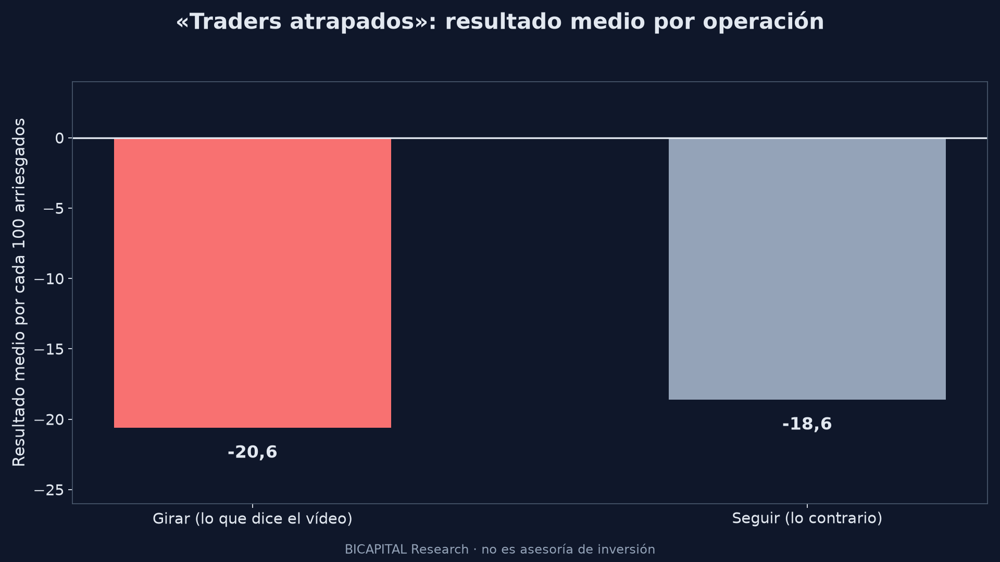
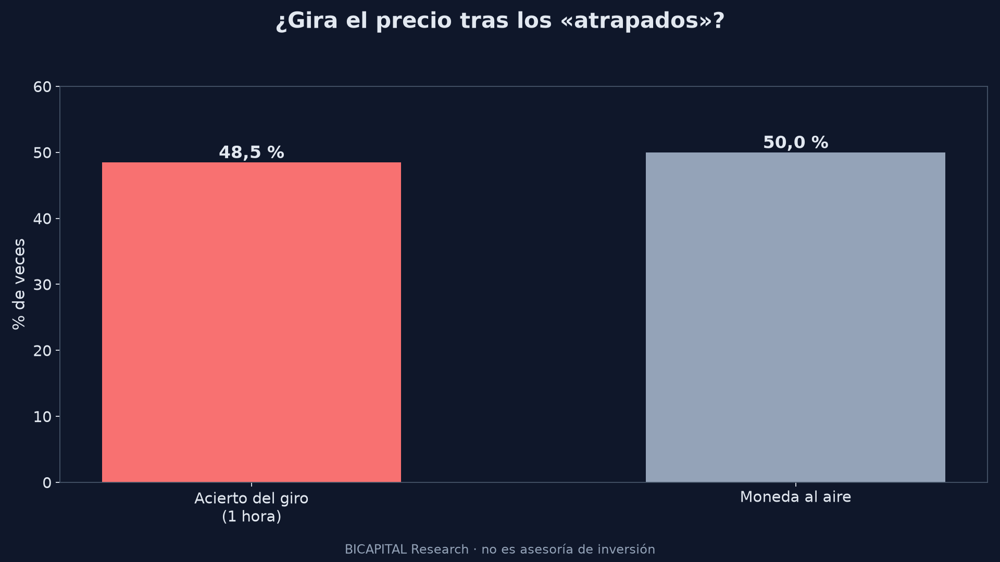
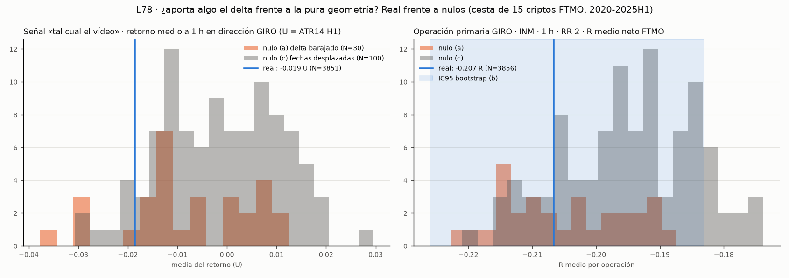
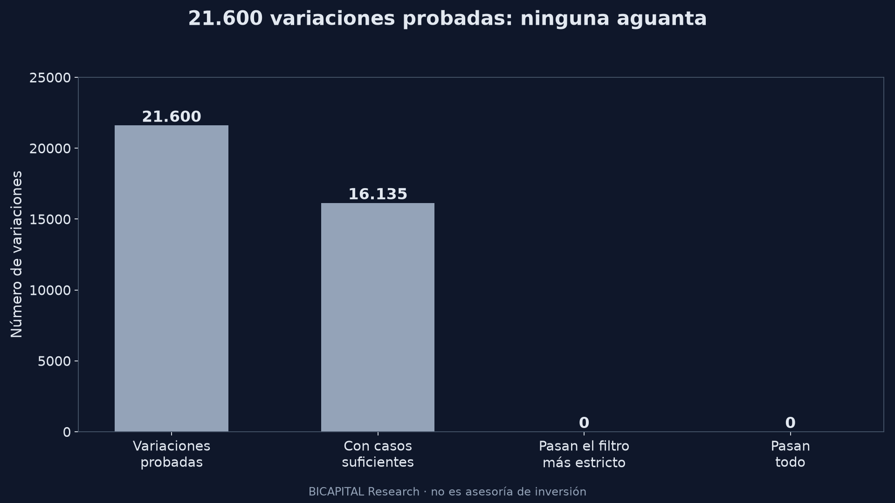

# Probé un vídeo sobre «traders atrapados» en cripto: no se confirma

*Un vídeo muy visto enseña a detectar compradores «atrapados» y operar el giro. Lo reproduje al pie de la letra en 15 criptomonedas durante cinco años y medio: pierde dinero y el giro acierta como una moneda.*

En redes circulan muchos vídeos con métodos que parecen de profesional. Uno de los más populares habla de los «traders atrapados» y usa un tipo de gráfico llamado *footprint* (huella), que muestra cuánto se compra y se vende en cada nivel de precio. Quise saber si funciona de verdad.

## Qué dice el vídeo, en sencillo

Imagina una subasta. De repente, mucha gente puja con prisa: las compras agresivas superan 4 a 1 a las ventas. Lo normal sería que el precio subiera. Pero no sube: se queda quieto.

Luego aparece el otro lado. Los vendedores empiezan a dominar con fuerza (a esto se le llama «absorción»). Según el vídeo, los compradores que entraron con prisa quedan «atrapados»: compraron caro y el precio no les acompaña. Cuando tiren la toalla y vendan, el precio caerá. La propuesta es apostar a ese giro.

Y al revés con las ventas: si los vendedores agresivos quedan atrapados, apostar a que el precio sube.

## Cómo lo reproduje

Quise ser lo más fiel posible al vídeo y lo más honesto posible con los costes:

- **Señal**: datos minuto a minuto de Binance, futuros y contado, donde se ve qué parte del volumen era de compradores agresivos.
- **Ejecución**: el contrato por diferencias (CFD) de cada criptomoneda en un bróker real, con todos sus costes: diferencia entre precio de compra y venta, comisión, coste por dejar la posición abierta de noche y deslizamiento (pagar un poco peor de lo previsto).
- **Mercados**: 15 criptomonedas, entre ellas bitcoin, ether, XRP y dogecoin.
- **Periodo**: de 2020 a junio de 2025.

Las reglas «tal cual el vídeo»: compras agresivas al menos 4 veces mayores que las ventas en un nivel, con volumen alto; el precio no avanza en 15 minutos; luego llega la absorción del otro lado. Entonces se entra a favor del giro, con un objetivo del doble del tope de pérdida, durante una hora.

## Resultado 1: pierde, y lo contrario también

**Cómo leer el gráfico:** la barra roja es el resultado medio por operación siguiendo el vídeo: por cada 100 que arriesgas en una operación, pierdes de media unos 20,6. La gris es lo que pasa si haces justo lo contrario (apostar a que el precio sigue): pierdes unos 18,6. Las dos barras están bajo cero.

Fueron 3.607 operaciones. Que la idea y su contraria pierdan casi lo mismo es una pista muy clara: la señal no aporta nada y lo que se ve son, sobre todo, los costes.

## Resultado 2: el giro acierta menos que una moneda

**Cómo leer el gráfico:** quitando los costes y mirando solo hacia dónde va el precio en la hora siguiente, el giro acierta el 48,5 % de las veces (barra roja). Una moneda acertaría el 50 % (barra gris). La señal del vídeo queda incluso un poco por debajo.

## Resultado 3: igual que un mercado al azar

Aquí está la prueba más importante. ¿Y si los compradores «atrapados» no tienen nada que ver, y lo que se ve es solo la forma del gráfico? Para saberlo construí dos tipos de azar:

1. **Huella barajada**: dejo los precios tal cual, pero mezclo dentro de cada día quién compraba y quién vendía con prisa. Así la «huella» ya no significa nada.
2. **Fechas desplazadas**: uso la huella de otro día distinto con los precios de hoy.

Si la idea del vídeo fuera cierta, el resultado real debería ser claramente mejor que estos dos azares.

**Cómo leer el gráfico:** es un gráfico del propio laboratorio. Las barras de colores (naranja y gris) muestran los resultados que salen con los mercados al azar, repitiendo el experimento muchas veces. La línea azul vertical es el resultado real. A la izquierda, hacia dónde va el precio en una hora; a la derecha, el resultado por operación con costes. En los dos casos, la línea azul cae en medio de las barras del azar: la huella real no se distingue de una huella barajada.

## Resultado 4: probé 21.600 variaciones

Alguien podría decir: «es que hay que ajustar los números». Así que probé muchas versiones: proporción de 3, 4 o 5 a 1, distintos tamaños de nivel, velas de 5 y 15 minutos, sin absorción, con datos de contado o de futuros, con 4 duraciones distintas, con 3 objetivos distintos, y tanto el giro como la continuación.

**Cómo leer el gráfico:** de 21.600 variaciones, 16.135 tenían operaciones suficientes para juzgarlas (al menos 30). Cuando pruebas tantas cosas, algunas salen bien por suerte, igual que si lanzas 16.000 monedas alguna dará muchas caras seguidas. Por eso uso un filtro estricto que tiene en cuenta cuántas cosas probé. Lo pasaron 0. Y ninguna superó a la vez todos los controles: costes más caros, peores precios de entrada, varios años positivos y los azares.

Las variaciones que mejor parecían tenían solo entre 30 y 40 operaciones en cinco años y medio. Demasiado pocas: es lo que sale cuando buscas en un montón muy grande.

## Por qué el vídeo convence

Los ejemplos de un vídeo están elegidos a mano: se muestran los casos en que el giro salió bien. Es fácil encontrar diez gráficos bonitos entre miles. Lo difícil es que funcione en todos, con costes, y mejor que el azar. Eso es justo lo que no pasa.

Además, en cripto los costes pesan mucho: el coste por dejar la posición abierta de noche en estos contratos era de un 0,0833 % por noche.

## Qué me llevo

- Un método que se ve claro en cinco ejemplos puede ser azar en cinco mil. Pide siempre la prueba completa.
- Si una señal y su contraria pierden lo mismo, la señal no está diciendo nada.
- Comprueba que la idea gana a un azar construido con los mismos precios. Si no, solo estás viendo la forma del gráfico.
- Probar miles de variaciones hasta que una salga bien no es descubrir algo: es encontrar la moneda con suerte.

*Contenido educativo. No es asesoría de inversión.*
