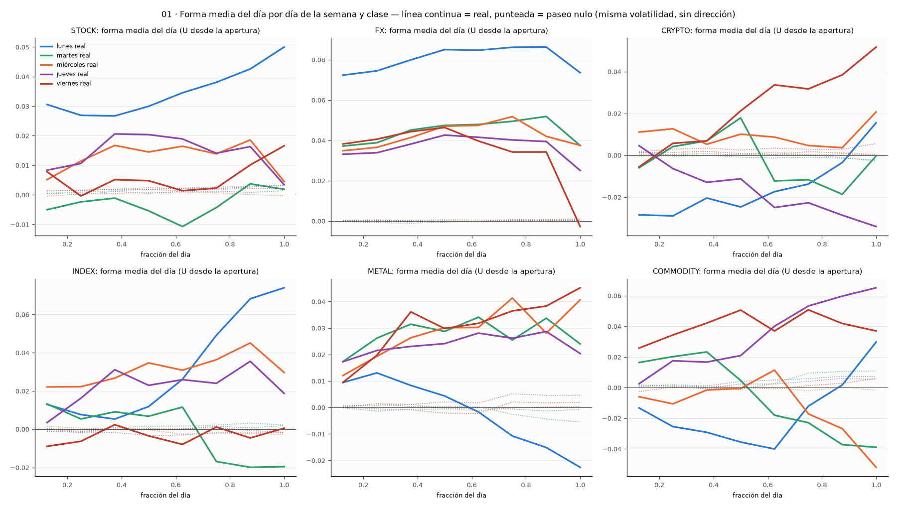
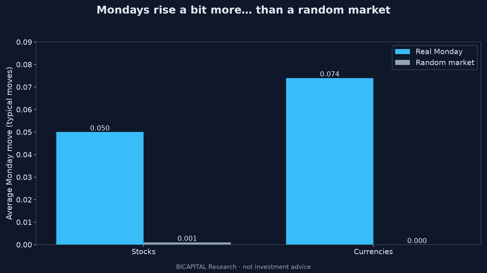
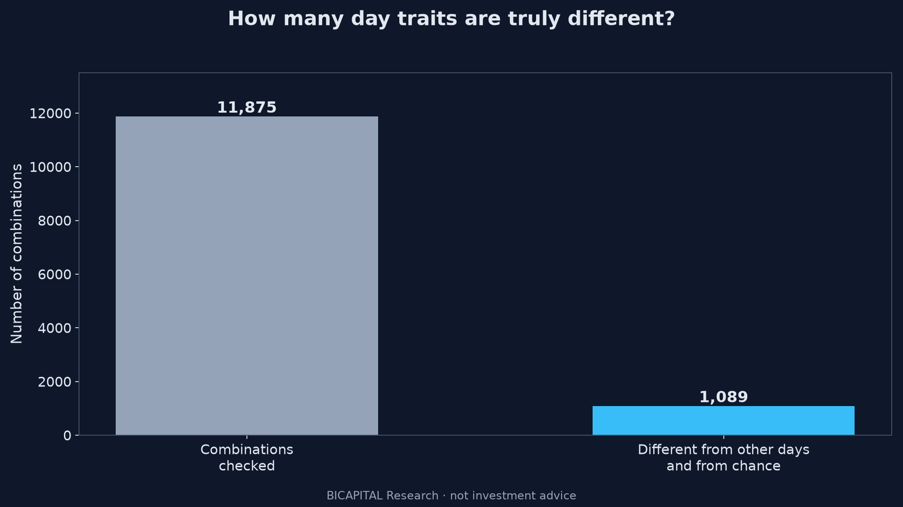
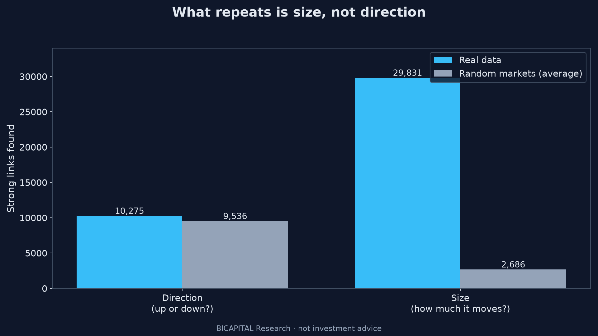

# Is Monday different? The shape of each day of the week

*I looked at 20 years of data from more than a hundred markets to see whether each weekday has its own "personality". There is something, mostly in how much price moves. In direction, it barely separates from chance.*

Almost everyone has an opinion about the days of the week. "Markets are weird on Mondays." "On Fridays people close positions and nothing happens." You hear these lines all the time. This lab puts them to the test with data.

It is not a trading system. It is an X-ray: I want to see the shape of a typical day, and whether Monday, Tuesday or Friday really behave differently.

## The data I used

- From 2005 to mid-2025.
- Stocks, currencies, stock indices, cryptocurrencies, metals and commodities.
- More than a hundred assets, and 125 in the part that looks for links between them.

For each day I measured several "traits": how far price moved from open to close, how far it travelled between the high and the low, what time the high and low were set, whether it reversed late in the day, and so on.

## The chance I compare against

To know whether something is special I need a point of comparison. I call it a "random market", and it is built like this: I take each asset's real 15-minute candles, keep their size and their wicks, but flip a coin to decide whether each candle goes up or down. The result is a market just as busy as the real one, but with no underlying direction.

It's like a car with the same engine but a steering wheel that turns at random. If the real car reaches places the crazy-wheel car can't, something real is going on.

## Result 1: each day has a bit of its own shape

**How to read the chart:** this is the lab's own chart (labels in Spanish). There are six panels, one per market type (stocks, currencies, crypto, indices, metals and commodities). Each colored line is a weekday ("lunes" is Monday, "viernes" is Friday) and shows, on average, how far price has moved since the open as the day goes on (left to right). The thin dotted lines, hugging zero, are the random market. The blue line is Monday: in stocks and currencies it ends above the others.

The real lines separate from the dotted ones. In other words: real days are not flat like the random market. There is something.

## Result 2: Mondays rise a tiny bit more

**How to read the chart:** the blue bars are the average Monday move, from open to close, in stocks and in currencies. The grey bars are the same in the random market. The unit is each asset's "typical move": 0.050 means 5 hundredths of what that asset usually moves in a normal stretch.

The difference exists, but it is very small. As if, for every 100 normal steps of price, Monday gave away 5 extra upward. Before costs. After paying them, very little is left.

## Result 3: few traits are truly different

**How to read the chart:** I checked 11,875 combinations of asset, day and trait (for example, "Apple, Monday, time of the low"). The blue bar shows those that are different both from the other days and from the random market: 1,089. That's about 9 in every 100.

I also checked whether "day types" (quiet days versus days with a big range) are spread differently across weekdays. That only happens in 9 of 125 assets.

## Result 4: does one market warn about another?

The second part aimed higher. For example: "when a stock closes strong on Friday, does a currency rise on Monday?" I checked millions of combinations of asset, day and delay.

To know how many strong links would appear by pure luck, I used another kind of chance: I shift each asset's dates along the calendar, keeping the weekday. Each asset is still itself, but its link with the others is broken. If real data gives many more links than that, there is something.

**How to read the chart:** each pair of bars counts how many strong links appear: blue with real data, grey in the random markets (on average). On the left, direction links ("if A rises, then B rises"). On the right, size links ("if A moves a lot, then B moves a lot").

- Direction: 10,275 real versus 9,536 by chance. Barely 8% more. The vast majority would have shown up by luck anyway.
- Size: 29,831 versus 2,686. About 11 times more. Here there is clearly something.

But careful: a good part of the size effect is that markets all get agitated at the same time. When I removed that common effect, 4,941 links remained versus 2,526 by chance. Still double, but far less spectacular.

A concrete example: "one asset's Friday warns about another asset's Monday". There were 587 strong links, versus about 383 by chance.

## A hidden trap: panic days

Many of these links depend on very few days. About 525,000 of the 2.7 million stored cells depend on just 5 dates when almost everything moved at once, such as 24 June 2016 (the Brexit referendum result) or 12 March 2020 (the pandemic). If a "rule" lives off five historic days, it isn't a rule: it's a memory.

## Where I stand

Weekdays do have some personality, mostly in how much price moves and at what time. But if the question is "which day should I buy?", the data's answer is: direction looks a lot like chance, and the little that's left over is small and fragile.

## What I take away

- Knowing that Monday or Friday tends to be more or less busy helps you size your trades, not guess the side.
- When someone says "this market warns about that one", ask how many links like that would appear by luck.
- Be wary of patterns that depend on a handful of historic panic days.
- The bullish Monday exists on average, but it is so small that costs can eat it.

*Educational content. Not investment advice.*
