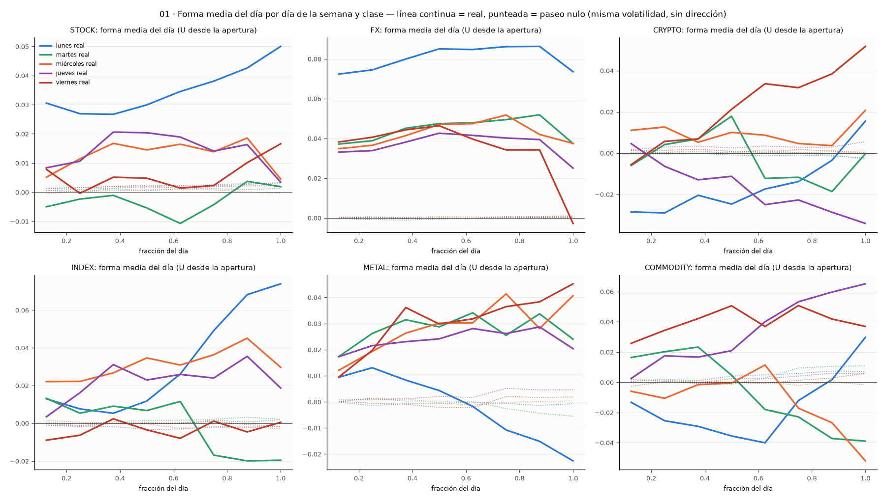
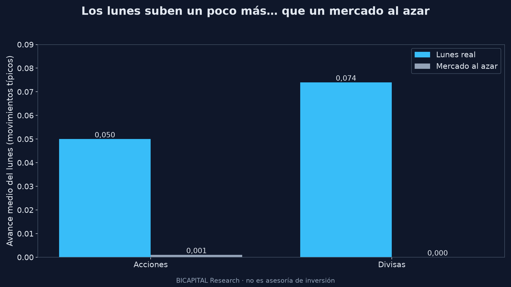
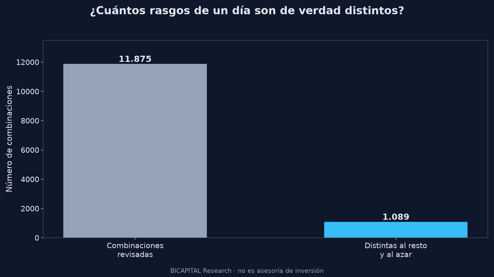
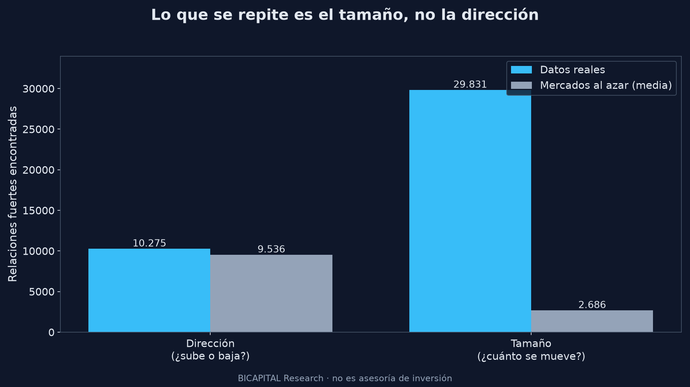

# ¿El lunes es distinto? La forma de cada día de la semana

*Miré 20 años de datos de más de cien mercados para ver si cada día de la semana tiene su propia «personalidad». Algo hay, sobre todo en cuánto se mueve el precio. En la dirección, apenas se separa del azar.*

Casi todo el mundo tiene una idea sobre los días de la semana. «Los lunes el mercado está raro». «Los viernes la gente cierra posiciones y no pasa nada». Son frases que se oyen mucho. Este laboratorio las pone a prueba con datos.

No es un sistema para operar. Es una radiografía: quiero ver qué forma tiene un día típico, y si el lunes, el martes o el viernes se comportan de verdad de forma distinta.

## Qué datos usé

- Desde 2005 hasta mediados de 2025.
- Acciones, divisas, índices bursátiles, criptomonedas, metales y materias primas.
- Más de cien activos, y 125 en la parte que busca relaciones entre unos y otros.

Para cada día medí varios «rasgos»: cuánto avanzó desde la apertura hasta el cierre, cuánto se movió entre el punto más alto y el más bajo, a qué hora marcó el máximo y el mínimo, si dio la vuelta al final, etc.

## El azar contra el que comparo

Para saber si algo es especial necesito un punto de comparación. Aquí lo llamo «mercado al azar», y se construye así: tomo las velas reales de cada activo, cada 15 minutos, conservo su tamaño y sus mechas, pero lanzo una moneda para decidir si cada vela sube o baja. El resultado es un mercado igual de movido que el real, pero sin ninguna dirección de fondo.

Es como tener un coche con el mismo motor pero con un volante que gira al azar. Si el coche de verdad llega a sitios que el del volante loco no alcanza, hay algo real.

## Resultado 1: cada día tiene algo de forma propia

**Cómo leer el gráfico:** es un gráfico del propio laboratorio. Hay seis paneles, uno por tipo de mercado (acciones, divisas, cripto, índices, metales y materias primas). Cada línea de color es un día de la semana y muestra, de media, cuánto se ha movido el precio desde la apertura a medida que avanza el día (de izquierda a derecha). Las líneas finas punteadas, casi pegadas al cero, son el mercado al azar. La línea azul es el lunes: en acciones y divisas acaba por encima de las demás.

Las líneas reales se separan de las punteadas. O sea: los días reales no son planos como el mercado al azar. Hay algo.

## Resultado 2: los lunes suben un poquito más

**Cómo leer el gráfico:** las barras azules son el avance medio de un lunes, de la apertura al cierre, en acciones y en divisas. Las grises, lo mismo en el mercado al azar. La unidad es el «movimiento típico» de cada activo: un 0,050 quiere decir 5 centésimas de lo que suele moverse ese activo en un rato normal.

La diferencia existe, pero es muy pequeña. Es como si, de cada 100 pasos normales del precio, un lunes regalara 5 extra hacia arriba. Antes de pagar costes. Después de pagarlos, queda muy poco.

## Resultado 3: pocos rasgos son de verdad distintos

**Cómo leer el gráfico:** revisé 11.875 combinaciones de activo, día y rasgo (por ejemplo, «Apple, lunes, hora del mínimo»). La barra azul son las que salen distintas a la vez frente a los otros días y frente al mercado al azar: 1.089. Es decir, unas 9 de cada 100.

Además, miré si los «tipos de día» (días tranquilos frente a días con mucho recorrido) se reparten distinto según el día de la semana. Solo pasa en 9 de 125 activos.

## Resultado 4: ¿un mercado avisa a otro?

La segunda parte buscaba algo más ambicioso. Por ejemplo: «cuando una acción cierra fuerte el viernes, ¿una divisa sube el lunes?». Revisé millones de combinaciones de activo, día y retraso.

Para saber cuántas relaciones fuertes saldrían por pura casualidad, usé otro azar: muevo en el calendario las fechas de cada activo, conservando el día de la semana. Así cada activo sigue siendo él mismo, pero su relación con los demás se rompe. Si con datos reales salen muchas más relaciones que así, hay algo.

**Cómo leer el gráfico:** cada pareja de barras cuenta cuántas relaciones fuertes aparecen: azul con datos reales, gris en los mercados al azar (de media). A la izquierda, relaciones de dirección («si A sube, luego B sube»). A la derecha, relaciones de tamaño («si A se mueve mucho, luego B se mueve mucho»).

- En dirección: 10.275 reales frente a 9.536 al azar. Apenas un 8 % más. La inmensa mayoría habrían salido igual por casualidad.
- En tamaño: 29.831 frente a 2.686. Unas 11 veces más. Aquí sí hay algo claro.

Pero ojo: buena parte del tamaño es que los mercados se agitan todos a la vez. Cuando quité ese efecto común, quedaron 4.941 relaciones frente a 2.526 al azar. Sigue siendo el doble, pero mucho menos espectacular.

Un ejemplo concreto: «el viernes de un activo avisa del lunes de otro». Salieron 587 relaciones fuertes, frente a unas 383 por azar.

## Una trampa escondida: los días de pánico

Muchas de estas relaciones dependen de muy pocos días. Unas 525.000 de los 2,7 millones de casillas guardadas dependen de solo 5 fechas en las que casi todo se movió a la vez, como el 24 de junio de 2016 (el día del resultado del referéndum del Brexit) o el 12 de marzo de 2020 (pandemia). Si una «regla» vive de cinco días históricos, no es una regla: es un recuerdo.

## Mi postura

Los días de la semana tienen algo de personalidad, sobre todo en cuánto se mueve el precio y a qué hora. Pero si la pregunta es «¿qué día comprar?», la respuesta de los datos es: la dirección se parece mucho al azar, y lo poco que sobra es pequeño y frágil.

## Qué me llevo

- Saber que el lunes o el viernes suelen ser más o menos movidos sirve para ajustar el tamaño de las operaciones, no para adivinar el lado.
- Cuando alguien diga «este mercado avisa de aquel otro», pregunta cuántas relaciones así saldrían por casualidad.
- Desconfía de patrones que dependen de unos pocos días históricos de pánico.
- El lunes alcista existe en promedio, pero es tan pequeño que los costes se lo pueden comer.

*Contenido educativo. No es asesoría de inversión.*
