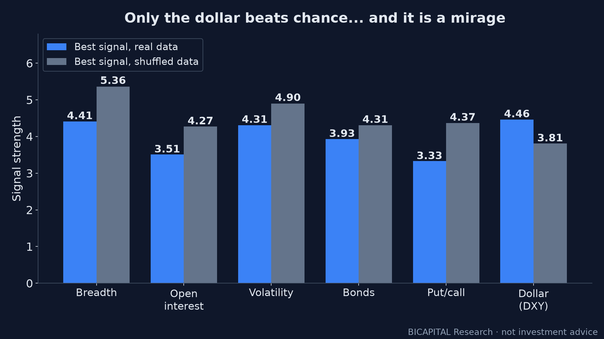
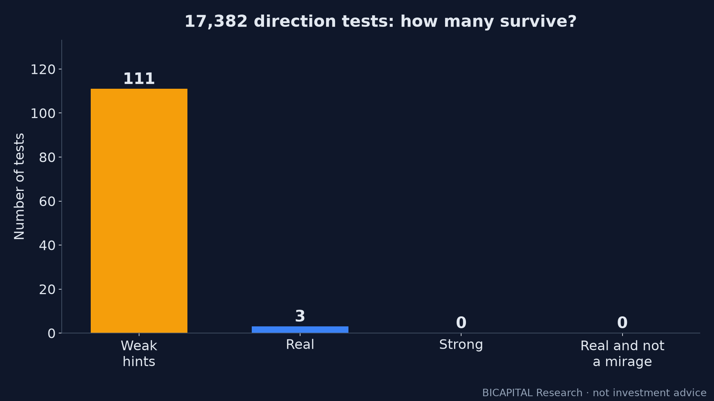
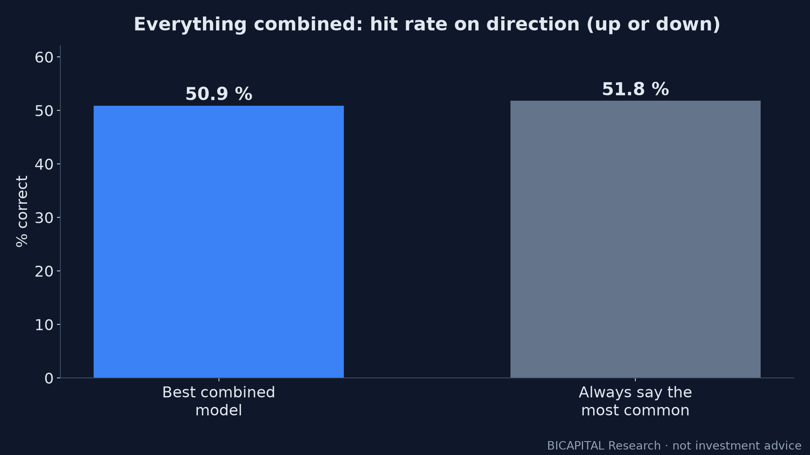
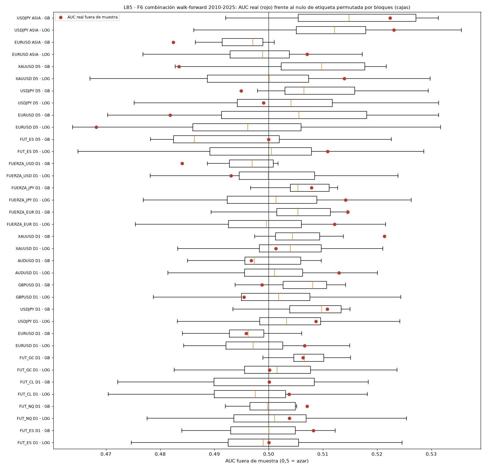

# Put/call, breadth, bonds and the dollar on TradingView: no direction

*We measured 17,382 ways of using these indicators to guess whether price goes up or down. None truly beat chance. The only one that seemed to was a mirage.*

TradingView offers a lot of "background" market data besides price: how many stocks rise and how many fall, how much downside protection is being bought, bond yields, the strength of the dollar... Many people add them to their charts thinking they anticipate direction.

We wanted to answer a simple question: does any of these data, on its own, tell whether price will rise or fall tomorrow? We measured it with data from 2010 to mid-2025.

## The data we tested, explained

- **Breadth.** Counts how many stocks on the New York Stock Exchange or the Nasdaq go up and how many go down. It is like looking not only at a class's average grade, but at how many students passed.
- **Open interest.** How many futures contracts remain open. It is like counting how many bets are still alive in a race.
- **Implied volatility.** How much the options market expects price to move. It is the "fear" priced into insurance.
- **Bonds across countries.** Differences in interest rates, for example between the US and Germany or Japan.
- **Put/call.** Compares how many put options (insurance against falls) are bought versus calls (bets on rises). It is like counting in a shop how many umbrellas are sold versus sunglasses: it tells you what weather people expect.
- **Dollar (DXY).** An index of the dollar's strength against other major currencies.

## How we measured it

For each indicator we took the extreme days: when it was very high and when it was very low. Then we checked whether another market's price rose or fell more than usual afterwards. We tested it on currencies, gold, oil and indices, over different horizons. In total, 17,382 tests.

We took care of one important detail: an indicator is only used after the time it is actually published. For example, put/call is not used before 5:15 pm New York time. That way no test "peeks at the future".

And how is chance built? In two ways. In the first, the whole indicator series is shifted a few days forwards or backwards, like a clock out of sync. In the second, the dates are shuffled within each year. In both cases the indicator keeps its shape but loses any real link to price. If the real data does not clearly beat those shuffled versions, it adds nothing.

## Result by family

**How to read the chart:** for each family, the blue bar is the strongest signal we found with real data. The grey bar is the strongest signal that shows up with shuffled data (the one reached in the luckiest 5% of cases). If blue does not beat grey, the finding is explained by having searched a lot. For breadth, open interest, volatility, bonds and put/call, blue falls short. Only the dollar beats it: 4.46 versus 3.81.

## The dollar mirage

The dollar gave three results that passed the filters. For example: when the dollar had risen a lot during the day, the euro tended to rise in the following Asian session. It was right 57.3% of the time over 1,003 days.

It looks promising. But we looked closer. When the dollar rises a lot, the euro has usually fallen a lot that same day. And after a very strong day, price tends to bounce back a little. That can already be seen on the euro's own chart, without looking at the dollar.

When we removed from the dollar the part that just repeats the day's move, its signal disappeared: it dropped to practically zero. In other words, the dollar brought no new information. It just repeated, in other words, what the euro was already saying.

**How to read the chart:** out of 17,382 tests, 111 were rated "weak hints", 3 "real" and none "strong". And the 3 real ones are the dollar's, explained by the same-day bounce. In the end, none adds new direction.

## What if we combine them all?

Maybe each indicator alone is weak but together they add up. We tested 36 models combining all the families. They were trained only on the past and tested on the following years, moving forward step by step from 2010 to 2025.

**How to read the chart:** the best combined model, on gold, guessed up or down correctly on 50.9% of days. Always saying whatever happens most often gave 51.8%. The model did not beat that very simple rule. None of the 36 models beat its random version.

**How to read the chart:** each row is a model (a market and a method; labels in Spanish). The vertical line in the middle, 0.50, is tossing a coin. The box shows the results the same model gives when the answers are shuffled: it is the luck zone. The red dot is the real result. Almost every red dot falls inside or near its box. And all of them sit very close to 0.50: a few hundredths above or below.

## Why this happens

These data are public and watched by a huge number of people. If they clearly told where price was going, the market would exploit it immediately and the edge would vanish. What they do is describe the mood: whether there is fear, whether many stocks join a rally. That helps you understand the market, but not guess tomorrow's direction.

## What I take away

- Put/call, breadth, open interest, volatility and bonds gave no direction on their own across 17,382 tests.
- If an indicator seems to predict, check that it is not just repeating what price itself already says.
- Combining many weak indicators does not make them strong: the best model did worse than the simplest rule.
- Use them to understand the market's mood, not as a buy or sell signal.

*Educational content. Not investment advice.*
