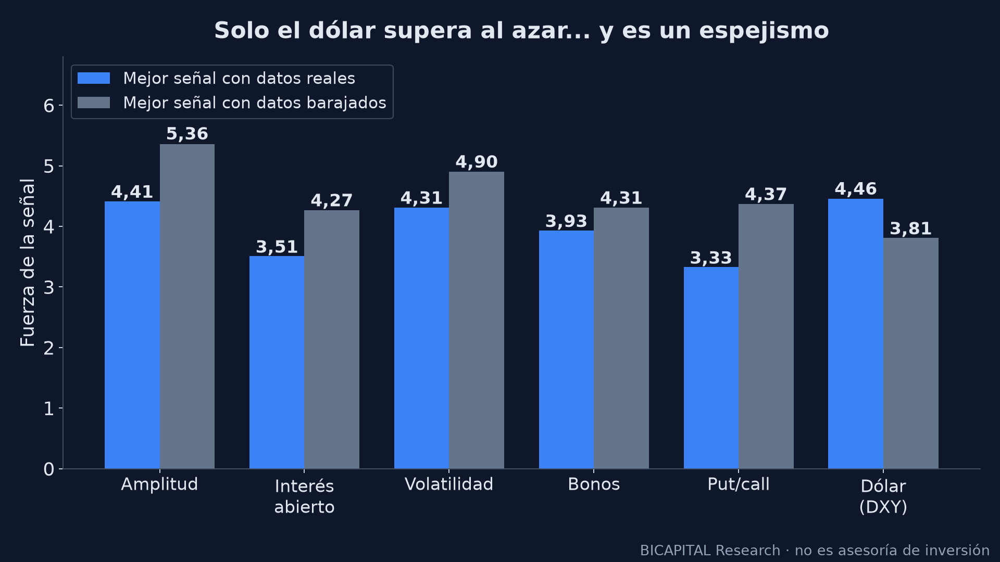
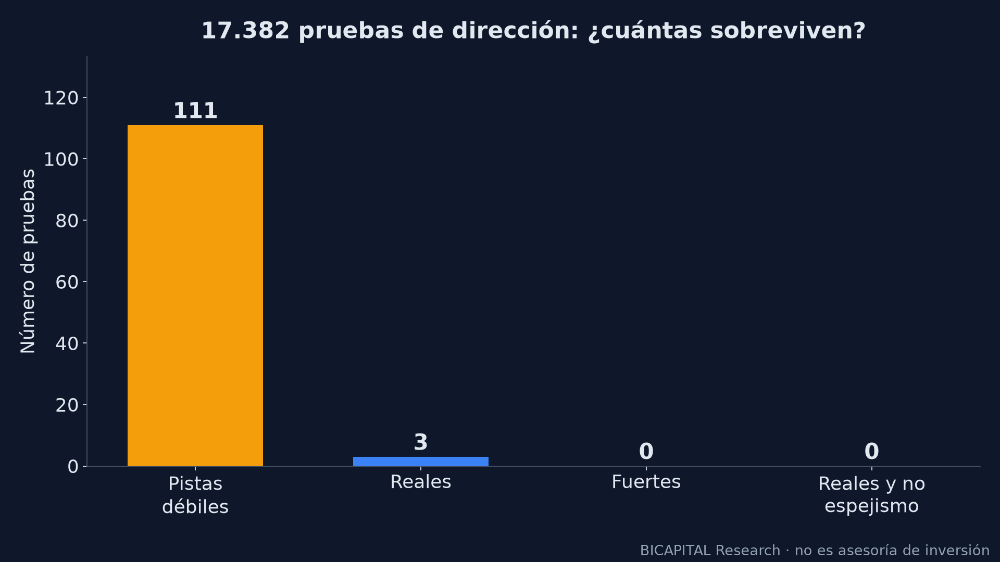
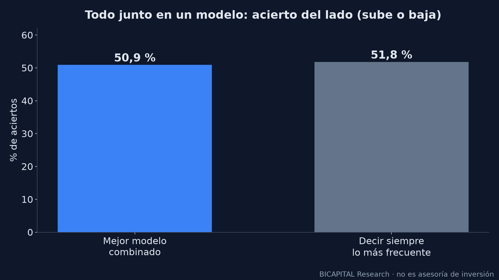
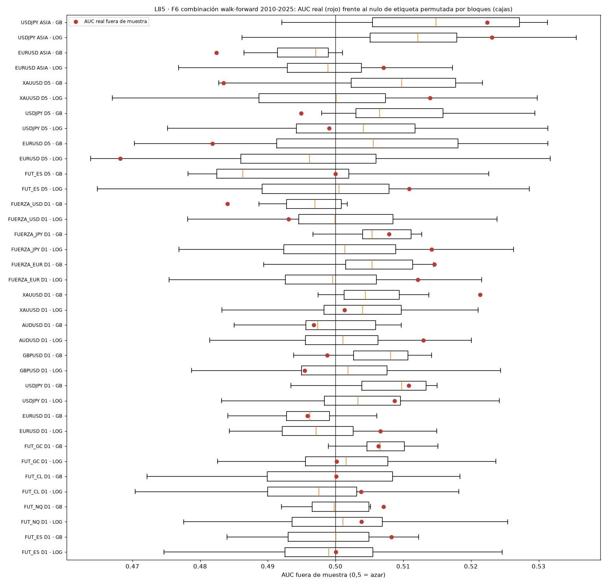

# Put/call, amplitud, bonos y dólar en TradingView: no dan dirección

*Medimos 17.382 formas de usar estos indicadores para adivinar si el precio sube o baja. Ninguna superó al azar de verdad. La única que lo parecía era un espejismo.*

TradingView ofrece muchos datos «de fondo» del mercado, además del precio: cuántas acciones suben y cuántas bajan, cuántas opciones de protección se compran, tipos de interés de bonos, la fuerza del dólar... Mucha gente los añade a sus gráficos pensando que anticipan la dirección.

Queríamos responder una pregunta sencilla: ¿alguno de estos datos, por sí solo, dice si mañana el precio subirá o bajará? Lo medimos con datos desde 2010 hasta mediados de 2025.

## Los datos que probamos, explicados

- **Amplitud.** Cuenta cuántas acciones de la bolsa de Nueva York o del Nasdaq suben y cuántas bajan. Es como mirar no solo la nota media de una clase, sino cuántos alumnos aprobaron.
- **Interés abierto.** Cuántos contratos de futuros siguen abiertos. Es como contar cuántas apuestas siguen vivas en una carrera.
- **Volatilidad implícita.** Lo que el mercado de opciones espera que se mueva el precio. Es el «miedo» que se cobra en los seguros.
- **Bonos entre países.** Diferencias de tipos de interés, por ejemplo entre Estados Unidos y Alemania o Japón.
- **Put/call.** Compara cuántas opciones put (seguros contra caídas) se compran frente a cuántas calls (apuestas a subidas). Es como contar en una tienda cuántos paraguas se venden frente a cuántas gafas de sol: dice qué tiempo espera la gente.
- **Dólar (DXY).** Un índice de la fuerza del dólar frente a otras monedas grandes.

## Cómo lo medimos

Para cada dato tomamos los días extremos: cuando estaba muy alto y cuando estaba muy bajo. Y miramos si después el precio de otro mercado subía o bajaba más de lo normal. Lo probamos sobre divisas, oro, petróleo e índices, a distintos plazos. En total, 17.382 pruebas.

Cuidamos un detalle importante: solo se usa un dato después de la hora en que de verdad se publica. Por ejemplo, el put/call no se usa antes de las 17:15 de Nueva York. Así ninguna prueba «mira el futuro».

¿Y cómo se construye el azar? De dos formas. En la primera, se desplaza toda la serie del indicador unos días hacia delante o hacia atrás, como si se desincronizara un reloj. En la segunda, se barajan las fechas dentro de cada año. En los dos casos, el indicador conserva su forma, pero pierde cualquier relación real con el precio. Si el dato real no supera claramente a esas versiones mezcladas, no aporta nada.

## Resultado por familia

**Cómo leer el gráfico:** para cada familia, la barra azul es la señal más fuerte que encontramos con datos reales. La gris es la señal más fuerte que aparece con datos barajados (la que sale en el 5 % de los casos más afortunados). Si la azul no supera a la gris, lo encontrado se explica por haber buscado mucho. En amplitud, interés abierto, volatilidad, bonos y put/call, la azul queda por debajo. Solo el dólar la supera: 4,46 frente a 3,81.

## El espejismo del dólar

El dólar dio tres resultados que pasaban los filtros. Por ejemplo: cuando el dólar había subido mucho en el día, el euro tendía a subir en la sesión asiática siguiente. Acertaba el 57,3 % de las veces en 1.003 días.

Parece prometedor. Pero miramos más de cerca. Cuando el dólar sube mucho, el euro suele haber bajado mucho ese mismo día. Y después de un día muy fuerte, el precio tiende a recuperar un poco. Eso ya se ve en el propio gráfico del euro, sin mirar el dólar.

Cuando quitamos al dólar la parte que repite el movimiento del día, su señal desaparece: queda prácticamente en cero. Es decir, el dólar no aportaba información nueva. Solo repetía, con otras palabras, lo que el euro ya decía.

**Cómo leer el gráfico:** de 17.382 pruebas, 111 quedaron como «pistas débiles», 3 como «reales» y ninguna como «fuerte». Y las 3 reales son la del dólar, que se explica por el rebote del propio día. Al final, ninguna aporta dirección nueva.

## ¿Y si los juntamos todos?

Quizá cada dato por separado es débil, pero juntos suman. Probamos 36 modelos que combinan todas las familias. Se entrenaban solo con el pasado y se probaban en los años siguientes, avanzando paso a paso de 2010 a 2025.

**Cómo leer el gráfico:** el mejor modelo combinado, sobre el oro, acertó si subía o bajaba el 50,9 % de los días. Decir siempre lo que pasa con más frecuencia daba un 51,8 %. El modelo no mejoró a esa regla tan simple. Ninguno de los 36 modelos superó a su versión al azar.

**Cómo leer el gráfico:** cada fila es un modelo (un mercado y un método). La línea vertical del centro, 0,50, es lanzar una moneda. La caja muestra los resultados que da el mismo modelo cuando se barajan las respuestas: es la zona de la suerte. El punto rojo es el resultado real. Casi todos los puntos rojos caen dentro o cerca de su caja. Y todos están muy cerca de 0,50: pocas centésimas arriba o abajo.

## Por qué pasa esto

Estos datos son públicos y los mira muchísima gente. Si dijeran claramente hacia dónde va el precio, el mercado lo aprovecharía enseguida y la ventaja desaparecería. Lo que sí hacen es describir el ambiente: si hay miedo, si muchas acciones acompañan a la subida. Eso es útil para entender el mercado, pero no para adivinar el lado de mañana.

## Qué me llevo

- Put/call, amplitud, interés abierto, volatilidad y bonos no dieron dirección por sí solos en 17.382 pruebas.
- Si un indicador parece predecir, comprueba si no está repitiendo lo que ya dice el propio precio.
- Juntar muchos indicadores débiles no los hace fuertes: el mejor modelo acertó menos que la regla más simple.
- Úsalos para entender el ambiente del mercado, no como señal de compra o venta.

*Contenido educativo. No es asesoría de inversión.*
