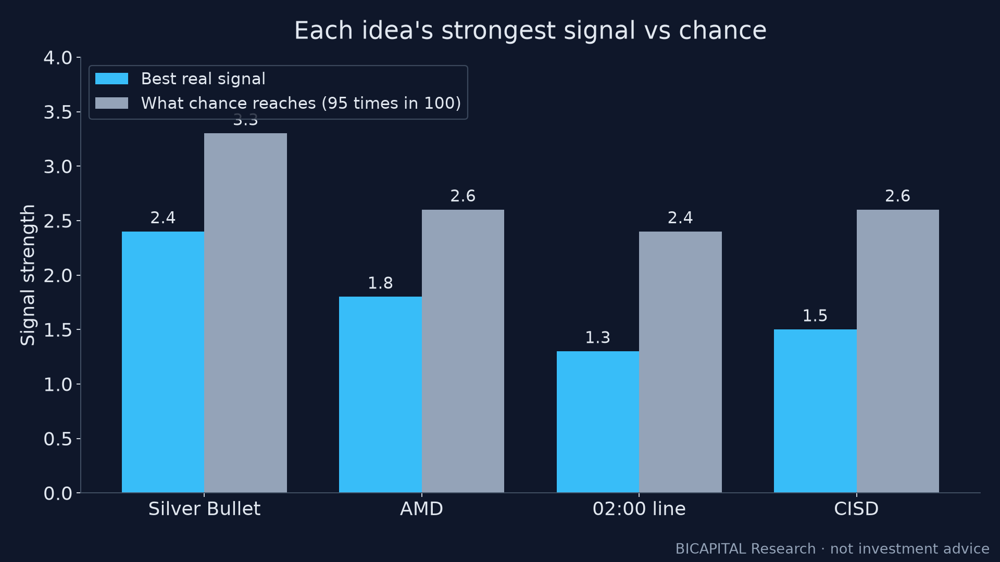
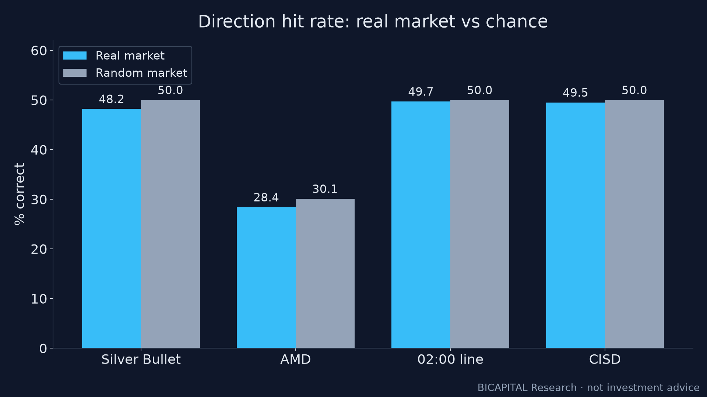
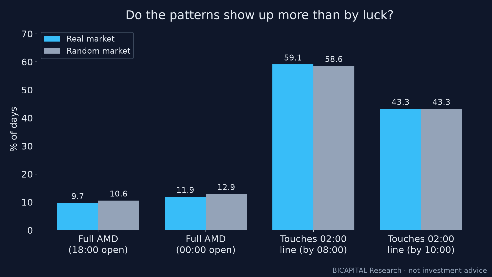
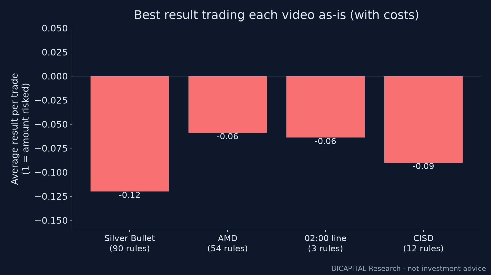

# Silver Bullet, AMD and other ICT ideas vs a random market

*We turned four popular ICT/SMC video ideas into exact rules and compared them with an invented market. None of them stood out from chance.*

If you have watched trading videos in recent years, words like «Silver Bullet», «AMD» or «liquidity sweep» probably ring a bell. They come from a school called ICT (short for *Inner Circle Trader*, its creator's name) and its cousin SMC (*Smart Money Concepts*). The core idea is appealing: big banks would leave footprints on the chart, and whoever learns to read them could follow along.

It is like believing that footprints in the snow will tell you where the wolf went. It sounds logical. But before following footprints, it is worth checking they are not just from any passer-by.

That is what we did. We picked four ideas, turned them into rules a computer can follow without hesitation, and measured them over many years of data from 16 markets: indices, currencies, gold and others.

## The four ideas, in plain words

- **Silver Bullet.** In three one-hour windows (03-04, 10-11 and 14-15, New York time), price «sweeps» the high or low of the Asian or London session. Sweeping means going slightly past a level and coming back, like stepping on a line and stepping back. It then leaves a gap between candles and, from there, would head for the opposite side.
- **AMD or «Power of three».** The day would be a play in three acts: Asia accumulates (price stays still), London manipulates (it fakes out by breaking an extreme) and New York distributes (it goes the other way and closes near the extreme).
- **The 02:00 line.** The New York 02:00 price would split «expensive» (above) from «cheap» (below). Sell above, buy below, and the line would pull price back like a magnet.
- **CISD («change in state of delivery»).** After a sweep, the first candle that closes beyond the opening of the move would mark the turn.

## How we built the random market

This is the key to the study. A 55 % hit rate looks good, but what if chance also gives 55 %? We need a yardstick.

For each market we built 100 invented copies. Each copy uses the same candle sizes as the real market, minute by minute, but with the direction shuffled at random. It is like shuffling the cards from a game: same cards, but the order no longer has any intention.

Those copies also have Asian sessions, sweeps, gaps and 02:00 lines, because they appear on their own whenever price moves. So we applied exactly the same rules to the real market and to the copies. If the ICT idea truly discovers something, the real market should clearly beat the copies.

Also, because we tested many versions of each idea, we protected ourselves from the «lucky shot». If you try 60 versions, one will look pretty by pure chance. So we compared the best real version with the best version that shows up in the random copies.

## Result 1: the strongest signal does not beat chance

**How to read the chart:** each pair of bars is one idea. The blue bar is the strongest signal we found in the real market across all its versions. The grey one is what the random market reaches in 95 out of 100 copies. For an idea to be interesting, blue should be clearly above grey. In all four it is below: Silver Bullet 2.4 vs 3.3; AMD 1.8 vs 2.6; 02:00 line 1.3 vs 2.4; CISD 1.5 vs 2.6.

For Silver Bullet we tested 60 main versions. For AMD, 16. For the 02:00 line and CISD, 6 each. None was real and stable in its favour.

## Result 2: the hit rate is a coin flip

**How to read the chart:** the blue bar is how often the idea got the direction right in the real market; the grey one, the same in the random market. If they match, the idea adds nothing. The most striking Silver Bullet version was right 48.2 % of the time vs 50.0 % by chance. The 02:00 line version, 49.7 % vs 50.0 %. CISD, 49.5 % vs 50.0 %. For AMD the question is tougher (closing at the extreme), so the numbers are low: 28.4 % real vs 30.1 % random.

## Result 3: the patterns show up just as often in chance

**How to read the chart:** here we do not measure hits, but how many days the pattern appears. The two bars on the left are the full AMD (all three acts): it appears on 9.7 % and 11.9 % of days in the real market, and slightly more in the random one (10.6 % and 12.9 %). The ones on the right show how often price comes back to touch the 02:00 line: 59.1 % vs 58.6 % by 08:00, and 43.3 % vs 43.3 % by 10:00.

This matters. The 02:00 line «magnet» exists, yes, but it exists just the same in an invented market. It is geometry: if price moves little, it passes again where it was. No bank is needed to explain it.

CISD behaved similarly. The turn signal gets «cancelled» (price crosses back over the line) between 81 % and 96 % of the time depending on the version, exactly as in the random market.

## Result 4: trading it as-is, with costs, loses

**How to read the chart:** we traded the ideas as explained in the videos, with stop and target, paying a broker's real costs. Each bar is the average result of the BEST rule for each idea. We measure it in «risk units»: 1 means winning as much as you risk; −1, losing all of it on that trade. Every bar is below zero: Silver Bullet −0.120, AMD −0.059, 02:00 line −0.064 and CISD −0.090. Those are the best; the rest did worse.

In total, 159 rules were traded as-is. All 159 were discarded.

## What about the loose pieces?

We also measured the «triggers» on their own: sweeps, body closes, gaps between candles, structure changes and their combinations. There were more than 600 combinations in the classic markets and none survived. In relative series (for example, a stock divided by its index) a single one survived: a sweep of the previous week's extreme was right 53.1 % of the time vs 49.9 %. But on review it had no effect of its own: it was explained by an already known rebound.

These results will be recalculated with corrected spread data; we will publish the update.

## My takeaways

- None of the four ideas (Silver Bullet, AMD, 02:00 line, CISD) stood out from a random market with the same movement.
- A pattern that «shows up» a lot on the chart proves nothing: sweeps, gaps and magnets also appear in invented markets.
- Traded as-is, with costs, all 159 rules lost.
- This does not mean ICT users are foolish. It means that, with these rules and this data, no edge appears. If someone shows you one, ask for the comparison with chance.

*Educational content. Not investment advice.*
