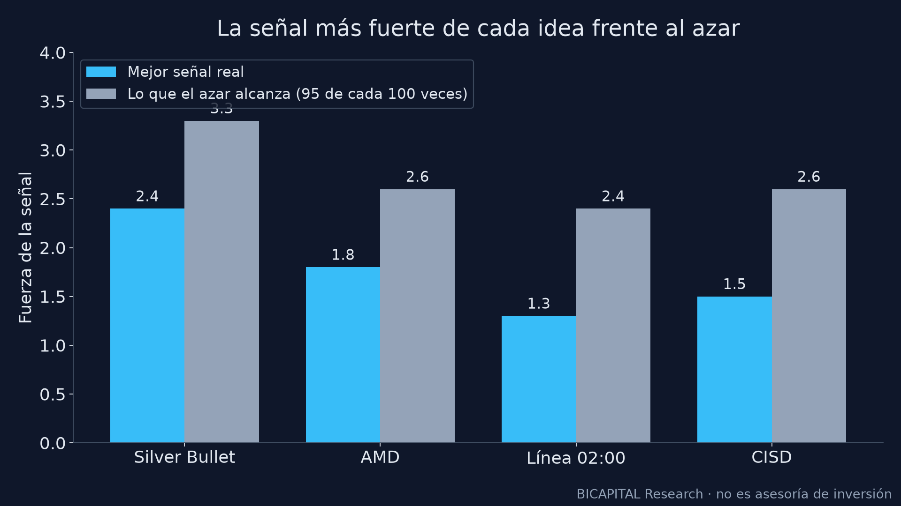
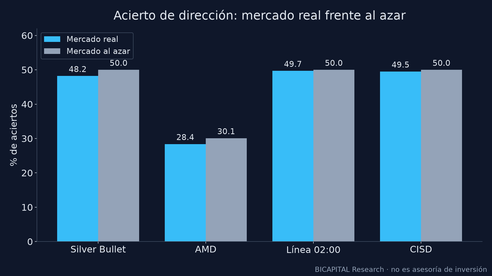
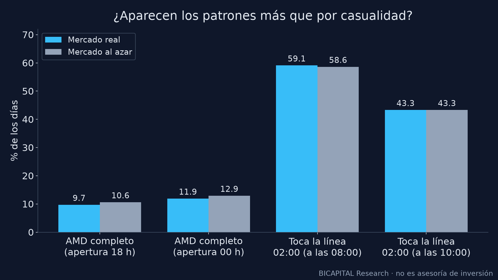
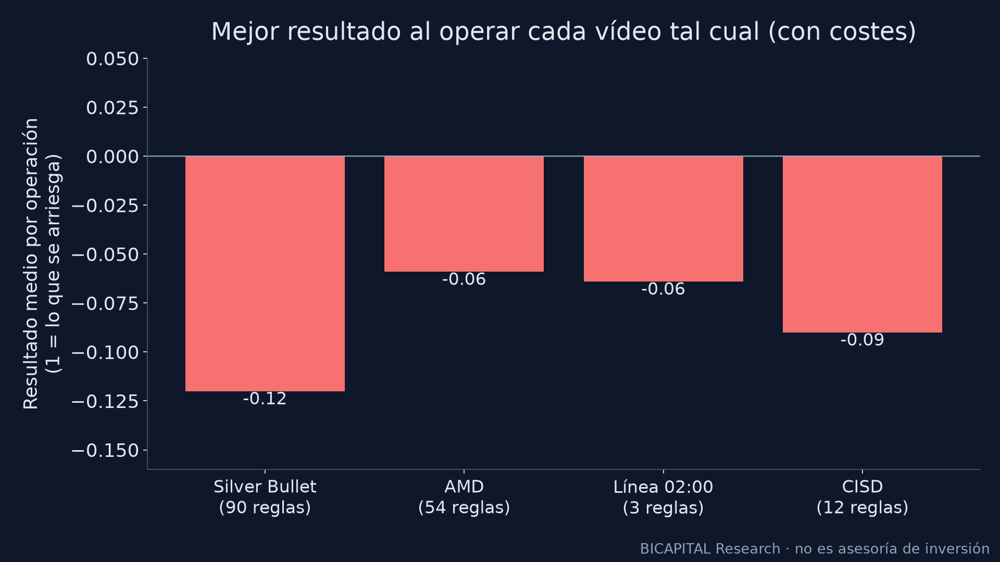

# Silver Bullet, AMD y otras ideas ICT frente a un mercado al azar

*Tradujimos a reglas exactas cuatro ideas muy populares de los vídeos ICT/SMC y las comparamos con un mercado inventado. Ninguna se distinguió del azar.*

Si has visto vídeos de trading en los últimos años, seguro que te suenan palabras como «Silver Bullet», «AMD» o «barrido de liquidez». Vienen de una escuela llamada ICT (las siglas de su creador, *Inner Circle Trader*) y de su prima SMC (*Smart Money Concepts*, «conceptos del dinero inteligente»). La idea de fondo es atractiva: los grandes bancos dejarían huellas en el gráfico, y quien sepa leerlas podría ir detrás de ellos.

Es como pensar que, si miras las pisadas en la nieve, sabrás hacia dónde ha ido el lobo. Suena lógico. Pero antes de seguir pisadas conviene comprobar que no son las de cualquier paseante.

Eso hicimos. Escogimos cuatro ideas, las convertimos en reglas que un ordenador puede seguir sin dudar y las medimos con muchos años de datos de 16 mercados: índices, divisas, oro y otros.

## Las cuatro ideas, explicadas en sencillo

- **Silver Bullet («bala de plata»).** En tres ventanas de una hora (03-04, 10-11 y 14-15, hora de Nueva York), el precio «barre» el máximo o el mínimo de la sesión de Asia o de Londres. Barrer es pasar un poco por encima de un nivel y volver, como quien pisa la raya y retrocede. Después deja un hueco entre velas y desde ahí iría a buscar el lado contrario.
- **AMD o «Poder de tres».** El día sería una obra en tres actos: Asia acumula (el precio se queda quieto), Londres manipula (engaña rompiendo un extremo) y Nueva York distribuye (se va al lado contrario y cierra cerca del extremo).
- **La línea de las 02:00.** El precio de las 02:00 de Nueva York separaría lo «caro» (encima) de lo «barato» (debajo). Encima se vende, debajo se compra, y la línea atraería al precio como un imán.
- **CISD («cambio de estado de entrega»).** Tras un barrido, la primera vela que cierra al otro lado de la apertura del movimiento marcaría el giro.

## Cómo fabricamos el mercado al azar

Aquí está la clave del estudio. Un acierto del 55 % parece bueno, pero ¿y si el azar también da un 55 %? Necesitamos una vara de medir.

Para cada mercado construimos 100 copias inventadas. Cada copia se hace con el mismo tamaño de velas que el mercado real, minuto a minuto, pero con la dirección mezclada al azar. Es como barajar las cartas de una partida: las cartas son las mismas, el orden ya no tiene intención.

En esas copias también hay sesiones de Asia, barridos, huecos y líneas de las 02:00, porque salen solos cuando el precio se mueve. Así, aplicamos exactamente las mismas reglas al mercado real y a las copias. Si la idea ICT descubre algo de verdad, el mercado real debería ganar con claridad a las copias.

Además, como probamos muchas versiones de cada idea, nos protegemos del «golpe de suerte». Si pruebas 60 versiones, alguna saldrá bonita por pura casualidad. Por eso comparamos la mejor versión real con la mejor versión que sale en el azar.

## Resultado 1: la señal más fuerte no supera al azar

**Cómo leer el gráfico:** cada pareja de barras es una idea. La barra azul es la señal más fuerte que encontramos en el mercado real entre todas sus versiones. La gris es lo que llega a alcanzar el mercado al azar en 95 de cada 100 copias. Para que una idea sea interesante, la azul debería quedar claramente por encima de la gris. En las cuatro queda por debajo: Silver Bullet 2,4 frente a 3,3; AMD 1,8 frente a 2,6; línea de las 02:00 1,3 frente a 2,4; CISD 1,5 frente a 2,6.

## Resultado 2: el acierto es el de una moneda

**Cómo leer el gráfico:** la barra azul es el porcentaje de veces que la idea acertó la dirección en el mercado real; la gris, lo mismo en el mercado al azar. Si fueran iguales, la idea no aporta nada. La versión más llamativa de Silver Bullet acertó el 48,2 % frente al 50,0 % del azar. La de la línea de las 02:00, el 49,7 % frente a 50,0 %. La de CISD, el 49,5 % frente a 50,0 %. En AMD la pregunta es más exigente (cerrar en el extremo) y por eso las cifras son bajas: 28,4 % real frente a 30,1 % al azar.

## Resultado 3: los patrones aparecen igual en el azar

**Cómo leer el gráfico:** aquí no medimos aciertos, sino cuántos días aparece el patrón. Las dos barras de la izquierda son el AMD completo (los tres actos): aparece el 9,7 % y el 11,9 % de los días en el mercado real, y algo más en el azar (10,6 % y 12,9 %). Las de la derecha son las veces que el precio vuelve a tocar la línea de las 02:00: 59,1 % frente a 58,6 % a las 08:00, y 43,3 % frente a 43,3 % a las 10:00.

Esto es importante. El «imán» de la línea de las 02:00 existe, sí, pero existe igual en un mercado inventado. Es geometría: si el precio se mueve poco, vuelve a pasar por donde estaba. No hace falta ningún banco para explicarlo.

En CISD pasó algo parecido. La señal de giro se «invalida» (el precio vuelve a cruzar la línea) entre el 81 % y el 96 % de las veces según la versión, exactamente igual que en el azar.

## Resultado 4: operarlo tal cual, con costes, pierde

**Cómo leer el gráfico:** probamos a operar las ideas como se explican en los vídeos, con stop y objetivo, pagando los costes reales de un bróker. Cada barra es el resultado medio de la MEJOR regla de cada idea. Lo medimos en «unidades de riesgo»: 1 significa ganar lo mismo que arriesgas; −1, perderlo todo en esa operación. Todas las barras están bajo cero: Silver Bullet −0,120, AMD −0,059, línea de las 02:00 −0,064 y CISD −0,090. Son las mejores; el resto fue peor.

En total, 159 reglas operadas tal cual. Las 159 quedaron descartadas.

## ¿Y las piezas sueltas?

También medimos los «gatillos» por separado: barridos, cierres de cuerpo, huecos entre velas, cambios de estructura y sus combinaciones. Fueron más de 600 combinaciones en los mercados clásicos y ninguna sobrevivió. En las series relativas (por ejemplo, una acción dividida entre su índice) sobrevivió una sola: un barrido del extremo de la semana anterior acertó el 53,1 % frente al 49,9 %. Pero al revisarla no tenía efecto propio: se explicaba por un rebote ya conocido.

Estos resultados se recalcularán con datos de spread corregidos; publicaremos la actualización.

## Qué me llevo

- Ninguna de las cuatro ideas (Silver Bullet, AMD, línea de las 02:00, CISD) se distinguió de un mercado al azar con el mismo movimiento.
- Que un patrón «se vea» mucho en el gráfico no prueba nada: los barridos, los huecos y los imanes también salen en mercados inventados.
- Operadas tal cual, con costes, las 159 reglas perdieron.
- Esto no significa que quien usa ICT sea tonto. Significa que, con estas reglas y estos datos, la ventaja no aparece. Si alguien te muestra una, pídele la comparación con el azar.

*Contenido educativo. No es asesoría de inversión.*
