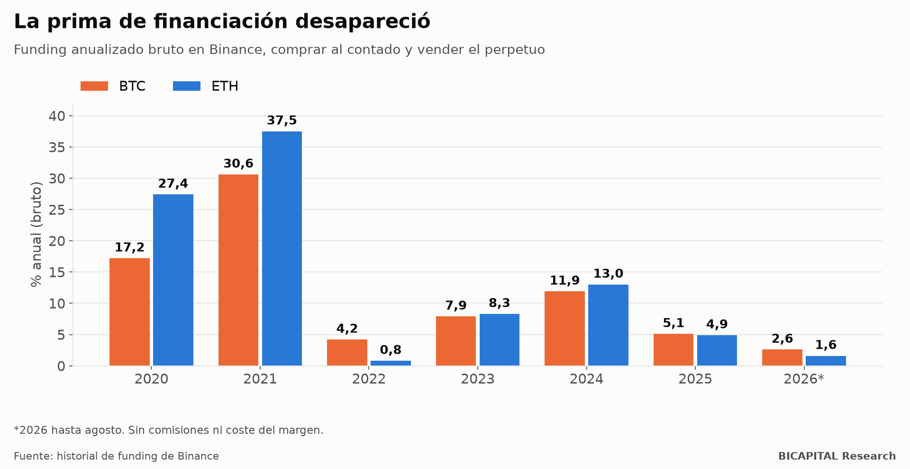

# El funding de Binance: del 30 % anual al 2 %

Hay una estrategia cripto que suena a dinero gratis: **comprar Bitcoin al contado y vender a la vez el contrato perpetuo**.
Así no apuestas a si sube o baja: lo que ganas por un lado lo pierdes por el otro. Lo que sí cobras es la «financiación»
(funding), el pago periódico que hacen los que compran perpetuos con apalancamiento a los que venden.

En 2021 esa prima fue enorme. La medí año a año con el historial de Binance, de 2020 a agosto de 2026. **Hoy casi no
queda nada.**

## Lo que pagaba el funding

| Año | BTC | ETH | SOL | BNB | XRP |
|---|---:|---:|---:|---:|---:|
| 2020 | 17,2 % | 27,4 % | −12,4 % | 2,5 % | 24,6 % |
| 2021 | **30,6 %** | **37,5 %** | 28,6 % | 21,7 % | 48,1 % |
| 2022 | 4,2 % | 0,8 % | −38,0 % | −12,6 % | 0,0 % |
| 2023 | 7,9 % | 8,3 % | 1,3 % | −8,4 % | 8,2 % |
| 2024 | 11,9 % | 13,0 % | 13,6 % | −3,3 % | 14,2 % |
| 2025 | 5,1 % | 4,9 % | 0,4 % | −2,1 % | 3,5 % |
| 2026 (hasta agosto) | **2,6 %** | **1,6 %** | −1,7 % | 2,7 % | −0,8 % |

Son cifras **brutas y anualizadas**, sin comisiones ni el coste de inmovilizar capital como garantía. Es decir, el techo de
lo que se podía ganar, no lo que te quedaba.

## Tres cosas que la tabla enseña

**1. La prima existió, y fue enorme.** En 2021, cobrar el funding de Bitcoin rendía un 30,6 % anual sin apostar por la
dirección: en un año de euforia, los compradores con apalancamiento pagaban mucho por mantener sus posiciones.

**2. No siempre cobras: a veces pagas.** En 2022, el funding de Solana fue de −38 %: los que vendían perpetuos pagaban a
los que compraban. En 2026, la mitad de los cobros de Solana y de XRP fueron negativos. La estrategia «neutral» también
tiene años malos.

**3. Hoy está arbitrada.** Desde 2025, la prima de Bitcoin y Ethereum está por debajo de lo que paga un depósito sin riesgo
en dólares. Y para cobrarla asumes el riesgo del exchange y tienes parte del capital inmovilizado como garantía.

## Por qué desapareció

Es el ciclo típico de una ventaja en los mercados:

1. **Existe** porque pocos la explotan.
2. **Se publica** y se vuelve conocida.
3. **Llega el capital**: fondos y productos que hacen exactamente esto a gran escala.
4. **Desaparece**, porque tanta gente vendiendo perpetuos abarata el funding.

Mi lectura es que la llegada de productos dedicados a esta estrategia a partir de 2024 aceleró el paso 3. Es una
interpretación, no algo que haya medido.

## Qué te llevas

- **Si alguien te vende el «carry de funding» con cifras de 2021, te vende el pasado.** Pide los números de este año.
- **Una estrategia neutral no es una estrategia sin riesgo.** Hay años con funding negativo, riesgo del exchange y riesgo de
  liquidación de la pata corta si el precio sube muy rápido.
- **Las primas fáciles se acaban.** Cuando una ventaja es conocida y fácil de ejecutar, el capital la cierra.

*Héctor Sandoval · BICAPITAL Research*

---

*Contenido educativo y de investigación. No es asesoría de inversión ni una recomendación personalizada. Funding histórico
de Binance, bruto y anualizado, sin costes ni margen; 2026 solo hasta agosto. Los derivados con apalancamiento pueden
causar pérdidas superiores al capital aportado.*
