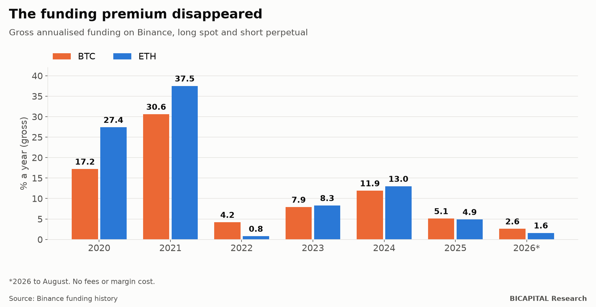

# Binance funding: from 30% a year to 2%

There is a crypto strategy that sounds like free money: **buy Bitcoin spot and, at the same time, sell the perpetual
contract**. That way you do not bet on whether it goes up or down: what you make on one side you lose on the other. What
you do collect is the "funding", the periodic payment that leveraged perpetual buyers make to sellers.

In 2021 that premium was huge. I measured it year by year with Binance's history, from 2020 to August 2026. **Today there
is almost nothing left.**

## What funding paid

| Year | BTC | ETH | SOL | BNB | XRP |
|---|---:|---:|---:|---:|---:|
| 2020 | 17.2% | 27.4% | −12.4% | 2.5% | 24.6% |
| 2021 | **30.6%** | **37.5%** | 28.6% | 21.7% | 48.1% |
| 2022 | 4.2% | 0.8% | −38.0% | −12.6% | 0.0% |
| 2023 | 7.9% | 8.3% | 1.3% | −8.4% | 8.2% |
| 2024 | 11.9% | 13.0% | 13.6% | −3.3% | 14.2% |
| 2025 | 5.1% | 4.9% | 0.4% | −2.1% | 3.5% |
| 2026 (to August) | **2.6%** | **1.6%** | −1.7% | 2.7% | −0.8% |

These are **gross, annualised** figures, without fees or the cost of tying up capital as collateral. In other words, the
ceiling of what could be earned, not what you kept.

## Three things the table shows

**1. The premium existed, and it was huge.** In 2021, collecting Bitcoin's funding returned 30.6% a year without betting on
direction: in a euphoric year, leveraged buyers paid a lot to keep their positions open.

**2. You do not always collect: sometimes you pay.** In 2022, Solana's funding was −38%: perpetual sellers paid the
buyers. In 2026, half of Solana's and XRP's funding payments were negative. The "neutral" strategy has bad years too.

**3. Today it is arbitraged away.** Since 2025, the Bitcoin and Ethereum premium has been below what a risk-free dollar
deposit pays. And to collect it you take on exchange risk and keep part of your capital locked up as collateral.

## Why it disappeared

It is the typical life cycle of an edge in markets:

1. **It exists** because few people exploit it.
2. **It gets published** and becomes well known.
3. **Capital arrives**: funds and products that do exactly this at scale.
4. **It disappears**, because so many people selling perpetuals push funding down.

My reading is that the arrival of products dedicated to this strategy from 2024 onwards accelerated step 3. That is an
interpretation, not something I measured.

## Takeaways

- **If someone sells you "funding carry" with 2021 numbers, they are selling you the past.** Ask for this year's numbers.
- **A neutral strategy is not a riskless strategy.** There are years of negative funding, exchange risk and the risk of the
  short leg being liquidated if price rises very fast.
- **Easy premiums run out.** When an edge is known and easy to execute, capital closes it.

*Héctor Sandoval · BICAPITAL Research*

---

*Educational and research content. Not investment advice or a personalised recommendation. Historical Binance funding,
gross and annualised, without costs or margin; 2026 only to August. Leveraged derivatives can cause losses greater than the
capital deposited.*
