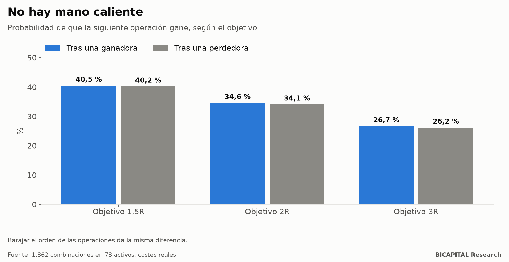

# «Está en racha»: encender y apagar estrategias según cómo van no funciona

Es uno de los consejos más repetidos de la gestión de estrategias: **opera la que está en racha y apaga la que va mal.**
Suena a sentido común. Si una herramienta acaba de ganar varias veces, estará «en su momento»; si pierde, el mercado habrá
cambiado.

Lo probé a gran escala: **1.862 combinaciones de herramienta y salida en 78 activos**, con costes reales de CFD, millones
de operaciones. Primero miré si existe la racha. Después, si encender y apagar según la racha mejora el resultado.

## ¿Ganar hace más probable volver a ganar?

Con un objetivo de 1,5 veces lo arriesgado:

| Después de… | La siguiente operación gana |
|---|---:|
| una ganadora | 40,5 % |
| una perdedora | 40,2 % |
| las mismas operaciones, barajadas | misma diferencia |

**La diferencia es de 0,3 puntos, exactamente la misma que sale al barajar el orden de las operaciones.** No hay «mano
caliente»: el resultado de la operación anterior no dice nada de la siguiente.

Lo único que sí persiste es **el tamaño** de los movimientos: después de operaciones largas vienen operaciones largas,
porque la volatilidad se agrupa. Pero eso no dice si vas a ganar o perder.

## ¿Y si enciendo y apago según la racha?

Probé tres versiones del interruptor (por operación, por día y por semana) y una cartera que cada año elige sus
herramientas con los tres años anteriores y las enciende o apaga según su racha reciente:

- **Encendidas, ninguna celda gana dinero** después de corregir por el número de pruebas.
- **La mejor cartera adaptativa pierde −0,085 R por operación**: una rentabilidad anual compuesta del −76,6 % en la
  simulación, con una caída que llega a perderlo todo.
- En la mejor combinación, encender y apagar pierde algo menos que dejarla siempre encendida (−0,105 frente a −0,114 R por
  operación), pero sigue perdiendo. Y la cartera adaptativa no supera a esas mismas operaciones con el orden barajado.

## Por qué falla

Medí cuánto dura una «buena época»: **6 operaciones de mediana, unos 15 días.** Y en promedio deja **−0,65 R**: las buenas
épocas ya incluyen la vuelta a la normalidad.

El problema es el retraso. Desde el mejor momento de una racha hasta que el interruptor se da cuenta de que se acabó
pasan de mediana 3 operaciones, y en ese tiempo **se devuelven de media 3,2 R.** Cuando la racha se nota, ya terminó.

## Qué te llevas

1. **El resultado de la operación anterior no predice la siguiente.** Si sientes que «estás en racha», es probable que sea
   azar.
2. **Encender lo que ganó y apagar lo que perdió llega tarde**: compras el final de la racha y pagas la vuelta.
3. **Una herramienta sin ventaja no la gana por encenderse en el momento adecuado.** Si no gana siempre encendida, el
   interruptor no la salva.

*Héctor Sandoval · BICAPITAL Research*

---

*Contenido educativo y de investigación. No es asesoría de inversión ni una recomendación personalizada. Datos históricos de
CFD hasta junio de 2025 con costes reales; prerregistro firmado antes de calcular. Los CFD tienen un alto riesgo de perder
dinero por el apalancamiento.*
