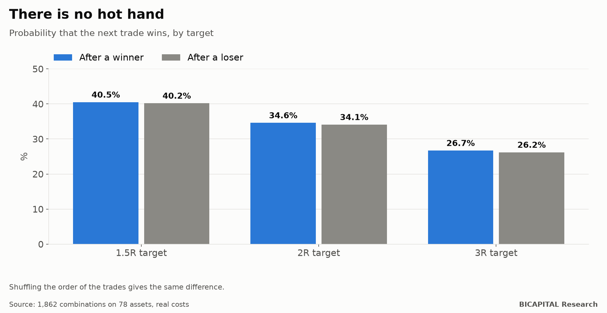

# "It's on a streak": switching strategies on and off by how they are doing does not work

It is one of the most repeated pieces of advice in managing strategies: **trade the one that is on a streak and switch off
the one that is doing badly.** It sounds like common sense. If a tool has just won several times, it must be "in its
moment"; if it loses, the market must have changed.

I tested it at scale: **1,862 tool-and-exit combinations on 78 assets**, with real CFD costs, millions of trades. First I
checked whether streaks exist. Then, whether switching on and off by the streak improves the result.

## Does winning make winning again more likely?

With a target of 1.5 times the amount risked:

| After… | The next trade wins |
|---|---:|
| a winner | 40.5% |
| a loser | 40.2% |
| the same trades, shuffled | same difference |

**The difference is 0.3 points, exactly what you get by shuffling the order of the trades.** There is no "hot hand": the
result of the previous trade says nothing about the next one.

The only thing that does persist is **the size** of the moves: long trades are followed by long trades, because volatility
clusters. But that does not tell you whether you will win or lose.

## What if I switch on and off by the streak?

I tested three versions of the switch (per trade, per day and per week) and a portfolio that each year picks its tools
using the previous three years and switches them on or off by their recent streak:

- **Switched on, no cell makes money** after correcting for the number of tests.
- **The best adaptive portfolio loses −0.085 R per trade**: a compound annual return of −76.6% in the simulation, with a
  drawdown that wipes everything out.
- In the best combination, switching on and off loses slightly less than leaving it always on (−0.105 against −0.114 R per
  trade), but it still loses. And the adaptive portfolio does not beat the same trades in shuffled order.

## Why it fails

I measured how long a "good spell" lasts: **6 trades at the median, about 15 days.** And on average it leaves **−0.65 R**:
good spells already include the return to normal.

The problem is the delay. From the best moment of a streak until the switch notices it is over takes a median of 3 trades,
and in that time **3.2 R is given back on average.** By the time the streak is noticeable, it has ended.

## Takeaways

1. **The result of the previous trade does not predict the next.** If you feel you are "on a roll", it is probably chance.
2. **Switching on what won and off what lost arrives late**: you buy the end of the streak and pay for the reversal.
3. **A tool with no edge does not gain one by being switched on at the right time.** If it does not win when always on, the
   switch will not save it.

*Héctor Sandoval · BICAPITAL Research*

---

*Educational and research content. Not investment advice or a personalised recommendation. Historical CFD data up to June
2025 with real costs; pre-registration signed before computing. CFDs carry a high risk of losing money due to leverage.*
