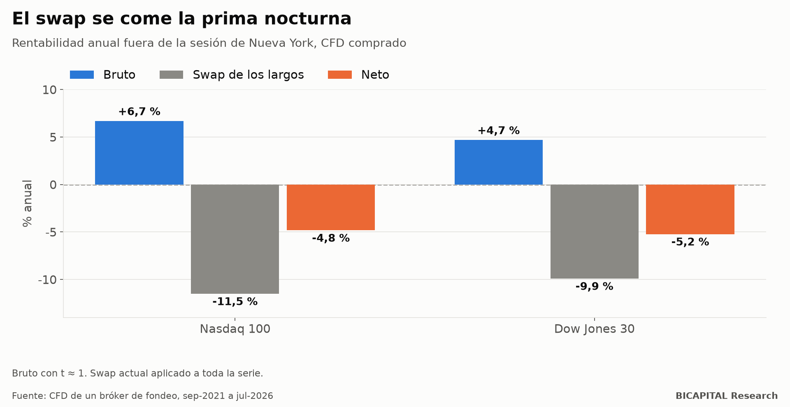

# Dormir comprado en índices con CFD: el swap convierte un +6,7 % en un −4,8 %

Una idea muy repetida en trading: **una parte importante de la subida de las bolsas ocurre de noche**, entre el cierre y la
apertura. Si es así, bastaría con comprar el Nasdaq al cierre y venderlo a la mañana siguiente.

Lo medí con los CFD de índices de un bróker de fondeo. El dato bruto se parece a lo que dice la idea. **El problema es lo
que cuesta dormir comprado.**

## Lo que rinde cada tramo del día

Separé la rentabilidad de los índices estadounidenses en dos tramos: la **sesión de Nueva York** y **fuera de sesión** (de
cierre a apertura). Datos de septiembre de 2021 a julio de 2026 (el Dow desde febrero de 2019):

| Índice | Sesión | Fuera de sesión |
|---|---:|---:|
| Nasdaq 100 | +7,0 % al año | +6,7 % al año |
| Dow Jones 30 | +5,3 % al año | +4,7 % al año |
| S&P 500 | +6,5 % al año | +4,5 % al año |

Fuera de sesión rinde casi tanto como la sesión. Primera advertencia: **ninguna de estas cifras
es estadísticamente distinta de cero** (t ≈ 1). En cinco años, la bolsa sube o baja por muchos motivos.

## Lo que cuesta pasar la noche

Un CFD comprado paga un **swap** cada noche: el coste de financiar la posición. Con los swaps actuales del bróker:

| Índice | Fuera de sesión, bruto | Swap de los largos | **Neto** |
|---|---:|---:|---:|
| Nasdaq 100 | +6,7 % | −11,5 % | **−4,8 %** |
| Dow Jones 30 | +4,7 % | −9,9 % | **−5,2 %** |

**El swap se come la prima entera, y algo más.** En el Nasdaq son unos 3,2 puntos básicos por noche: si mantienes la
posición cuatro noches, pagas en swap unas 20 veces lo que pagaste de spread al entrar.

## Por qué pasa

El swap de un CFD se calcula sobre el valor completo de la posición, aunque tú solo pongas una parte como garantía. Es el
precio del apalancamiento. Cuando los tipos de interés son altos, ese coste supera con facilidad lo que el índice sube de
noche.

## Matices honestos

- **Apliqué el swap de hoy a toda la serie.** Con los tipos bajos de 2021, el swap era menor; el neto de esos meses habría
  sido mejor.
- **El bruto no es fiable** (t ≈ 1). Aunque no hubiera swap, no podría afirmar que la noche tenga una prima real en estos
  datos.
- **Es un CFD, no la acción ni el ETF.** Si compras el índice con un fondo cotizado, sin apalancamiento, no pagas swap.

## Qué te llevas

1. **Antes de una estrategia de varios días con CFD, suma el swap.** Muchas veces pesa más que el spread y la comisión
   juntos.
2. **Una prima bruta no es una ventaja** si no sobrevive a los costes de mantener la posición.
3. **Si quieres la rentabilidad de la bolsa a largo plazo**, el CFD apalancado es la forma más cara de tenerla.

*Héctor Sandoval · BICAPITAL Research*

---

*Contenido educativo y de investigación. No es asesoría de inversión ni una recomendación personalizada. Datos históricos de
CFD de índices de un bróker de fondeo; swap vigente aplicado a toda la serie. Los CFD son instrumentos complejos con un alto
riesgo de perder dinero rápidamente debido al apalancamiento.*
