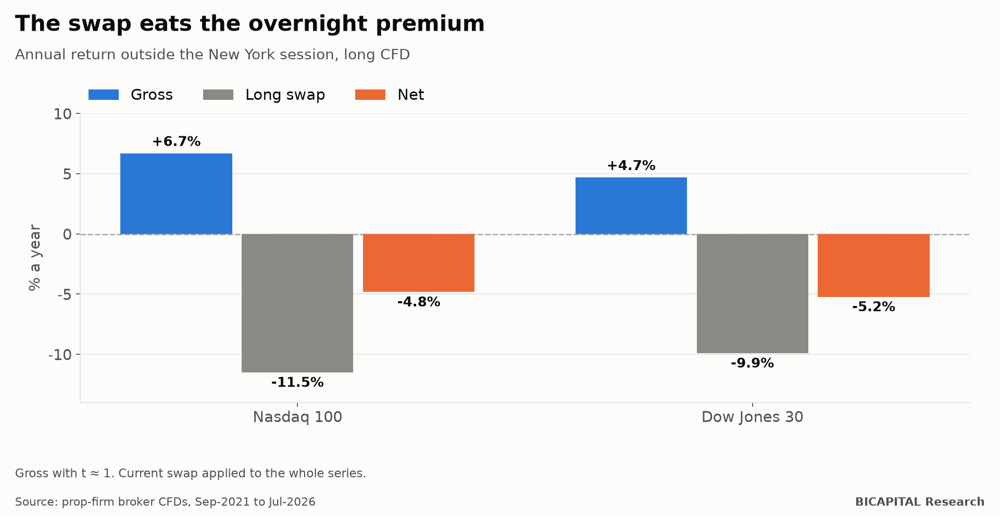

# Holding index CFDs overnight: the swap turns +6.7% into −4.8%

A much-repeated idea in trading: **a large share of stock market gains happens overnight**, between the close and the
open. If so, it would be enough to buy the Nasdaq at the close and sell it the next morning.

I measured it with a prop-firm broker's index CFDs. The gross figure looks like what the idea says. **The problem is what
it costs to hold overnight.**

## What each part of the day returns

I split the return of the US indices into two parts: the **New York session** and **outside the session** (close to open).
Data from September 2021 to July 2026 (the Dow from February 2019):

| Index | Session | Outside the session |
|---|---:|---:|
| Nasdaq 100 | +7.0% a year | +6.7% a year |
| Dow Jones 30 | +5.3% a year | +4.7% a year |
| S&P 500 | +6.5% a year | +4.5% a year |

Outside the session returns almost as much as the session. First warning: **none of these figures is
statistically different from zero** (t ≈ 1). Over five years, the market rises or falls for many reasons.

## What spending the night costs

A long CFD pays a **swap** every night: the cost of financing the position. With the broker's current swaps:

| Index | Outside session, gross | Long swap | **Net** |
|---|---:|---:|---:|
| Nasdaq 100 | +6.7% | −11.5% | **−4.8%** |
| Dow Jones 30 | +4.7% | −9.9% | **−5.2%** |

**The swap eats the whole premium, and then some.** On the Nasdaq it is about 3.2 basis points per night: hold the
position for four nights and you pay in swap about 20 times what you paid in spread to get in.

## Why it happens

A CFD's swap is charged on the full value of the position, even though you only put up part of it as margin. It is the
price of leverage. When interest rates are high, that cost easily exceeds what the index gains overnight.

## Honest caveats

- **I applied today's swap to the whole series.** With the low rates of 2021, the swap was smaller; the net for those
  months would have been better.
- **The gross figure is not reliable** (t ≈ 1). Even with no swap, I could not claim the night has a real premium in this
  data.
- **It is a CFD, not the stock or the ETF.** If you buy the index through an exchange-traded fund, without leverage, you
  pay no swap.

## Takeaways

1. **Before any multi-day strategy with CFDs, add up the swap.** It often weighs more than spread and commission combined.
2. **A gross premium is not an edge** if it does not survive the cost of holding the position.
3. **If you want the long-term return of the stock market**, a leveraged CFD is the most expensive way to own it.

*Héctor Sandoval · BICAPITAL Research*

---

*Educational and research content. Not investment advice or a personalised recommendation. Historical index CFD data from a
prop-firm broker; current swap applied to the whole series. CFDs are complex instruments and carry a high risk of losing
money rapidly due to leverage.*
