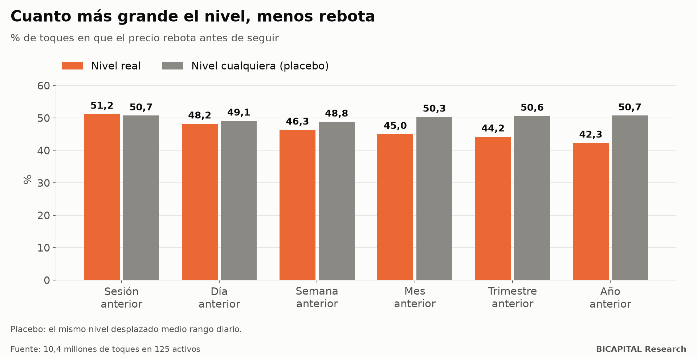

# Soportes y resistencias: los máximos del mes y del año no frenan el precio

Una de las ideas más extendidas del análisis técnico: **los máximos y mínimos anteriores frenan el precio.** El máximo de
ayer, el de la semana pasada, el del mes. Cuanto más grande el periodo, más «fuerte» el nivel. Al tocarlo, el precio
rebota.

Lo medí con **10,4 millones de toques reales en 125 activos** (divisas, índices, metales, energía, cripto y acciones en
CFD), desde los máximos de la sesión anterior hasta los del año anterior.

## Cómo se mide un rebote sin engañarse

Cuando el precio toca un nivel, cuento si vuelve hacia dentro una cierta distancia **antes** de avanzar esa misma
distancia más allá. Y comparo con dos referencias:

- **Un nivel cualquiera:** el mismo nivel desplazado medio rango diario arriba o abajo, tocado de la misma forma y a la
  misma hora. Si los niveles «importan», el real tiene que rebotar más que este.
- **Un precio aleatorio** con la misma volatilidad, minuto a minuto, después del toque.

## Lo que salió

| Nivel tocado | Rebota | Nivel cualquiera | Diferencia |
|---|---:|---:|---:|
| Máximo o mínimo de la sesión anterior | 51,2 % | 50,7 % | +0,5 |
| Del día anterior | 48,2 % | 49,1 % | −0,9 |
| De la semana anterior | 46,3 % | 48,8 % | −2,5 |
| Del mes anterior | 45,0 % | 50,3 % | −5,4 |
| Del trimestre anterior | 44,2 % | 50,6 % | −6,1 |
| Del año anterior | 42,3 % | 50,7 % | −7,3 |

**Es justo al revés de lo que se enseña.** Cuanto más grande el nivel, **menos** rebota el precio comparado con un nivel
cualquiera. Los máximos del mes, del trimestre y del año tienden a romperse más que a frenar.

Y frente a un precio aleatorio, los grandes niveles se comportan prácticamente igual que el azar. No tienen nada especial.

Solo el nivel más pequeño, el de la sesión anterior, rebota un poco más que uno cualquiera: medio punto.

## ¿Se puede operar?

Probé 60 reglas, escritas antes de ver los resultados: comprar el rebote, vender la ruptura, esperar al barrido y la
vuelta. Con costes reales: **0 de 60 pasan.** La diferencia de medio punto en los niveles pequeños es mucho menor que el
coste de operar.

## Por qué puede pasar

Mi interpretación, que no he medido: los grandes niveles son los que todo el mundo mira. Ahí se acumulan órdenes de stop
y de entrada por ruptura, y cuando el precio llega, esas órdenes lo empujan más allá. El nivel no frena: atrae.

## Qué te llevas

1. **Un nivel que «aguantó» en tu gráfico no prueba nada.** Compáralo con un nivel cualquiera cercano.
2. **No asumas que un máximo grande es una pared.** En estos datos, rompe más que rebota.
3. **Ni el rebote ni la ruptura pagan el coste** en este estudio. Saber qué pasa en un nivel no basta si la diferencia es
   menor que lo que pagas por operar.

*Héctor Sandoval · BICAPITAL Research*

---

*Contenido educativo y de investigación. No es asesoría de inversión ni una recomendación personalizada. Datos históricos de
CFD hasta junio de 2025 con costes reales; prerregistro firmado antes de calcular. Los CFD tienen un alto riesgo de perder
dinero por el apalancamiento.*
