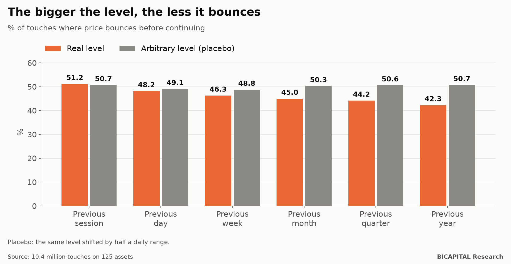

# Support and resistance: last month's and last year's highs do not stop price

One of the most widespread ideas in technical analysis: **previous highs and lows stop price.** Yesterday's high, last
week's, last month's. The bigger the period, the "stronger" the level. When price touches it, it bounces.

I measured it with **10.4 million real touches on 125 assets** (FX, indices, metals, energy, crypto and stock CFDs), from
the previous session's highs up to the previous year's.

## How to measure a bounce without fooling yourself

When price touches a level, I count whether it comes back inside by a certain distance **before** moving that same distance
beyond it. And I compare with two references:

- **Any level:** the same level shifted half a daily range up or down, touched the same way at the same time. If levels
  "matter", the real one should bounce more than this one.
- **A random price** with the same minute-by-minute volatility after the touch.

## What came out

| Level touched | Bounces | Any level | Difference |
|---|---:|---:|---:|
| Previous session's high or low | 51.2% | 50.7% | +0.5 |
| Previous day's | 48.2% | 49.1% | −0.9 |
| Previous week's | 46.3% | 48.8% | −2.5 |
| Previous month's | 45.0% | 50.3% | −5.4 |
| Previous quarter's | 44.2% | 50.6% | −6.1 |
| Previous year's | 42.3% | 50.7% | −7.3 |

**It is exactly the opposite of what is taught.** The bigger the level, the **less** price bounces compared with any
level. Monthly, quarterly and yearly highs tend to break rather than hold.

And against a random price, the big levels behave practically like chance. There is nothing special about them.

Only the smallest level, the previous session's, bounces slightly more than an arbitrary one: half a point.

## Can it be traded?

I tested 60 rules, written down before seeing the results: buying the bounce, selling the breakout, waiting for the sweep
and the return. With real costs: **0 of 60 pass.** The half-point difference at small levels is far smaller than the cost
of trading.

## Why it might happen

My interpretation, which I have not measured: big levels are the ones everybody watches. Stop orders and breakout entries
pile up there, and when price arrives, those orders push it further. The level does not stop price: it attracts it.

## Takeaways

1. **A level that "held" on your chart proves nothing.** Compare it with any nearby level.
2. **Do not assume a big high is a wall.** In this data it breaks more than it bounces.
3. **Neither the bounce nor the breakout pays for its cost** in this study. Knowing what happens at a level is not enough
   if the difference is smaller than what you pay to trade.

*Héctor Sandoval · BICAPITAL Research*

---

*Educational and research content. Not investment advice or a personalised recommendation. Historical CFD data up to June
2025 with real costs; pre-registration signed before computing. CFDs carry a high risk of losing money due to leverage.*
